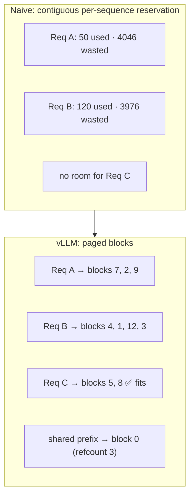
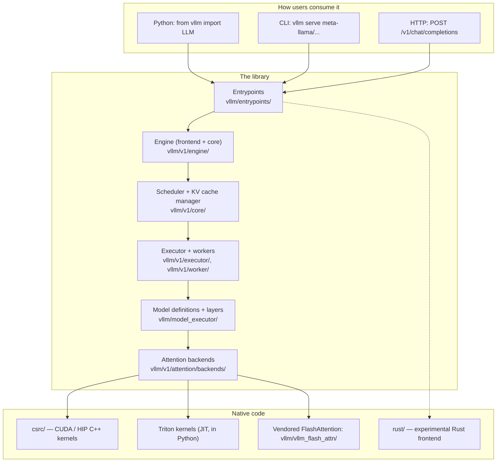

# 1. Project Overview — What vLLM Is and Why It Looks Like This

## 1.1 The problem

Serving an autoregressive LLM is not like serving a stateless model. Three properties make
it awkward:

1. **Output length is unknown in advance.** A request may produce 3 tokens or 3,000. You
   cannot pre-allocate a tight buffer.
2. **Generation is sequential and memory-bound.** Each new token requires attending over
   every previous token's key/value vectors. Those K/V vectors — the *KV cache* — must be
   kept in GPU memory for the life of the request.
3. **The KV cache is enormous.** For a 13B model at fp16, roughly 800 KB per token. A
   single 4k-token conversation is ~3 GB. The weights are fixed; the KV cache is what
   actually limits how many users you can serve at once.

The naive implementation reserves, per sequence, a contiguous buffer sized for
`max_model_len`. If a request asks for up to 4,096 tokens and generates 50, the other
4,046 slots are wasted. Measured internal+external fragmentation in such systems commonly
wasted 60–80% of KV memory. Fewer concurrent requests means lower throughput, because the
GPU spends decode steps underutilised on tiny batches.

## 1.2 The core idea: treat KV cache like virtual memory

vLLM's founding contribution (**PagedAttention**, from the *Efficient Memory Management for
Large Language Model Serving with PagedAttention* paper, SOSP 2023) is to borrow the OS
virtual-memory playbook:

| OS concept | vLLM equivalent | Code |
| --- | --- | --- |
| Page | KV block (fixed token count, e.g. 16/64/128 tokens) | `KVCacheBlock`, `vllm/v1/core/kv_cache_utils.py:160` |
| Physical frame pool | Pre-allocated block pool on GPU | `BlockPool`, `vllm/v1/core/block_pool.py:107` |
| Page table | Per-request block table (logical → physical block id) | `BlockTables`, `vllm/v1/worker/gpu/block_table.py` |
| Free list | O(1) doubly-linked LRU free queue | `FreeKVCacheBlockQueue`, `vllm/v1/core/kv_cache_utils.py:248` |
| Shared/COW pages | Content-hashed blocks shared across requests | `BlockPool.get_cached_block`, `vllm/v1/core/block_pool.py:175` |
| Swapping | Offload blocks to CPU/disk or transfer to a peer | `vllm/v1/kv_offload/`, `vllm/distributed/kv_transfer/` |

A sequence's KV no longer has to be contiguous. Blocks are handed out one at a time as the
sequence grows, so waste is bounded by *one partially-filled block per request* instead of
the entire unused tail of a reservation. The attention kernel is given the block table and
gathers KV through it.

## 1.3 What follows from paging

Almost every headline vLLM feature is a direct consequence of the block abstraction:

- **Prefix caching.** If a block is full and its contents are determined by the tokens in
  it *plus all preceding tokens*, then hashing that chain gives a content address. Two
  requests sharing a system prompt map to the *same physical blocks*, refcounted. See
  [features/02-prefix-caching.md](features/02-prefix-caching.md).
- **Continuous batching.** Because allocation is incremental, requests can join and leave
  the running batch at *every* forward pass instead of waiting for a batch to drain. The
  scheduler thinks purely in terms of "how many tokens can I afford this step".
  See [features/03-continuous-batching-and-scheduler.md](features/03-continuous-batching-and-scheduler.md).
- **Chunked prefill.** A 100k-token prompt does not need to be processed in one forward
  pass; it can be fed 2,048 tokens at a time, interleaved with other requests' decodes.
  See [features/04-chunked-prefill.md](features/04-chunked-prefill.md).
- **Preemption instead of OOM.** When blocks run out the scheduler evicts a victim
  request's blocks and re-queues it; its prefix may still be in the cache when it resumes.
  `Scheduler._preempt_request`, `vllm/v1/core/sched/scheduler.py:1823`.
- **Disaggregated serving.** Blocks are just addressable buffers, so a "prefill" machine
  can compute them and ship them over RDMA to a "decode" machine.
  See [features/12-kv-connectors-and-disaggregation.md](features/12-kv-connectors-and-disaggregation.md).

## 1.4 What the project actually is, as software

vLLM is a Python library plus a set of hand-written CUDA/HIP/Triton kernels, plus an
OpenAI-compatible HTTP server.

Headline numbers for the tree as of this commit: ~9,600 tracked files, ~1,000 supported
model architectures under `vllm/model_executor/models/`, and ~35 attention backends under
`vllm/v1/attention/backends/` spanning NVIDIA, AMD ROCm, Intel XPU, CPU, and TPU.

## 1.5 "V1" — what that means in the tree

You will see `vllm/v1/` everywhere. This is not a version of the *package*; it is the
engine rewrite that became the default. The V1 engine is characterised by:

- A **clean separation between a frontend process and an engine-core process**, talking
  over ZeroMQ with msgpack-serialised messages (`vllm/v1/engine/core_client.py`).
- A **single `Request` state object** (`vllm/v1/request.py:63`) with just
  `num_computed_tokens` and `num_tokens_with_spec`, instead of a prefill/decode state
  machine. The scheduler's job is only *"advance `num_computed_tokens` towards
  `num_tokens_with_spec`"*. The comment at `vllm/v1/core/sched/scheduler.py:696` states
  this directly:

  > There's no "decoding phase" nor "prefill phase" in the scheduler. Each request just
  > has the `num_computed_tokens` and `num_tokens_with_spec`. [...] This is general enough
  > to cover chunked prefills, prefix caching, speculative decoding [...]

- **Persistent batch state on the GPU.** `InputBatch`/`BlockTables` keep per-request rows
  resident across steps so each iteration only writes deltas, instead of rebuilding tensors
  from Python every step (`vllm/v1/worker/gpu/input_batch.py`,
  `vllm/v1/worker/gpu/block_table.py`).
- **`torch.compile` + CUDA graphs as the default execution path**, not an optimisation flag
  (`vllm/compilation/`).

Legacy V0 code paths have been removed from this tree; `vllm/v1/` *is* the engine.

## 1.6 Mental model to carry into the rest of the docs

Hold these five sentences in your head and the rest of the codebase reads easily:

1. **The KV cache is a block pool.** Everything in `vllm/v1/core/` exists to hand out,
   share, and reclaim those blocks.
2. **The engine is one loop.** Schedule → execute → update. Synchronous, single-threaded,
   in one process (`EngineCore`).
3. **The scheduler never thinks about phases.** It distributes a *token budget* across
   requests each step.
4. **The workers are dumb and symmetric.** They receive a `SchedulerOutput`, run the model,
   return sampled tokens. All ranks execute the same plan.
5. **Features are plugins on that loop.** Spec decode adds draft tokens to the plan,
   structured output adds a bitmask before sampling, LoRA adds adapter indices to the
   batch, connectors add KV load/save side-channels.

Next: [02-architecture.md](02-architecture.md).
