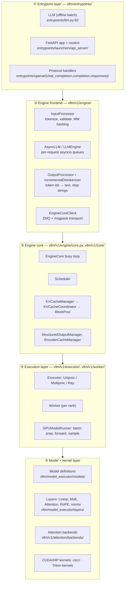
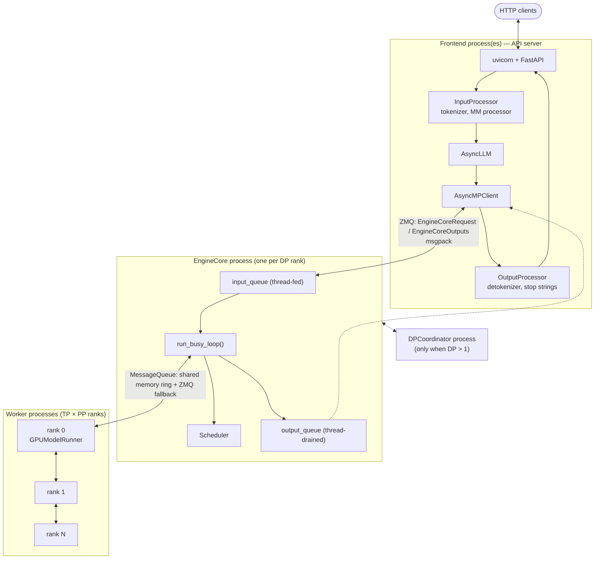
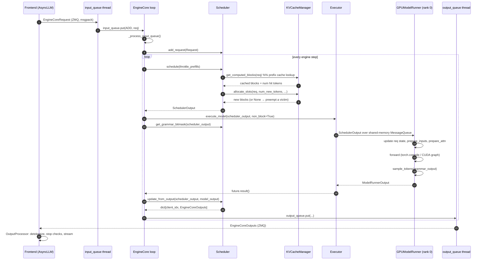
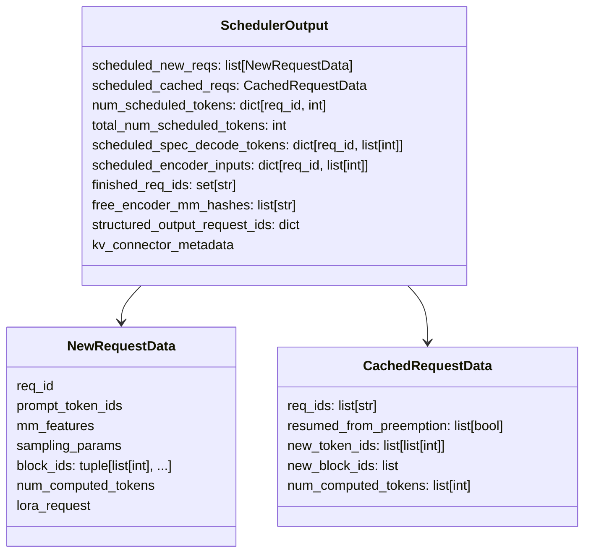
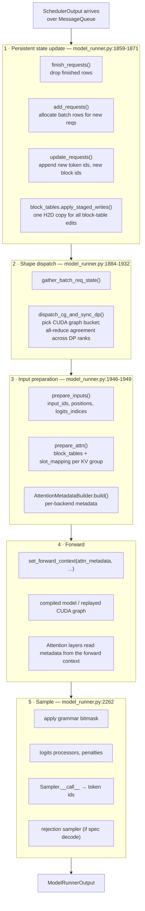
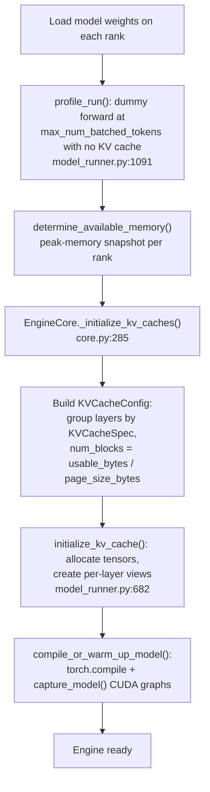

# 2. Architecture in Detail

This document describes vLLM's runtime structure: the layers, the processes, the control
loop, and the data that crosses each boundary.

---

## 2.1 The five layers



**The boundary that matters most is between ③ and ④.** Everything above it is Python
bookkeeping about *which tokens to compute*. Everything below it is "run this exact batch
on this device". The contract across it is a single object, `SchedulerOutput`
(`vllm/v1/core/sched/output.py:241`), and a single return value, `ModelRunnerOutput`.

---

## 2.2 Process topology

vLLM is multi-process by default. The reason is the GIL: tokenisation, detokenisation, and
HTTP serialisation are CPU-heavy Python, and if they share a thread with the engine's
schedule/execute loop they steal time from the GPU. So the frontend and the engine core run
in **separate OS processes** connected by ZeroMQ.



### Who decides the topology

| Decision | Code | Rule |
| --- | --- | --- |
| In-process vs. separate engine process | `EngineCoreClient.make_client`, `vllm/v1/engine/core_client.py:111` | `InprocClient` for synchronous single-process use; `SyncMPClient`/`AsyncMPClient` otherwise. `asyncio_mode` without `multiprocess_mode` is explicitly unsupported |
| Which executor | `Executor.get_class`, `vllm/v1/executor/abstract.py:66` | `uni` → `UniProcExecutor` (world size 1, worker in-process), `mp` → `MultiprocExecutor`, `ray` → `RayExecutorV2`, `external_launcher` → `ExecutorWithExternalLauncher` |
| Which client under DP | `EngineCoreClient.make_async_mp_client`, `vllm/v1/engine/core_client.py:153` | DP=1 → `AsyncMPClient`; DP>1 internal LB → `DPLBAsyncMPClient`; DP>1 external LB → `DPAsyncMPClient` (one client per rank) |

### Why the engine core is single-threaded

`EngineCore.run_busy_loop` (`vllm/v1/engine/core.py:1794`) is deliberately a plain `while`
loop with no locks:

```python
while self._handle_shutdown():
    # 1) Poll the input queue until there is work to do.
    self._process_input_queue()
    self._maybe_publish_request_counts()
    # 2) Step the engine core and return the outputs.
    self._process_engine_step()
    self._maybe_publish_request_counts()
```

Request arrival and output delivery are pushed onto **background threads** that only touch
`queue.Queue` objects (`process_input_sockets` at `vllm/v1/engine/core.py:2171`). The loop
itself never blocks on IO while a GPU step is outstanding, and all mutation of scheduler
state happens on one thread, which removes a whole class of races.

---

## 2.3 The control loop in detail



The step function itself is only 30 lines (`EngineCore.step`,
`vllm/v1/engine/core.py:700`). Note the ordering trick on lines 713–718: `execute_model` is
launched **non-blocking**, then the grammar bitmask for structured-output requests is
computed on the CPU *while the GPU runs the forward pass*, and only then is the result
awaited and `sample_tokens` invoked. CPU grammar work is overlapped with GPU compute for
free.

### Two step functions

| Function | When used | Behaviour |
| --- | --- | --- |
| `EngineCore.step` (`core.py:700`) | default | One schedule → one execute → one update, strictly serialised |
| `EngineCore.step_with_batch_queue` (`core.py:745`) | async scheduling / PP | Keeps a `batch_queue` of in-flight steps; schedules step *N+1* before step *N*'s output has been consumed, so the CPU scheduling cost overlaps GPU execution |

`step_with_batch_queue` is where pipeline parallelism gets its bubbles filled: with
`batch_queue_size > 1`, filling the queue takes priority over draining it
(see the docstring at `core.py:748`).

---

## 2.4 The scheduler's contract: `SchedulerOutput`

`vllm/v1/core/sched/output.py:241`. This is the single most important data structure to
understand, because it *is* the plan for one forward pass.



The split between `scheduled_new_reqs` and `scheduled_cached_reqs` is the "persistent
batch" optimisation: a **new** request ships its full prompt and parameters once, and from
then on each step ships only the **delta** (new token ids, newly allocated block ids,
updated computed-token count). This keeps per-step serialisation cost proportional to the
number of *new tokens*, not to context length.

---

## 2.5 The worker side



Two things are worth calling out.

**Attention metadata travels through a context variable, not through function arguments.**
`set_forward_context` (`vllm/forward_context.py:274`) installs a `ForwardContext`
(`vllm/forward_context.py:137`) holding the per-layer attention metadata; each `Attention`
module fetches it with `get_forward_context()` inside its `forward`
(`vllm/model_executor/layers/attention/attention.py:528`). This is what lets model
definitions be written as plain `nn.Module`s with a `(hidden_states, positions)` signature
— and it is what makes them `torch.compile`-able without the compiler seeing dynamic
metadata objects.

**Shape dispatch happens before input preparation.** `dispatch_cg_and_sync_dp` decides
which CUDA-graph bucket (padded token count) this step will use and, under data
parallelism, **all-reduces that decision across DP ranks** so every rank runs the same
graph. If one rank diverged, a collective inside the model would deadlock. This is why so
many DP bugs look like hangs rather than wrong answers.

---

## 2.6 Memory layout and startup

Before the first request, the engine has to decide how many KV blocks exist. That number is
a function of free device memory after weights and activations, so it must be *measured*.



Key types:

- `KVCacheSpec` (`vllm/v1/kv_cache_interface.py:189`) — what *one layer* needs per block.
  Subclasses: `AttentionSpec` (:456), `MLAAttentionSpec` (:520), `MambaSpec` (:549),
  `HiSparsePageSpec` (:427).
- `KVCacheGroup` (`vllm/v1/kv_cache_interface.py:688`) — a set of layers that share a
  block table because their specs are compatible. Hybrid models (e.g. Mamba +
  full-attention, or sliding-window + full-attention) produce **multiple groups**, which is
  why nearly every KV API returns *tuples indexed by group*.
- `KVCacheConfig` (`vllm/v1/kv_cache_interface.py:843`) — the final plan: tensors, groups,
  `num_blocks`.

The `determine_available_memory` → `num_blocks` path is also why "it OOMs at step 500, not
at startup" bugs happen: anything that allocates memory *after* profiling (a new CUDA
graph, a fragmentation-sensitive allocator pattern, an NCCL buffer) eats into the margin
the profiler left.

---

## 2.7 Where each concern lives (quick lookup)

| Question | Go here |
| --- | --- |
| "Why was my request not scheduled this step?" | `Scheduler.schedule`, `vllm/v1/core/sched/scheduler.py:694` |
| "Why did I get a cache miss?" | `KVCacheManager.get_computed_blocks:287`, `FullAttentionManager.find_longest_cache_hit:906` |
| "Why did it preempt?" | `allocate_slots` returned `None` → `scheduler.py:901-961` |
| "Why is the batch shape padded to N?" | `dispatch_cg_and_sync_dp`, `vllm/v1/worker/gpu/dp_utils.py:232` |
| "Where are the sampled tokens turned into text?" | `OutputProcessor`, `vllm/v1/engine/output_processor.py:554` |
| "Where does the HTTP response get built?" | `vllm/entrypoints/openai/chat_completion/` |
| "Which kernel actually ran?" | `AttentionBackend` subclass chosen by `vllm/v1/attention/selector.py` |
| "What does rank 1 do differently from rank 0?" | almost nothing — see `_get_output_rank`, `vllm/v1/executor/multiproc_executor.py:684` |

Next: [03-code-map.md](03-code-map.md).
