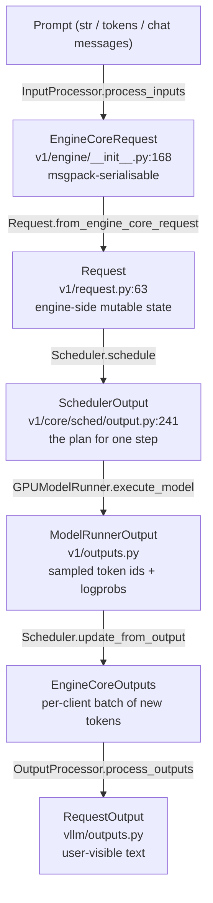
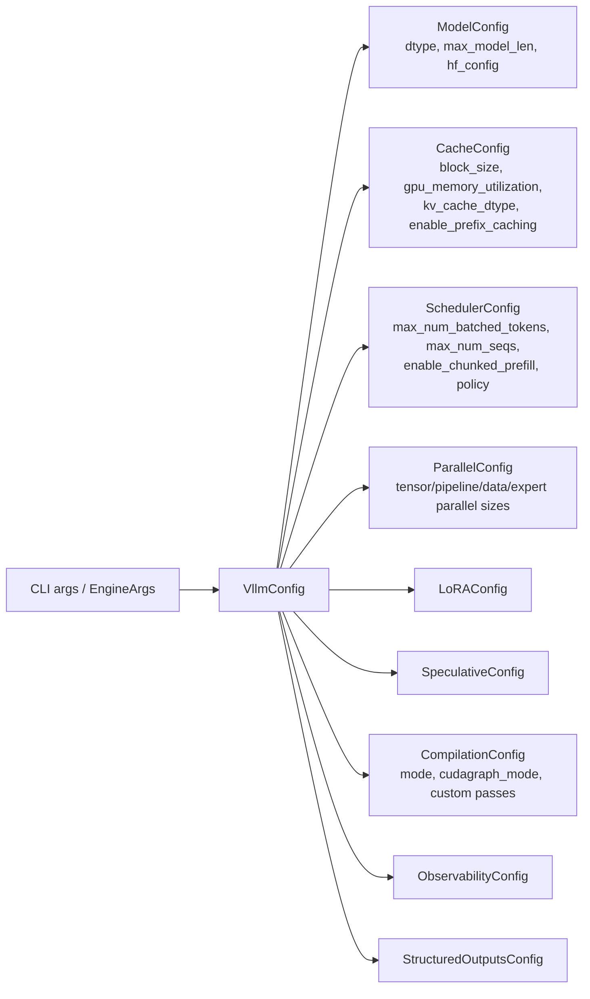

# 3. Code Map — Where Everything Lives

A directory-by-directory tour. Use this as a lookup table when you are chasing something
through the tree.

## 3.1 Repository root

```text
vllm/                  the Python package — all engine code
csrc/                  CUDA / HIP / C++ kernels, built by CMakeLists.txt
rust/                  experimental Rust frontend (HTTP + protocol handling)
tests/                 pytest suite, mirrors vllm/ layout
benchmarks/            throughput/latency/serving benchmark harnesses
examples/              runnable usage examples (offline, online, feature demos)
docs/                  the published docs site (mkdocs.yaml)
recipes/               tuned launch configurations for specific models
cmake/ docker/ tools/  build, container, and dev tooling
requirements/          pinned dependency sets per platform
AGENTS.md              contributor guide for AI-assisted contributions
```

## 3.2 `vllm/` top level

| Path | Owns |
| --- | --- |
| `v1/` | **The engine.** Scheduler, KV cache, engine core, workers, attention backends |
| `entrypoints/` | User-facing surfaces: `LLM`, CLI, OpenAI/Anthropic/Cohere-compatible HTTP servers |
| `model_executor/` | Model definitions, layer implementations, weight loading, quantization |
| `distributed/` | Process groups, collectives, KV transfer, expert-parallel load balancing |
| `compilation/` | `torch.compile` integration, piecewise graphs, CUDA graph capture |
| `multimodal/` | Image/video/audio processing, registry, MM hashing and caching |
| `lora/` | LoRA adapters: loading, layer wrappers, Punica kernel dispatch |
| `attention/`→ see `v1/attention` | — (the attention interface now lives under `v1/`) |
| `config/` | The `VllmConfig` dataclass tree (`ModelConfig`, `CacheConfig`, `SchedulerConfig`, …) |
| `platforms/` | Per-backend platform shims: `cuda.py`, `rocm.py`, `xpu.py`, `cpu.py`, `tpu.py` |
| `transformers_utils/` | Tokenizer and HF-config plumbing |
| `inputs/`, `renderers/`, `parser/` | Prompt types, chat templating, tool/reasoning parsers |
| `envs.py` | Every `VLLM_*` environment variable, in one place |
| `sampling_params.py`, `pooling_params.py` | The public request-parameter objects |
| `outputs.py` | `RequestOutput`, `CompletionOutput`, `PoolingRequestOutput` |
| `forward_context.py` | The per-step context carrying attention metadata into layers |

## 3.3 `vllm/v1/` — the engine


Other notable subtrees under `v1/`:

| Path | Owns |
| --- | --- |
| `attention/backend.py` | `AttentionBackend`, `AttentionMetadata`, `AttentionMetadataBuilder`, `AttentionImpl` interfaces |
| `attention/backends/` | ~35 concrete backends: `flash_attn.py`, `flashinfer.py`, `triton_attn.py`, `mla/`, `mamba2_attn.py`, `rocm_*.py`, `cpu_attn.py`, … |
| `attention/selector.py` | Backend auto-selection from device capability + model geometry |
| `executor/` | `abstract.py` (interface), `uniproc_executor.py`, `multiproc_executor.py`, `ray_executor_v2.py` |
| `kv_cache_interface.py` | `KVCacheSpec` / `KVCacheGroup` / `KVCacheConfig` type system |
| `structured_output/` | Grammar backends: `backend_xgrammar.py`, `backend_guidance.py`, `backend_outlines.py`, `backend_lm_format_enforcer.py` |
| `spec_decode/` | Spec-decode metrics and dynamic-lookahead utilities (the drafters live under `worker/gpu/spec_decode/`) |
| `metrics/` | `stats.py` (the stat dataclasses), `loggers.py` (logging + Prometheus) |
| `kv_offload/`, `simple_kv_offload/` | CPU/disk KV tiering |
| `request.py` | `Request` and `RequestStatus` — the engine-side request object |
| `outputs.py` | `ModelRunnerOutput`, `EngineCoreOutputs` |
| `serial_utils.py` | msgpack encoders/decoders for the ZMQ hop |
| `fault_tolerance/` | Watchdogs, engine-death detection, recovery |

## 3.4 `vllm/model_executor/`

| Path | Owns |
| --- | --- |
| `models/` | ~1,000 architectures. Each file defines `<Name>ForCausalLM` with `forward`, `load_weights`, and a registry entry in `models/registry.py` |
| `layers/linear.py` | `ColumnParallelLinear`, `RowParallelLinear`, `QKVParallelLinear`, `MergedColumnParallelLinear` — TP sharding lives here |
| `layers/attention/attention.py` | The `Attention` module (`:256`) every model instantiates; binds a KV cache slice and an `AttentionImpl` |
| `layers/fused_moe/` | MoE: routing, expert dispatch, `MoERunner`, EP/TP combinations |
| `layers/quantization/` | One module per quant scheme: `fp8.py`, `mxfp4.py`, `compressed_tensors/`, `modelopt.py`, `awq_triton.py`, `quark/`, … |
| `layers/rotary_embedding/` | RoPE variants: default, YaRN, linear/dynamic scaling, mRoPE, Llama-3 |
| `layers/mamba/` | SSM layers: Mamba1/2, short conv, gated delta net |
| `layers/pooler/`, `layers/logits_processor.py` | Pooling heads; logits → vocab projection |
| `layers/vocab_parallel_embedding.py` | Sharded embedding + LM head |
| `model_loader/` | Safetensors/GGUF/bitsandbytes/runai loaders, sharded-state loading |
| `custom_op.py` | `CustomOp` base: per-platform `forward_cuda` / `forward_hip` / `forward_cpu` dispatch |

## 3.5 `csrc/` — native kernels

| Path | Contents |
| --- | --- |
| `attention/` | PagedAttention v1/v2, MLA, merge-attn-states |
| `quantization/` | fp8, int8, AWQ, GPTQ, Marlin, machete, cutlass_w8a8, mxfp4 |
| `moe/` | MoE align/sum kernels, topk softmax, permute/unpermute |
| `mamba/` | selective scan, causal conv1d |
| `cache_kernels.cu` | `reshape_and_cache`, block copy/swap |
| `sampler.cu` | repetition-penalty kernel (see [issue deep dive 1](../issue-deep-dives/01-medium-dual-chunk-attention-empty-batch-crash.md)) |
| `torch_bindings.cpp` | `TORCH_LIBRARY` registrations → what you call as `torch.ops._C.*` |

Python-side wrappers for these live in `vllm/_custom_ops.py` (and `_aiter_ops.py`,
`_cpu_ops.py`, `_xpu_ops.py` for other platforms).

## 3.6 The objects that cross layer boundaries

Knowing these seven types is most of the fluency:



| Type | Defined at | Crosses |
| --- | --- | --- |
| `EngineCoreRequest` | `vllm/v1/engine/__init__.py:168` | frontend process → engine process |
| `Request` | `vllm/v1/request.py:63` | lives inside the engine core only |
| `SchedulerOutput` | `vllm/v1/core/sched/output.py:241` | engine core → worker processes |
| `ModelRunnerOutput` | `vllm/v1/outputs.py` | worker → engine core |
| `EngineCoreOutputs` | `vllm/v1/outputs.py` | engine process → frontend process |
| `RequestOutput` | `vllm/outputs.py` | engine → user code / HTTP handler |
| `KVCacheConfig` | `vllm/v1/kv_cache_interface.py:843` | engine core → all workers, once at startup |

## 3.7 Configuration

All configuration funnels into one object graph, `VllmConfig` (`vllm/config/`):



Every subsystem reads from this one object, and it is hashed to key compilation caches
(`vllm/compilation/caching.py`). If you want to know what a flag actually does, grep the
config field name — usage is always a direct attribute read, never a global.

## 3.8 Tests as documentation

`tests/` mirrors `vllm/`, and the core tests are unusually readable because they run on CPU
with tiny synthetic configs:

| Test file | Teaches you |
| --- | --- |
| `tests/v1/core/test_scheduler.py` | How to construct a `Scheduler` and drive `schedule()`/`update_from_output()` by hand |
| `tests/v1/core/test_prefix_caching.py`, `tests/v1/core/prefix_cache/` | Block hashing and hit semantics |
| `tests/v1/core/test_kv_cache_utils.py` | `FreeKVCacheBlockQueue` invariants |
| `tests/v1/worker/` | Batch preparation, attention metadata, block tables |
| `tests/kernels/` | Kernel correctness against PyTorch reference implementations |

When you cannot work out what a core function is *supposed* to do, the test that calls it
is usually the fastest answer.

Next: [04-request-lifecycle.md](04-request-lifecycle.md).
