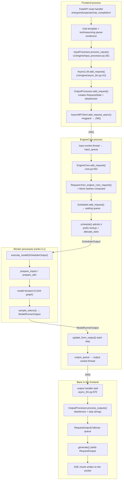
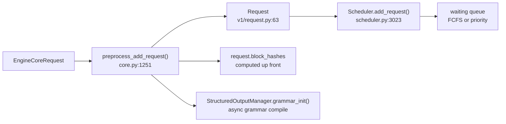
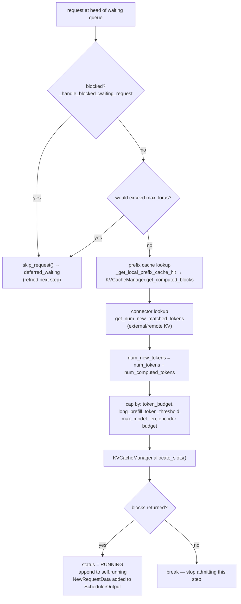
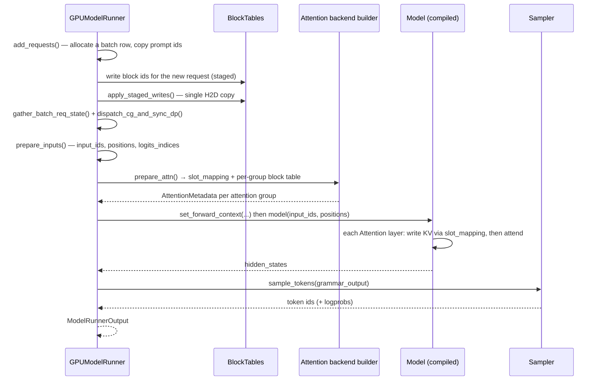
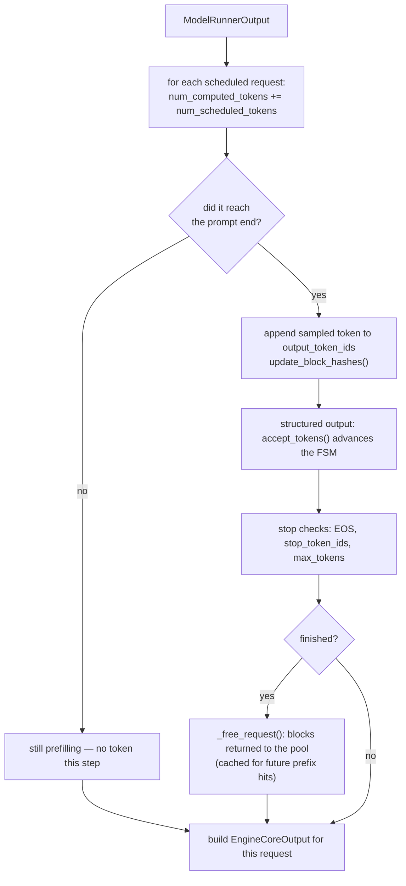

# 4. The Life of One Request

This document follows a single HTTP chat completion from socket to socket, naming every
function it passes through. If you only read one page of these docs, read this one — most
debugging starts by locating which of these stages went wrong.

Scenario: `POST /v1/chat/completions` with a 3,000-token prompt, `max_tokens=200`,
`stream=true`, on a server started with `--tensor-parallel-size 2 --enable-prefix-caching`.

---

## 4.1 The whole journey



---

## 4.2 Stage 1 — HTTP to tokens (frontend process)

1. **Route handler.** The FastAPI app built in `vllm/entrypoints/launchers/app.py` dispatches
   to the chat-completion serving class under `vllm/entrypoints/openai/chat_completion/`.
   It validates the request body against the Pydantic protocol models, resolves the model
   name (including LoRA adapter names), and generates a `request_id`.

2. **Rendering.** The chat messages are turned into a flat prompt by the renderer
   (`vllm/renderers/`): chat template application, multimodal placeholder expansion, tool
   schema injection. Output: token ids plus, if present, multimodal feature specs.

3. **`InputProcessor.process_inputs()`** (`vllm/v1/engine/input_processor.py:361`). This is
   the validation gate:
   - `_validate_params` — rejects impossible sampling parameters, incompatible feature
     combinations (e.g. `_validate_lora` at `:266`).
   - `_validate_prompt_len` / `_validate_model_inputs` — prompt must fit
     `max_model_len` minus the tokens you asked to generate.
   - Multimodal inputs are hashed and looked up in the MM processor cache
     (`inject_into_mm_cache`, `:302`) so an image sent twice is processed once.
   - Produces an `EngineCoreRequest` (`vllm/v1/engine/__init__.py:168`), which is a
     msgspec `Struct` — i.e. designed to be serialised cheaply.

4. **`AsyncLLM.add_request()`** (`vllm/v1/engine/async_llm.py:411`) does three things in
   order, and the order matters:
   - registers the request with the `OutputProcessor` **before** sending it to the engine,
     so no output can arrive for an unknown request;
   - creates a `RequestOutputCollector` — the per-request asyncio queue the caller will
     iterate;
   - calls `add_request_async()` on the client, which msgpack-encodes the request and
     writes it to the ZMQ socket.

> **Admission control.** `AsyncLLM.check_admission()` (`:326`) can reject here with a
> 503-style error rather than queueing, when the engine is over its configured
> queue-length/token limits.

---

## 4.3 Stage 2 — into the engine core

The engine process has a dedicated thread reading the ZMQ input socket
(`EngineCoreProc.process_input_sockets`, `vllm/v1/engine/core.py:2171`) which decodes
messages and pushes them onto a plain `queue.Queue`. The busy loop drains that queue in
`_process_input_queue()` (`:1820`).

`EngineCore.add_request()` (`:552`) converts the wire format into engine state:



Two details worth internalising:

- **Block hashes are computed at admission, not at lookup.** `get_request_block_hasher`
  (`vllm/v1/core/kv_cache_utils.py:929`) builds the chained hash of every full block of
  the prompt once. Prefix-cache lookup then becomes a sequence of dict probes.
- **Grammar compilation starts immediately and runs off-thread.** For a structured-output
  request, `grammar_init` (`vllm/v1/structured_output/__init__.py:173`) submits compilation
  to a thread pool so the (potentially slow) JSON-schema → FSM step overlaps with queueing
  instead of blocking the first forward pass.

---

## 4.4 Stage 3 — admission by the scheduler

Our request sits in the waiting queue. On some step, the `WAITING` loop
(`vllm/v1/core/sched/scheduler.py:1032` onward) reaches it.



For our 3,000-token prompt with prefix caching on and a 2,048-token budget:

- Suppose 1,024 tokens of the system prompt hit the cache. `get_computed_blocks` returns
  the shared blocks and `num_new_local_computed_tokens = 1024`; those blocks' refcounts are
  bumped — no KV is recomputed.
- `num_new_tokens = 3000 − 1024 = 1976`, which fits the 2,048 budget, so the remaining
  prompt is scheduled in one chunk. Had the budget been 1,024, `num_new_tokens` would be
  clipped and the request would be a **prefill chunk** for several steps
  (see [features/04-chunked-prefill.md](features/04-chunked-prefill.md)).
- `allocate_slots` (`vllm/v1/core/kv_cache_manager.py:400`) grabs blocks for the uncached
  remainder plus lookahead slots. Its docstring contains the canonical block-layout
  diagram, reproduced in
  [features/01-paged-attention-and-kv-cache.md](features/01-paged-attention-and-kv-cache.md).

---

## 4.5 Stage 4 — the forward pass

`EngineCore.step()` ships the `SchedulerOutput` to the executor. With TP=2 the
`MultiprocExecutor` broadcasts it to both worker processes over a shared-memory
`MessageQueue`; both ranks run the identical plan and only the designated output rank
returns sampled tokens (`_get_output_rank`, `vllm/v1/executor/multiproc_executor.py:684`).

Inside `GPUModelRunner.execute_model` (`vllm/v1/worker/gpu/model_runner.py:1848`):



- `slot_mapping` is the per-token flat index into the paged KV tensor; it is how
  `reshape_and_cache` knows where to write each token's K and V.
- `logits_indices` selects which positions need logits. During a prefill chunk that is
  *only the last token of the chunk* (or nothing at all if the chunk does not reach the
  prompt end) — this is why chunked prefill costs almost nothing in sampler time.
- Our prefill chunk reaches the end of the prompt, so one row of logits is produced and one
  token is sampled.

---

## 4.6 Stage 5 — state update and output

Back in the engine core, `Scheduler.update_from_output()`
(`vllm/v1/core/sched/scheduler.py:2261`) is the counterpart to `schedule()`:



The returned value is `dict[client_index, EngineCoreOutputs]`
(`vllm/v1/engine/__init__.py:336`) — keyed by client so that, with multiple API-server
processes attached to one engine, each gets only its own requests' outputs.

Note the asymmetry worth remembering: **stop-token and `max_tokens` checks happen in the
engine core**, but **stop-*string* checks happen in the frontend** — a stop string can only
be detected after detokenisation, so it is handled in `OutputProcessor`.

---

## 4.7 Stage 6 — back to text

A background asyncio task, started by `AsyncLLM._run_output_handler`
(`vllm/v1/engine/async_llm.py:870`), loops forever:

1. `await client.get_output_async()` — one `EngineCoreOutputs` batch off the ZMQ socket.
2. `OutputProcessor.process_outputs()` — for each request:
   - `IncrementalDetokenizer.update()` (`vllm/v1/engine/detokenizer.py:44`) converts new
     token ids to a text delta. `FastIncrementalDetokenizer` (`:181`) uses the Rust
     `tokenizers` streaming decoder; `SlowIncrementalDetokenizer` (`:264`) is the
     pure-Python fallback.
   - stop strings are matched against the accumulated text; a hit truncates the delta and
     marks the request finished, and an **abort** is sent back to the engine.
   - logprobs are converted from tensors to the public `Logprob` objects
     (`vllm/v1/engine/logprobs.py`).
   - `RequestState.make_request_output()` (`vllm/v1/engine/output_processor.py:357`)
     produces a `RequestOutput` shaped by the request's `RequestOutputKind`
     (`DELTA` for streaming, `FINAL_ONLY` for non-streaming, `CUMULATIVE`).
3. The `RequestOutput` is pushed into the per-request `RequestOutputCollector`.

Meanwhile the coroutine the route handler is iterating — `AsyncLLM.generate()`
(`:740`) — is sitting in this loop (`:806-809`):

```python
while not finished:
    # Note: drain queue without await if possible (avoids
    # task switching under load which helps performance).
    out = q.get_nowait() or await q.get()
```

Each yielded `RequestOutput` becomes one SSE `data:` chunk. When `finished` is set, the
generator returns, the handler writes `data: [DONE]`, and the request is gone from every
data structure in the system.

---

## 4.8 The same journey, offline

`LLM.generate()` (`vllm/entrypoints/llm.py:427`) skips HTTP and asyncio: it adds all
requests up front, then drives `LLMEngine.step()` (`vllm/v1/engine/llm_engine.py:323`) in a
`while engine.has_unfinished_requests()` loop with a progress bar. The engine-core and
worker stages are **identical** — which is why a bug reproduced offline with `LLM(...)` is
almost always a genuine engine bug rather than a serving bug, and why that is the preferred
form for a minimal repro.

---

## 4.9 Timings to expect

Approximate shares of wall-clock for a healthy server, useful for sanity-checking a profile:

| Stage | Share |
| --- | --- |
| HTTP + rendering + tokenisation | ~0.5–2 ms per request (frontend process, parallel with GPU) |
| `Scheduler.schedule()` | tens of µs to ~1 ms per step |
| Model forward | the overwhelming majority |
| Sampling | ~100 µs–1 ms per step |
| `update_from_output()` + detokenisation | tens of µs per request per step |

If scheduling or detokenisation shows up as a meaningful fraction, that is a bug, not a
tuning problem — see
[issue deep dive 2](../issue-deep-dives/02-medium-nvml-reinit-per-layer-per-step.md) for a
real case where a per-layer NVML call cost ~15 ms *per attention layer per step*.

Next: the feature documents under [features/](features/).
