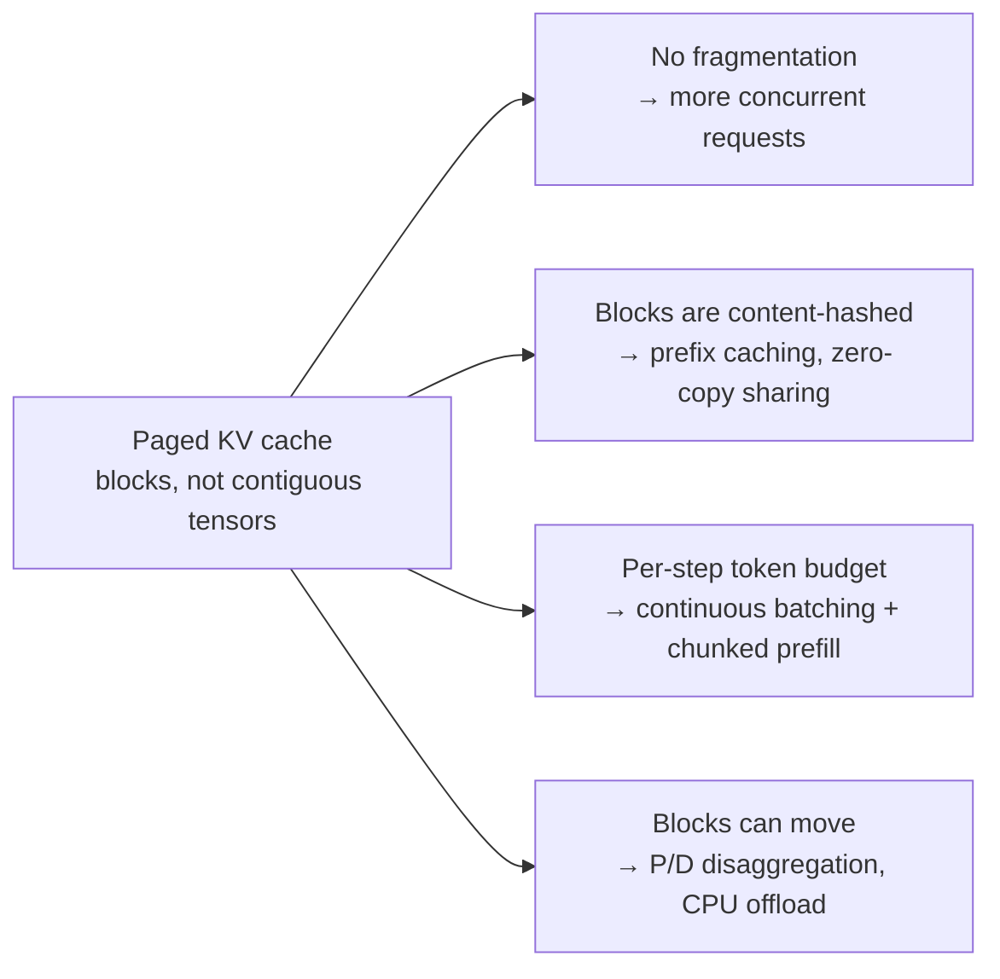

# vLLM — An Engineer's Introduction

This folder is a **from-scratch technical introduction to the vLLM codebase**: what the
project does, how it is architected, how a single request flows through the code, and how
each major feature is implemented.

Everything here was written by reading *this* checkout of the tree. Every claim is anchored
to a `path/to/file.py:line` reference so you can jump straight into the code and verify it.

> **Tree this documentation describes**
> Fork: `varun-projects/vllm` (fork of `vllm-project/vllm`), branch `intro`
> Base commit: `6f687a08` — *"[ROCm][Perf][GLM-5.3-Flash] Drop int32/int64 copies in the kpool sparse indexer (#63910)"*, 2026-11-19
>
> vLLM moves fast. Line numbers are accurate for this commit; symbol names are much
> more stable than line numbers, so if a reference drifts, grep for the symbol.

---

## Reading order

| # | Document | What you get |
| --- | --- | --- |
| 1 | [01-project-overview.md](01-project-overview.md) | What vLLM is, the problem it solves, the mental model of the whole system |
| 2 | [02-architecture.md](02-architecture.md) | Process topology, the five layers, the control loop, threading and IPC |
| 3 | [03-code-map.md](03-code-map.md) | Directory-by-directory map of the repo; which file owns which concern |
| 4 | [04-request-lifecycle.md](04-request-lifecycle.md) | One request traced end-to-end, function by function |
| 5 | [features/](features/) | One document per major feature, each with flowcharts |

Then, for applied debugging practice:

| # | Folder | What you get |
| --- | --- | --- |
| 6 | [../issue-deep-dives/](../issue-deep-dives/) | Fourteen **real, fixed** bugs (medium → difficult), each with root cause, the actual diff, and flowcharts of the broken vs. fixed control flow |

---

## Feature documents

Each file is self-contained and includes at least one Mermaid flowchart.

### Core engine

| Document | Subsystem |
| --- | --- |
| [01-paged-attention-and-kv-cache.md](features/01-paged-attention-and-kv-cache.md) | Paged KV cache, block pool, attention backends |
| [02-prefix-caching.md](features/02-prefix-caching.md) | Block hashing, cache lookup, LRU eviction, hybrid models |
| [03-continuous-batching-and-scheduler.md](features/03-continuous-batching-and-scheduler.md) | The scheduler, token budget, preemption |
| [04-chunked-prefill.md](features/04-chunked-prefill.md) | Splitting long prompts across steps |
| [05-speculative-decoding.md](features/05-speculative-decoding.md) | Drafting, verification, rejection sampling |
| [06-structured-output.md](features/06-structured-output.md) | Grammar compilation, bitmasks, backends |
| [07-multimodal-and-encoder-cache.md](features/07-multimodal-and-encoder-cache.md) | Vision/audio inputs, encoder cache budget |
| [13-sampling-and-logits-processors.md](features/13-sampling-and-logits-processors.md) | Sampler pipeline, penalties, logprobs |

### Scale-out and performance

| Document | Subsystem |
| --- | --- |
| [08-distributed-parallelism.md](features/08-distributed-parallelism.md) | TP / PP / DP / EP / DCP, executors, workers |
| [09-torch-compile-and-cudagraphs.md](features/09-torch-compile-and-cudagraphs.md) | `@support_torch_compile`, piecewise compilation, graph capture |
| [10-quantization.md](features/10-quantization.md) | Weight/activation/KV quantization plumbing |
| [11-lora.md](features/11-lora.md) | Multi-LoRA serving, Punica kernels, scheduling constraints |
| [12-kv-connectors-and-disaggregation.md](features/12-kv-connectors-and-disaggregation.md) | P/D disaggregation, NIXL, KV offloading |

### Serving surface

| Document | Subsystem |
| --- | --- |
| [14-api-server-and-entrypoints.md](features/14-api-server-and-entrypoints.md) | `LLM`, `vllm serve`, OpenAI-compatible routes |
| [15-metrics-and-observability.md](features/15-metrics-and-observability.md) | `SchedulerStats`, `IterationStats`, Prometheus |

---

## The 60-second version

vLLM is an **LLM inference and serving engine**. Its central insight is that the
attention key/value cache — the dominant memory consumer during generation — should be
managed like **virtual memory**: split into fixed-size *blocks*, allocated on demand,
shared between requests by content hash, and evicted LRU. That is *PagedAttention*, and
everything else in the architecture follows from it:

The engine runs a single-threaded **control loop** (`EngineCore.run_busy_loop`,
`vllm/v1/engine/core.py:1794`) that, every iteration, asks the scheduler which tokens to
run (`Scheduler.schedule`, `vllm/v1/core/sched/scheduler.py:694`), hands that plan to GPU
workers (`GPUModelRunner.execute_model`, `vllm/v1/worker/gpu/model_runner.py:1848`), and
feeds the sampled tokens back into request state
(`Scheduler.update_from_output`, `vllm/v1/core/sched/scheduler.py:2261`).

Everything else — speculative decoding, LoRA, structured output, quantization, tensor
parallelism — plugs into that loop.
