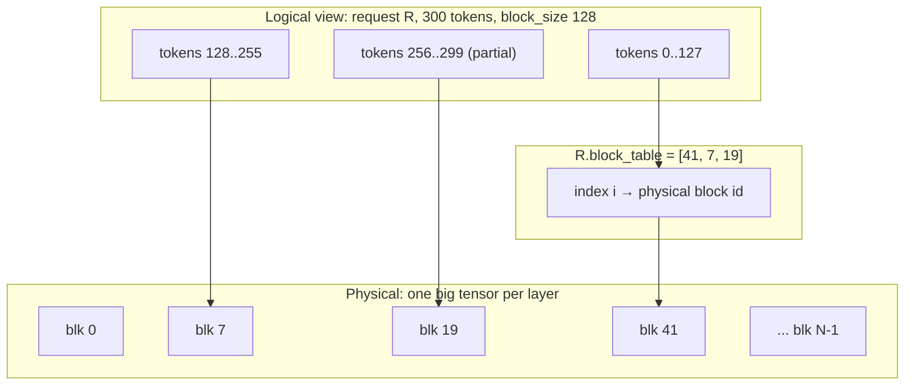
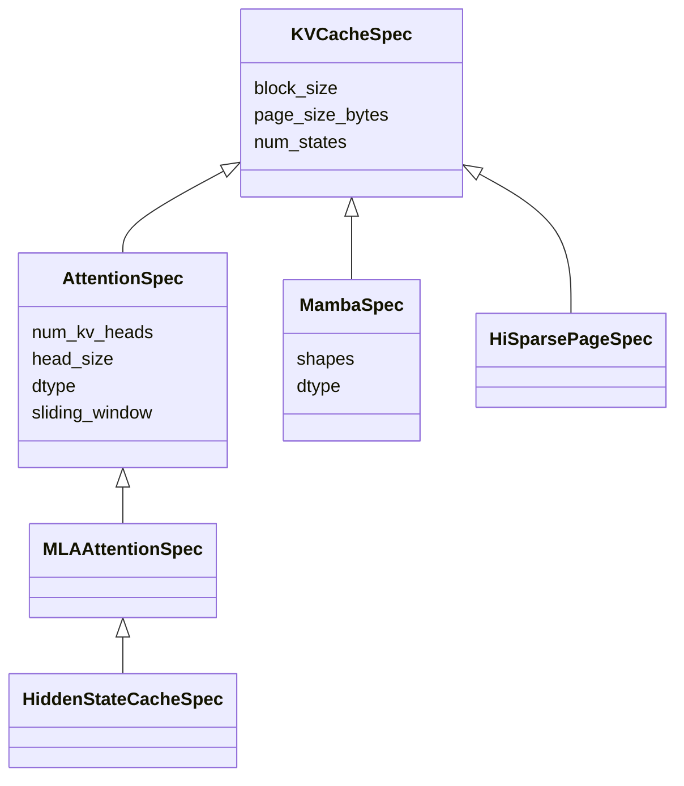
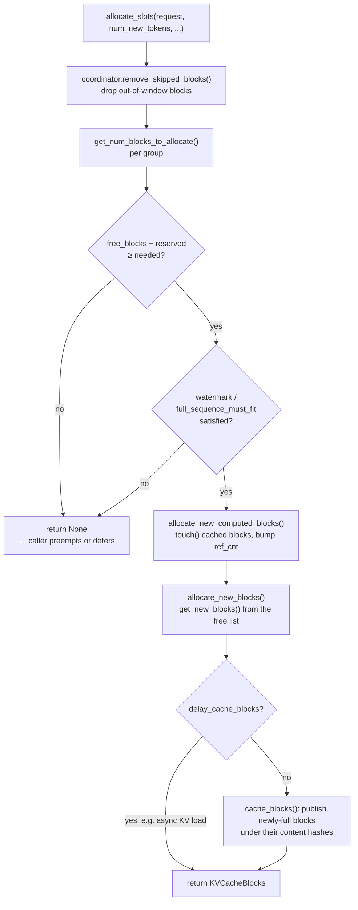
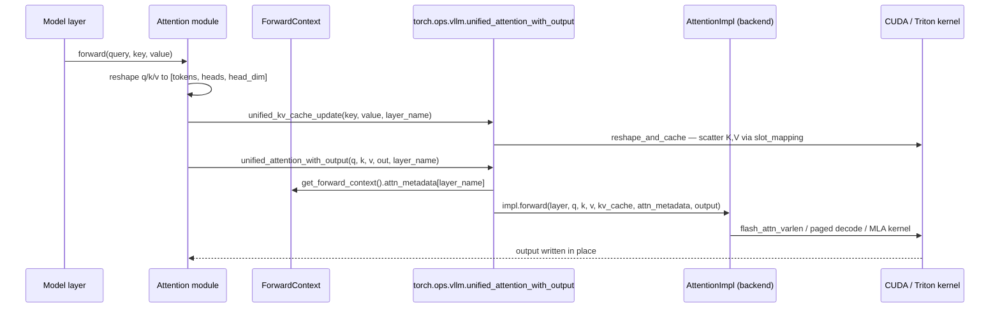

# Feature 01 — PagedAttention and the KV Cache

> **Code**: `vllm/v1/core/block_pool.py`, `vllm/v1/core/kv_cache_utils.py`,
> `vllm/v1/core/kv_cache_manager.py`, `vllm/v1/kv_cache_interface.py`,
> `vllm/v1/worker/gpu/block_table.py`, `vllm/v1/attention/backend.py`,
> `vllm/model_executor/layers/attention/attention.py`

## 1. The problem

During generation, every attention layer must attend over the K and V vectors of all
previous tokens. Recomputing them each step would be quadratic, so they are cached. That
cache is big: per token, per layer,

```text
2 (K and V) × num_kv_heads × head_size × dtype_bytes
```

For a 70B model with GQA (8 KV heads, head size 128) at fp16 and 80 layers that is
`2 × 8 × 128 × 2 × 80` ≈ **320 KB per token**. A 32k context is 10 GB for *one* request.

The KV cache — not the weights — determines how many requests fit on a GPU, so how it is
managed determines throughput.

## 2. The idea: pages, not buffers

Split the cache into fixed-size **blocks**, each holding `block_size` tokens
(commonly 16, 64 or 128). Pre-allocate one flat tensor per layer covering *all* blocks at
startup. Give every request a **block table**: a list of physical block ids, in logical
order. The sequence's KV is then logically contiguous even though it is physically
scattered.



Waste per request is now at most one partially-filled block, independent of
`max_model_len`.

## 3. The data structures

### 3.1 `KVCacheBlock` — `vllm/v1/core/kv_cache_utils.py:160`

```python
@dataclass
class KVCacheBlock:
    block_id: int                                  # 0 .. num_gpu_blocks-1
    ref_cnt: int = 0                               # how many requests hold it
    block_hash: BlockHashWithGroupId | None = None # set only when full & cached
    block_hash_num_tokens: int | None = None       # prefix length the hash covers
    prev_free_block: "KVCacheBlock | None" = None  # free-list links
    next_free_block: "KVCacheBlock | None" = None
    is_null: bool = False                          # sentinel, never cached
```

This is *metadata only* — it holds no tensor. The actual bytes live in the per-layer
tensors; `block_id` is the index into them.

`ref_cnt` is the sharing mechanism: when two requests share a cached prefix block, the same
`KVCacheBlock` appears in both block tables with `ref_cnt == 2`. A block is only evictable
at `ref_cnt == 0`.

### 3.2 `FreeKVCacheBlockQueue` — `vllm/v1/core/kv_cache_utils.py:248`

A hand-rolled intrusive doubly-linked list, not a `deque`. The docstring explains why:

> We implement this class instead of using Python builtin deque to support removing a block
> in the middle of the queue in O(1) time. To close the performance gap to the builtin
> deque [...] this class does not allocate any Python objects when manipulating the linked
> list.

Middle removal is required because a block can be *resurrected*: it is sitting in the free
list (so still cached and hashed), a new request hits it in the prefix cache, and it must be
pulled out of the free list in O(1).

Ordering is LRU with a tiebreak (`:257-264`):

1. least-recently-used at the front;
2. among blocks freed together by one request, the one covering **more** prefix tokens goes
   first — i.e. the tail of a chain is evicted before its head, so a shared prefix survives
   longer than a request-specific suffix.

### 3.3 `BlockPool` — `vllm/v1/core/block_pool.py:107`

Owns the universe of blocks and two structures over it:

| Member | Purpose |
| --- | --- |
| `free_block_queue` | the LRU free list above |
| `cached_block_hash_to_block` (`BlockHashToBlockMap`, `:38`) | content hash → block, for prefix-cache lookup |

Key methods:

| Method | Line | Role |
| --- | --- | --- |
| `get_new_blocks(n)` | `:681` | pop `n` blocks off the free list; evict their cache entries if they were still hashed |
| `get_cached_block(hash)` | `:175` | prefix-cache probe |
| `cache_full_blocks(...)` | `:203` | after a forward pass, publish newly-filled blocks under their hashes |
| `cache_partial_block(...)` | `:459` | publish a *partially* filled block (sub-block prefix matching) |
| `touch(blocks)` | `:774` | bump refcount and remove from free list when adopting cached blocks |
| `free_blocks(...)` | `:798` | return blocks, in reverse order, to maintain the eviction tiebreak |
| `_maybe_evict_cached_block(block)` | `:751` | drop a block's hash entry when it is reused for new content |

### 3.4 Specs, groups and config — `vllm/v1/kv_cache_interface.py`

Not every layer wants the same kind of cache. The type system makes that explicit:



- `KVCacheSpec` (`:189`) — what one layer needs per block. `page_size_bytes` (`:232`) is
  the unit the block count is computed from.
- `KVCacheGroup` (`:688`) — layers whose specs are compatible enough to **share one block
  table**. `KVCacheGroup.from_layers` (`:715`) does the grouping.
- `KVCacheConfig` (`:843`) — the resolved plan: `num_blocks`, the `KVCacheTensor`s, and the
  groups.

Why groups matter: a hybrid model (say Mamba layers + full-attention layers, or
sliding-window layers + global layers) has layers with *different* retention semantics. They
cannot share a block table, so there are several groups, and **every KV API returns tuples
indexed by group id**. If you ever wonder why `get_block_ids()` returns
`tuple[list[int], ...]`, this is why.

## 4. Allocation: `allocate_slots`

`KVCacheManager.allocate_slots` (`vllm/v1/core/kv_cache_manager.py:400`) is the single
entry point for "give this request room for N more tokens". Its docstring carries the
canonical layout picture (`:449`):

```text
----------------------------------------------------------------------
| < comp > | < new_comp > | < ext_comp >  | < new >  | < lookahead > |
----------------------------------------------------------------------
                                          |   < to be computed >     |
----------------------------------------------------------------------
                          |            < to be allocated >           |
----------------------------------------------------------------------
| Prefix-cached tokens from either vLLM   |
| or connector. Can be safely removed if  |
| they are outside sliding window.        |
----------------------------------------------------------------------
|   < cached by vLLM >    | not cached by |
                          | vLLM, but     |
| ref_cnt  | ref_cnt not  | cached by     |
| increased| increased yet| connector     |
----------------------------------------------------------------------
```

| Term | Meaning |
| --- | --- |
| `comp` | `request.num_computed_tokens` — already computed in earlier steps |
| `new_comp` | tokens just matched in the **local** prefix cache this step |
| `ext_comp` | tokens matched by a **KV connector** (remote/offloaded cache) |
| `new` | tokens to compute this step, including unverified draft tokens |
| `lookahead` | extra slots reserved for speculative decoding |

The three stages, per the docstring at `:487`:

1. free blocks no longer needed in `comp` (e.g. fallen out of a sliding window) and check
   there are enough free blocks — **return `None` if not**;
2. handle the prefix region: free what is unnecessary, allocate for `ext_comp`;
3. allocate for `new + lookahead`.



Returning `None` rather than raising is central to the design: it is a normal, expected
signal that means *"memory pressure — caller, do something about it"*. The scheduler's
response is to preempt (`vllm/v1/core/sched/scheduler.py:901-961`).

### Coordinators

`KVCacheManager` does not implement per-group policy itself; it delegates to a coordinator
(`vllm/v1/core/kv_cache_coordinator.py`):

| Coordinator | Line | Used when |
| --- | --- | --- |
| `KVCacheCoordinatorNoPrefixCache` | `:502` | prefix caching disabled |
| `UnitaryKVCacheCoordinator` | `:553` | exactly one KV cache group (the common case) |
| `HybridKVCacheCoordinator` | `:629` | multiple groups — must reconcile per-group hits |

which in turn delegates to per-group managers (`vllm/v1/core/single_type_kv_cache_manager.py`):
`FullAttentionManager` (`:902`), `SlidingWindowManager` (`:1109`),
`ChunkedLocalAttentionManager` (`:1758`), `MambaManager` (`:1934`),
`CrossAttentionManager` (`:2835`), `CircularBufferManager` (`:1630`), and the HiSparse
tiering managers (`:2920` onward).

## 5. The device side: block tables and slot mapping

Two tensors connect the Python bookkeeping to the kernels.

- **Block table** — `[num_reqs, max_blocks_per_req]` int32 on device.
  `vllm/v1/worker/gpu/block_table.py`. Writes are *staged* and flushed once per step with
  `apply_staged_writes()` (called at `vllm/v1/worker/gpu/model_runner.py:1871`) so that
  dozens of small edits become one H2D copy.
- **Slot mapping** — `[num_scheduled_tokens]` int64. For each token in this batch, the flat
  index into the paged KV tensor where its K and V must be written. Built in
  `prepare_attn` (`vllm/v1/worker/gpu/model_runner.py:1687`).

```text
slot = block_table[req_idx][token_pos // block_size] * block_size
     + token_pos % block_size
```

## 6. The attention call path



Three design points visible in `Attention.forward`
(`vllm/model_executor/layers/attention/attention.py:528`):

1. **The KV cache lives on the layer.** `self.kv_cache` is a slice of the global tensor,
   bound at `initialize_kv_cache`. The layer is identified by `self.layer_name`, which is
   how metadata and cache are looked up.
2. **Metadata comes from the forward context, not from arguments** (docstring at `:539`).
   This keeps every model's `forward` signature free of engine types and keeps
   `torch.compile` happy.
3. **The real work is behind a custom op.** `torch.ops.vllm.unified_attention_with_output`
   (`:831`) is opaque to Dynamo, which is exactly what piecewise compilation needs: the
   compiler treats attention as a black box and compiles the dense regions around it.
   The `use_direct_call` branch at `:583` skips the dispatcher when not compiling, to save
   CPU overhead.

Note also the separation of `unified_kv_cache_update` (`:788`) from the attention call: some
backends fold the cache write into their kernel (`forward_includes_kv_cache_update`), and
some layers share another layer's cache (`kv_sharing_target_layer_name`), in which case the
write is skipped entirely.

## 7. The backend interface

`vllm/v1/attention/backend.py`:

| Type | Line | Responsibility |
| --- | --- | --- |
| `AttentionBackend` | `:57` | static facts: name, supported head sizes, supported kernel block sizes, which impl/builder classes to use |
| `CommonAttentionMetadata` | `:410` | batch-level, backend-agnostic metadata: `query_start_loc`, `seq_lens`, `block_table_tensor`, `slot_mapping` |
| `AttentionMetadataBuilder` | `:603` | turns `CommonAttentionMetadata` into the backend's own metadata struct, once per step per group |
| `AttentionImpl` | `:885` | `forward()` — calls the kernel |
| `AttentionCGSupport` | `:567` | how much CUDA-graph capture this backend tolerates (never / decode-only / always) |

Backend selection happens in `vllm/v1/attention/selector.py` based on device capability,
head size, dtype, sliding window, and model geometry, and can be forced with
`VLLM_ATTENTION_BACKEND`.

One subtlety that generates real bugs: a backend declares its supported **kernel block
sizes**, which may be *smaller* than the cache `block_size` the user asked for. The engine
then lays the cache out in those smaller kernel blocks. Any component that re-derives this
choice independently will read the cache with the wrong stride — see
[issue deep dive 6](../../issue-deep-dives/06-difficult-eagle-draft-kernel-block-size.md)
for exactly that failure in the EAGLE drafter.

## 8. Things to remember

- Returning `None` from `allocate_slots` is the normal back-pressure signal, not an error.
- Everything KV-related is **per group** and returns tuples; single-group is the special
  case, not the general one.
- `ref_cnt == 0` does **not** mean "contents discarded" — the block stays hashed and
  reusable until it is actually popped off the free list for new content. That is what makes
  prefix caching work across requests.
- Block-table writes are staged; if you add a code path that mutates block tables, you must
  respect `apply_staged_writes()`.
