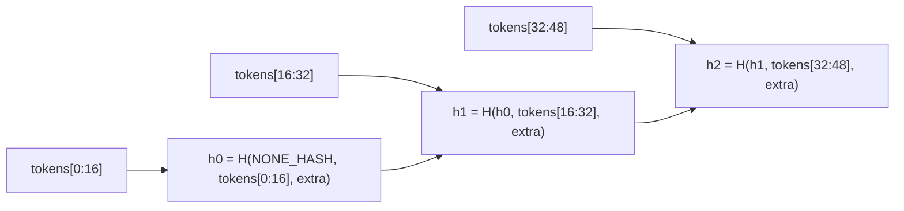
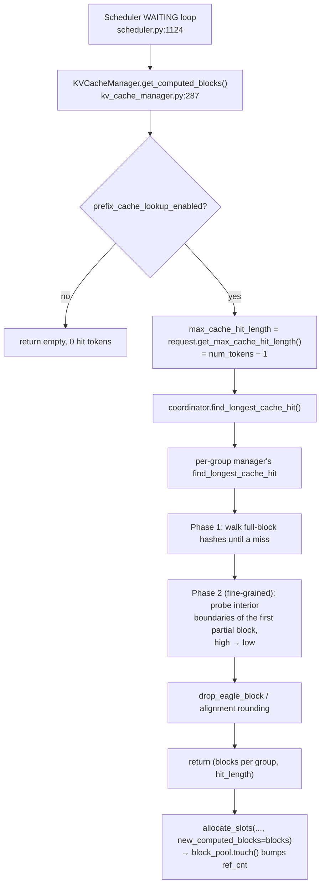
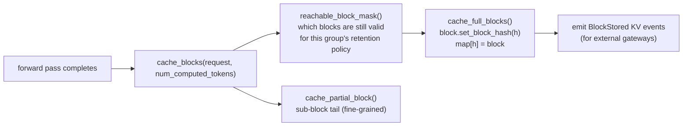
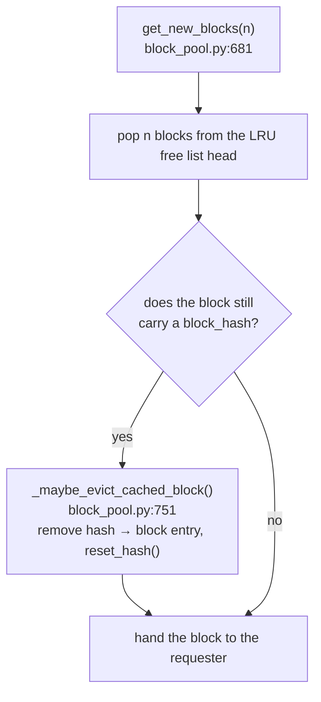
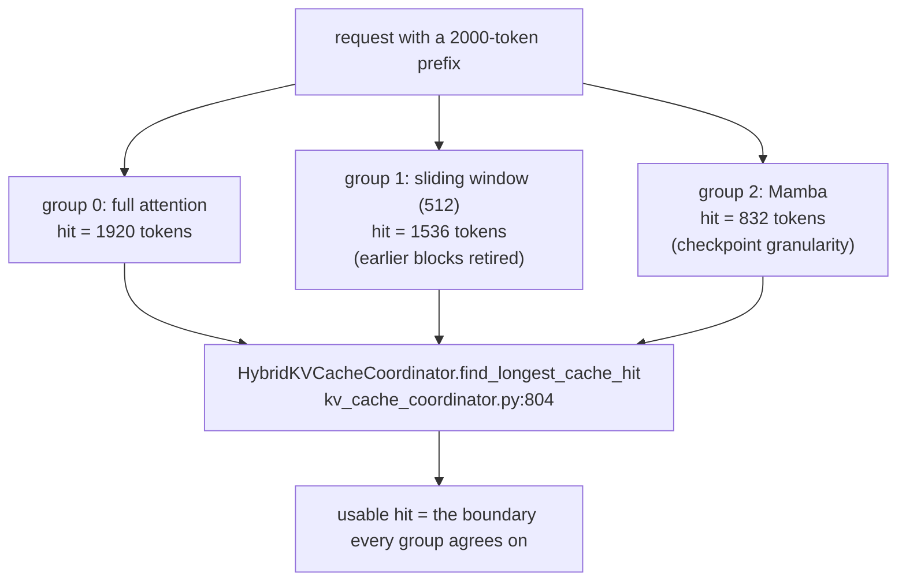

# Feature 02 — Automatic Prefix Caching

> **Code**: `vllm/v1/core/kv_cache_utils.py` (hashing), `vllm/v1/core/block_pool.py`
> (storage), `vllm/v1/core/kv_cache_manager.py` (lookup entry point),
> `vllm/v1/core/single_type_kv_cache_manager.py` (per-group hit policy),
> `vllm/v1/core/kv_cache_coordinator.py` (multi-group reconciliation)

## 1. The problem

Real traffic is massively redundant in its prefixes:

- every request in a deployment shares the same system prompt;
- a multi-turn chat resends the entire conversation each turn;
- few-shot prompts repeat the same exemplars;
- agentic loops resend a tool schema plus a growing scratchpad.

Recomputing the KV for a 2,000-token system prompt on every request is pure waste. If the
blocks holding it are still in GPU memory, they can be *reused as-is* — attention does not
care which request computed a K/V vector, only that it corresponds to the right token in the
right position with the right preceding context.

## 2. The key insight

> A block's KV content is fully determined by **the tokens in the block** plus
> **all tokens before it**.

So hash the block's tokens *chained with the hash of the previous block*. Equal hash ⇒ same
prefix ⇒ the cached KV is valid for the new request, bit for bit.

`hash_block_tokens` (`vllm/v1/core/kv_cache_utils.py:697`):

```python
return BlockHash(
    hash_function((parent_block_hash, curr_block_token_ids_tuple, extra_keys))
)
```



Two consequences of chaining:

1. **The hash list is a prefix fingerprint.** `h2` identifies the whole 48-token prefix, not
   just tokens 32–48.
2. **Lookup can stop at the first miss.** If `h1` is not cached, `h2` cannot be either —
   there is no way to have cached a block whose parent was never cached. Hence the comment
   in `find_longest_cache_hit` (`single_type_kv_cache_manager.py:950`): *"A missing block
   implies every later block misses too (chained hashes)."*

### `extra_keys` — what else must be in the hash

Pure token ids are not always enough. `generate_block_hash_extra_keys`
(`vllm/v1/core/kv_cache_utils.py:627`) mixes in:

| Source | Helper | Why |
| --- | --- | --- |
| Multimodal inputs | `_gen_mm_extra_hash_keys` (`:512`) | The same placeholder token ids stand for *different images*. The image's content hash must be in the key |
| LoRA adapter | `_gen_lora_extra_hash_keys` (`:580`) | A different adapter produces different K/V for identical tokens |
| Prompt embeddings | `_gen_prompt_embeds_extra_hash_keys` (`:600`) | Embedding inputs are not token ids at all |
| `cache_salt` (user-supplied) | handled in the hasher | Lets a tenant opt out of cross-tenant sharing |

Forgetting one of these is a *correctness* bug of the nastiest kind — a silent cache hit on
content that differs.

### Spec-decode lookahead

With `num_hash_lookahead_tokens = L > 0` (`:942`), each block's hash also covers the `L`
tokens *after* it, because the drafter's KV at the block's last position depends on them. A
block hash is therefore only emitted once those tokens exist. This is the kind of detail
that explains otherwise baffling "prefix caching + EAGLE gives different results" reports.

## 3. When hashes are computed

At **admission**, not at lookup. `EngineCore.preprocess_add_request`
(`vllm/v1/engine/core.py:1251`) installs the hasher built by `get_request_block_hasher`
(`vllm/v1/core/kv_cache_utils.py:929`), and `Request.update_block_hashes`
(`vllm/v1/request.py:300`) extends the list as output tokens are appended.

`request_block_hasher` (`:949`) is incremental and only ever hashes **full** blocks:

```python
start_token_idx = len(request.block_hashes) * hash_block_size
...
if end_token_idx > num_tokens:
    # We only hash full blocks
    break
```

Note `hash_block_size` is distinct from a group's `block_size`. Hashes are computed at the
*finest* granularity and coarser groups view the same list through
`BlockHashListWithBlockSize` (`:1144`). That is what makes sub-block ("fine-grained")
prefix matching possible without maintaining several hash lists.

## 4. Lookup



Two subtleties with real consequences:

- **The last token is always recomputed.** `get_computed_blocks` caps the hit at
  `prompt_length − 1` (comment at `kv_cache_manager.py:317`): if everything hit, there would
  be no logits to sample from. A 100%-cached prompt therefore still runs a one-token forward
  pass.
- **Hits are alignment-rounded.** `hit_length -= hit_length % alignment_tokens`
  (`single_type_kv_cache_manager.py:992`), because `allocate_slots` requires
  `num_computed_tokens` to sit on a boundary the group can express.

### Lookup is read-only until `allocate_slots`

`get_computed_blocks` does **not** bump refcounts. The blocks it returns may still be on the
free list. The adoption — `block_pool.touch()` → `ref_cnt += 1` and removal from the free
list — happens inside `allocate_slots`. If the request is not scheduled this step, nothing
was mutated, which is why `get_computed_blocks` can be called speculatively.

## 5. Publication: making blocks cacheable

After a forward pass fills blocks, they must be published.
`SingleTypeKVCacheManager.cache_blocks` → `BlockPool.cache_full_blocks`
(`vllm/v1/core/block_pool.py:203`) assigns each newly-full block its hash and inserts it
into `cached_block_hash_to_block`.



`block_mask` / `reachable_block_mask` exist because not every block a request holds is a
valid cache entry. Sliding-window groups may have retired earlier blocks; Mamba groups may
hold a *state* that does not correspond to the block's end. Publishing such a block under
its full-block hash hands out wrong data to the next request — which is precisely the bug in
[issue deep dive 5](../../issue-deep-dives/05-difficult-mamba-mid-block-resume-cache.md).

## 6. Eviction

There is no separate eviction pass. Eviction is a side effect of allocation:



So a freed block remains a **valid cache entry** for as long as nobody needs its memory.
This is the whole reason prefix caching works across requests: a request finishes, its
blocks go back to the free list *with their hashes intact*, and the next request with the
same prefix pulls them straight back out.

The ordering rules in `FreeKVCacheBlockQueue` (`vllm/v1/core/kv_cache_utils.py:257`) make
this behave sensibly: LRU, and within one request's freed chain, deeper blocks (more prefix
tokens) are evicted first. So a shared system prompt — held by many requests, re-touched
constantly — is effectively pinned, while request-specific tails churn.

`free_blocks` (`block_pool.py:798`) reverses the block order on free to maintain that
invariant; the comment at `kv_cache_utils.py:262` notes this is done *outside* the queue
class.

## 7. Hybrid models: where it gets hard

With one KV cache group, a prefix hit is a single number. With several groups (Mamba +
full attention, sliding window + global) each group has its **own** retention policy and its
own blocks, so the groups can disagree about how deep the hit goes.



`HybridKVCacheCoordinator` (`vllm/v1/core/kv_cache_coordinator.py:629`) reconciles this. It
also tracks a **shared-prefix boundary** (`kv_cache_manager.py:303`):

> the block-aligned token position of a shared prefix that a sparse-retention group (Mamba /
> sliding window) has not cached yet (Marconi-style APC) [...] Pinned so sparse prefix-cache
> retention does not drop the junction and defeat cross-request reuse.

And `find_longest_cache_hit_per_group` (`:951`) exists for the connector path, where the
full-attention hit is reported to the remote and a lagging group's divergence is flagged
(`get_computed_blocks_for_connector`, `kv_cache_manager.py:351`).

## 8. Observability

| Metric | Where produced |
| --- | --- |
| `vllm:prefix_cache_queries` / `vllm:prefix_cache_hits` | `PrefixCacheStats`, `vllm/v1/metrics/stats.py:121`; recorded via `KVCacheManager.record_prefix_cache_stats` (`:276`) |
| Hit rate in the log line | `CachingMetrics.hit_rate`, `vllm/v1/metrics/stats.py:113` |
| `BlockStored` / `BlockRemoved` events | `BlockPool._build_block_stored_event` (`:346`), `take_events` (`:925`) — published for external routers that do prefix-aware load balancing |

Stats are recorded **at admission, not at lookup** (`scheduler.py:1554`: *"Record at
admission so unscheduled lookups are not counted"*) — otherwise a request that was looked up
and then deferred would be double-counted.

## 9. Operational notes

- Enabled by default (`--enable-prefix-caching` / `--no-enable-prefix-caching`).
- `--block-size` trades granularity for overhead: smaller blocks mean finer sharing but more
  block-table entries and more hash probes.
- `cache_salt` in a request body partitions the cache — the right tool for multi-tenant
  isolation.
- `reset_prefix_cache()` (`kv_cache_manager.py:704`) clears it; it only succeeds when no
  blocks are in use.
- Disable it to triage a correctness bug: if the bug disappears, you are looking at a
  hashing or retention problem, and
  [issue deep dive 5](../../issue-deep-dives/05-difficult-mamba-mid-block-resume-cache.md)
  is a worked example of diagnosing exactly that.
