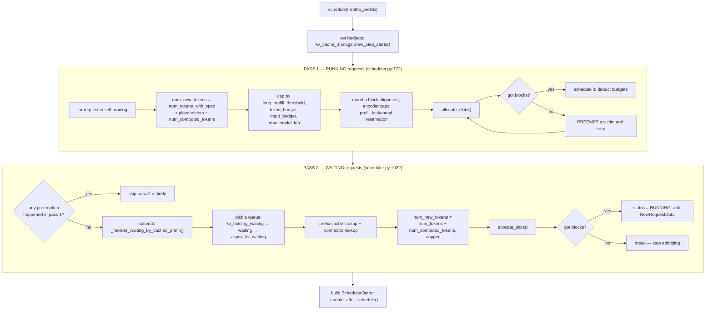
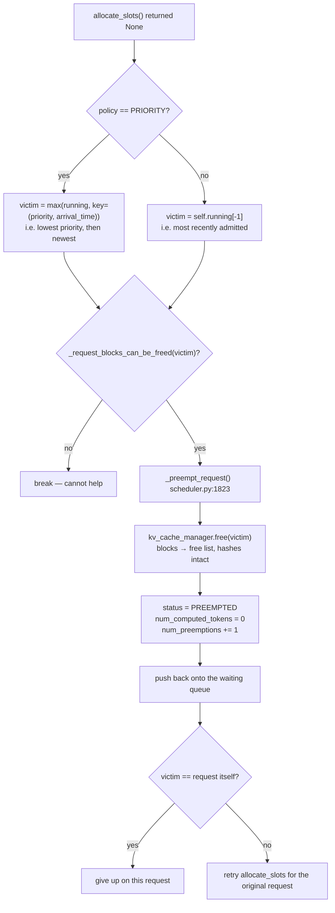
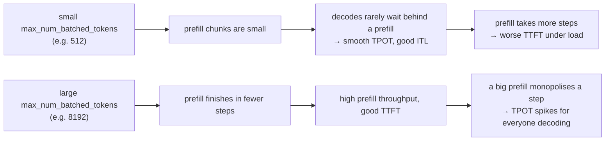

# Feature 03 — Continuous Batching and the Scheduler

> **Code**: `vllm/v1/core/sched/scheduler.py` (3,895 lines),
> `vllm/v1/core/sched/output.py`, `vllm/v1/core/sched/request_queue.py`,
> `vllm/v1/core/sched/interface.py`

## 1. The problem with static batching

Classic batched inference groups N requests, runs them together, returns when all are done.
For generation this is terrible:

```mermaid
gantt
    title Static batching — the GPU idles behind the longest request
    dateFormat X
    axisFormat %s
    section Req A (10 tokens)
    generating :0, 10
    idle, slot wasted :crit, 10, 90
    section Req B (90 tokens)
    generating :0, 90
    section Req C (arrives at t=5)
    waiting for the batch to drain :crit, 5, 90
    generating :90, 120
```



Two separate losses: finished sequences keep occupying batch slots, and newly arrived
requests wait for the whole batch to drain.

**Continuous batching** (a.k.a. iteration-level scheduling) re-forms the batch at **every
forward pass**. A finished request's slot is reused in the next step, 20 ms later, not when
the batch drains.

## 2. The vLLM formulation: no phases, just a token budget

The key simplification is stated in the code itself
(`vllm/v1/core/sched/scheduler.py:696`):

> There's no "decoding phase" nor "prefill phase" in the scheduler. Each request just has
> the `num_computed_tokens` and `num_tokens_with_spec`. [...] At each step, the scheduler
> tries to assign tokens to the requests so that each request's `num_computed_tokens` can
> catch up its `num_tokens_with_spec`. This is general enough to cover chunked prefills,
> prefix caching, speculative decoding, and the "jump decoding" optimization in the future.

So a request is just two integers, and the scheduler's job is distributing a per-step
**token budget** across requests. A 2,000-token prefill chunk and a 1-token decode are the
same kind of thing in different sizes.

| Field | Where | Meaning |
| --- | --- | --- |
| `num_computed_tokens` | `Request` | how far KV has been computed |
| `num_tokens` | `Request.num_tokens:333` | prompt + generated output |
| `num_tokens_with_spec` | `Request.num_tokens_with_spec:337` | the above plus unverified draft tokens |
| `num_output_placeholders` | `Request` | async-scheduling slots not yet filled |

## 3. The budgets

Set up at the top of `schedule()` (`:718-731`):

| Budget | Config | Purpose |
| --- | --- | --- |
| `token_budget` | `max_num_scheduled_tokens` | total tokens this step |
| `input_budget` | `scheduler_config.max_num_batched_tokens` | tokens the model will actually see, including reserved draft slots |
| `max_num_active_reqs` | `max_num_seqs` | batch row count |
| `encoder_compute_budget` | `max_num_encoder_input_tokens` | vision/audio encoder work per step |
| `long_prefill_token_threshold` | `scheduler_config.long_prefill_token_threshold` | per-request cap so one long prefill cannot starve everyone |

Note the subtle handling of `long_prefill_token_threshold` at `:753-768`:

```python
# `long_prefill_token_threshold` exists to stop a long prefill from
# starving other requests of the token budget. When it is the only
# request there is nobody to starve, so let it use the whole budget.
```

and, when `adaptive_long_prefill_threshold` is set, the cap is floored at
`input_budget // num_eligible_reqs` so it never cuts a request below its fair share.

## 4. `schedule()` — the two-pass algorithm



### Why running requests come first

Decodes are already holding KV. Advancing them frees memory soonest and keeps TPOT (time
per output token) stable for users mid-stream. Admitting new work first would risk
preempting a request that was nearly finished.

### Why a preemption aborts pass 2

`if not preempted_reqs and self._pause_state != PauseState.PAUSED_ALL:` (`:1033`). If the
system just had to evict someone to make room for existing work, admitting *more* work in
the same step would be thrashing.

### `continue` vs. `break`

Note the comment at `:882`:

```python
# NOTE(woosuk): Here, by doing `continue` instead of `break`,
# we do not strictly follow the FCFS scheduling policy and
# allow the lower-priority requests to be scheduled.
```

A request that cannot be scheduled for a *non-memory* reason (encoder budget exhausted, no
new tokens, alignment constraint) is skipped rather than blocking the queue. A request that
cannot be scheduled for lack of *blocks* causes a `break`, because nobody behind it will fit
either.

## 5. Preemption



Because the victim's blocks keep their hashes, a preempted request often gets most of its
KV back from the prefix cache when it resumes — recomputation is usually far cheaper than
the worst case. This is why vLLM preempts by **recompute** rather than by swapping to host
memory.

`_num_preempted_reqs` is incremented right here (`:1863`) for the preemption counter; the
reason it is counted in the scheduler instead of on resume is the subject of
[issue deep dive 3](../../issue-deep-dives/03-medium-preemption-metric-lost-on-abort.md).

## 6. Queues and policies

`vllm/v1/core/sched/request_queue.py`:

| Queue | Line | Semantics |
| --- | --- | --- |
| `FCFSRequestQueue` | `:75` | a `deque` subclass; arrival order |
| `PriorityRequestQueue` | `:131` | heap ordered by `(priority, arrival_time)` |

Chosen by `create_request_queue(policy)` (`:200`) from
`SchedulerConfig.policy` (`fcfs` or `priority`).

The scheduler actually maintains **several** waiting queues and picks between them
(`_next_waiting_queue`, `:2795`):

| Queue | Holds |
| --- | --- |
| `waiting` | normal new arrivals |
| `kv_holding_waiting` | requests that already hold KV blocks (e.g. a completed async load) — always drained first |
| `async_kv_waiting` | requests whose KV is being fetched remotely; these consume neither a batch slot nor token budget while loading |
| `deferred_waiting` | requests skipped this step, retried next step |

Optional reordering: `_reorder_waiting_by_cached_prefix` (`:2755`) promotes requests with
longer prefix-cache hits within a bounded window (`cache_aware_window`) — cheap wins, since
a request that will mostly hit the cache is nearly free to admit.

## 7. `update_from_output()`

`:2261`. The mirror of `schedule()`. Per request in the batch:

1. `num_in_flight_tokens -= num_tokens_scheduled`; drain stale-output bookkeeping (`:2326`).
2. Skip requests that were aborted mid-flight (`:2335`) — under PP or async scheduling the
   output can arrive after the abort.
3. Advance `num_computed_tokens`; if the request has passed the prompt end, append the
   sampled token(s) and extend `block_hashes`.
4. For speculative decoding, record drafted/accepted counts
   (`num_drafted_tokens_per_req`, `num_verified_tokens_per_req`).
5. Structured output: advance the grammar FSM with the accepted tokens.
6. Stop conditions: EOS, `stop_token_ids`, `max_tokens`, `min_tokens` gating.
7. Finished → `_free_request` (`:3128`) → blocks back to the pool.
8. Build `EngineCoreOutput` entries, grouped by `client_index`.

Note the performance warning at `:2310`:

```python
# NOTE(woosuk): As len(num_scheduled_tokens) can be up to 1K or more,
# the below loop can be a performance bottleneck. We should do our best
# to avoid expensive operations inside the loop.
```

This loop is hot: it runs once per request per step. Anything non-trivial added here shows
up directly in TPOT.

## 8. Variants and knobs

| Scheduler | File | Purpose |
| --- | --- | --- |
| `Scheduler` | `sched/scheduler.py:89` | the default |
| `AsyncScheduler` | `sched/async_scheduler.py` | schedules step *N+1* before step *N*'s output is processed, using output placeholders |
| `DiffusionScheduler` | `sched/diffusion_scheduler.py` | diffusion-style LLMs |
| `PrefixLMScheduler` | `sched/prefix_lm_scheduler.py` | bidirectional-prefix models |

Useful flags and the field they set:

| Flag | Effect |
| --- | --- |
| `--max-num-batched-tokens` | the per-step token budget. Larger → better prefill throughput, worse decode latency |
| `--max-num-seqs` | batch rows; bounded by block-table width and CUDA graph buckets |
| `--long-prefill-token-threshold` | per-request prefill cap |
| `--scheduling-policy priority` | switch to `PriorityRequestQueue` |
| `--async-scheduling` | use the async scheduler |
| `--prefill-schedule-interval` | run prefills only every Nth step (DP prefill balancing, `_should_throttle_prefills`, `core.py:694`) |

## 9. The latency/throughput trade-off in one picture



This is the single most important tuning dial, and the reason chunked prefill
([feature 04](04-chunked-prefill.md)) exists at all.

## 10. Reading the scheduler without drowning

`schedule()` is ~1,100 lines because it absorbs every feature's constraints. To read it
productively, follow this skeleton and treat everything else as a guard:

```text
schedule():
  ├── budgets
  ├── while running:            # pass 1
  │     num_new_tokens = ...    # ← the core computation
  │     allocate_slots(...)     # ← the memory decision
  │     [preempt loop]
  ├── while waiting:            # pass 2
  │     get_computed_blocks(...)  # ← prefix cache
  │     allocate_slots(...)
  └── build SchedulerOutput
```

Everything in between is one of: encoder-input budgeting, mamba block alignment,
spec-decode padding, KV-connector state machines, DP cadence throttling, pause/resume, or
structured-output bookkeeping. Each is documented in its own feature file.
