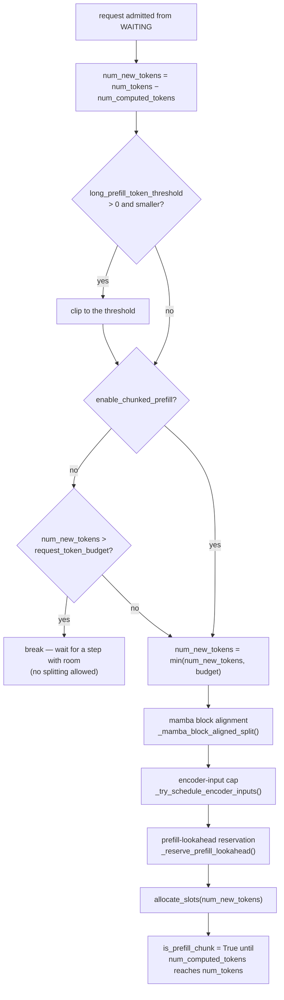

# Feature 04 — Chunked Prefill

> **Code**: `vllm/v1/core/sched/scheduler.py:1329-1404`, `SchedulerConfig`
> (`enable_chunked_prefill`, `max_num_batched_tokens`, `long_prefill_token_threshold`)

## 1. The problem

Prefill and decode have opposite shapes:

| | Prefill | Decode |
| --- | --- | --- |
| Tokens per request per step | hundreds to 100k+ | 1 (or 1 + draft tokens) |
| Bottleneck | compute (GEMM-bound) | memory bandwidth (weight loading) |
| GPU utilisation | high | low — the batch is thin |

If a 50,000-token prompt must be processed in a single forward pass, every decoding request
in the batch stalls for the entire duration — hundreds of milliseconds. Users mid-stream see
a visible hitch. Worse, the prefill needs activation memory proportional to its length, so
the engine must reserve headroom for the worst case.

```mermaid
gantt
    title Unchunked prefill blocks all decodes
    dateFormat X
    axisFormat %s
    section 50k-token prefill
    one giant forward pass :crit, 0, 400
    section decoding requests
    stalled :crit, 0, 400
    resume :400, 420
```



## 2. The fix

Because the scheduler thinks in tokens and the KV cache is paged, a prompt can be processed
**a slice at a time**, with decodes from other requests packed into the same batch.

```mermaid
gantt
    title Chunked prefill interleaves
    dateFormat X
    axisFormat %s
    section 50k prefill (2048-token chunks)
    chunk 1 :0, 25
    chunk 2 :50, 75
    chunk 3 :100, 125
    section decodes
    step :25, 50
    step :75, 100
    step :125, 150
```



The mechanism is nothing more than clipping `num_new_tokens` to the remaining budget
(`scheduler.py:1380`):

```python
num_new_tokens = min(num_new_tokens, request_token_budget)
assert num_new_tokens > 0
```

and leaving `request.num_computed_tokens` short of `request.num_tokens`. Next step, the
request is in `self.running`, pass 1 picks it up, and it advances again.

## 3. What makes it correct

Three invariants do the work:

1. **Attention is causal and append-only.** Tokens in chunk *k* attend over chunks
   `0..k-1`, whose KV is already in the cache and reachable through the block table. The
   attention metadata just reports a larger `seq_len` than `query_len` — exactly the shape
   a varlen prefill kernel already handles.
2. **Logits are only needed at the end.** `logits_indices` selects the last position of the
   *prompt*, so intermediate chunks produce no logits and cost nothing in the sampler. (The
   exception is `prompt_logprobs`, which forces logits for every prompt position — which is
   why requesting prompt logprobs disables prefix-cache reads for that request; see
   `KVCacheManager.prefix_cache_lookup_enabled`, `kv_cache_manager.py:250`.)
3. **The KV cache is paged.** A chunk boundary need not align with anything; the next chunk
   simply continues writing into the same block.

## 4. In the scheduler



Note the `enable_chunked_prefill == False` branch (`scheduler.py:1371-1378`):

```python
if (
    not self.scheduler_config.enable_chunked_prefill
    and num_new_tokens > request_token_budget
    and not self.is_mm_encoder_only
):
    # If chunked_prefill is disabled,
    # we can stop the scheduling here.
    break
```

With chunking disabled, a prompt that does not fit the remaining budget is not split — it
waits for a step with room.

## 5. The constraints that can override the chunk size

Chunk boundaries are not always free. Several features force alignment:

| Constraint | Function | Why |
| --- | --- | --- |
| Mamba / SSM block alignment | `_mamba_block_aligned_split`, `:541` | Recurrent state is checkpointed at block boundaries; a chunk must not end at a position where no valid state can be stored |
| Encoder inputs | `_try_schedule_encoder_inputs`, `:2041` | A chunk must not split a multimodal item when `disable_chunked_mm_input` is set, and must respect the encoder compute budget |
| Multi-module MTP | `_reserve_prefill_lookahead`, `:673` | A prefill chunk must not end within `num_prefill_lookahead` tokens of the prompt end |
| Spec-decode padding | `:1342-1364` | New decode rows are padded to `1 + num_spec_tokens` to keep a uniform CUDA-graph shape |

The multimodal case is subtle enough to have produced a family of real bugs; the one where a
prefix-cache hit lands *inside* an image is
[issue deep dive 4](../../issue-deep-dives/04-difficult-mm-item-split-on-prefix-hit.md).

## 6. Interaction with prefix caching

A cache hit makes the first chunk start part-way in:

```text
prompt:        [=================== 3000 tokens ===================]
cache hit:     [==== 1024 ====]
chunk 1:                      [==== 2048 ====]        budget-limited
chunk 2:                                      [ 1976 remaining... ]
```

`num_computed_tokens` is set to the hit length before chunking begins, so the two features
compose without special handling. The one coupling is alignment: the hit length is rounded
down to the group's alignment unit (`single_type_kv_cache_manager.py:992`) so that the first
chunk starts on a boundary `allocate_slots` can express.

## 7. Interaction with pipeline parallelism

Under PP, several micro-batches are in flight. A request that has had all its prompt tokens
scheduled but not yet executed has `num_new_tokens == 0` and is simply skipped
(`scheduler.py:868-886`, reason 1 in the comment list). This is why you see
`num_new_tokens == 0` paths that are *not* errors.

## 8. Tuning

| Setting | Effect |
| --- | --- |
| `--max-num-batched-tokens` | the chunk size ceiling. 2,048–8,192 is the usual range; larger favours TTFT and prefill throughput, smaller favours ITL smoothness |
| `--long-prefill-token-threshold` | per-request cap so one 200k prompt cannot consume whole steps even if the budget would allow it |
| `--enable-chunked-prefill` / `--no-enable-chunked-prefill` | on by default for most configurations |
| `--disable-chunked-mm-input` | forbid splitting a single multimodal item across chunks (required for models with bidirectional attention over image tokens) |

Diagnostic: `SchedulerIterationDetails` (`vllm/v1/metrics/stats.py:198`) reports
`num_ctx_requests` / `num_ctx_tokens` versus `num_generation_requests` /
`num_generation_tokens` per step, i.e. exactly how prefill and decode shared each step.
Enable with `--enable-logging-iteration-details`.
