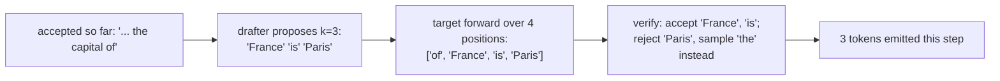
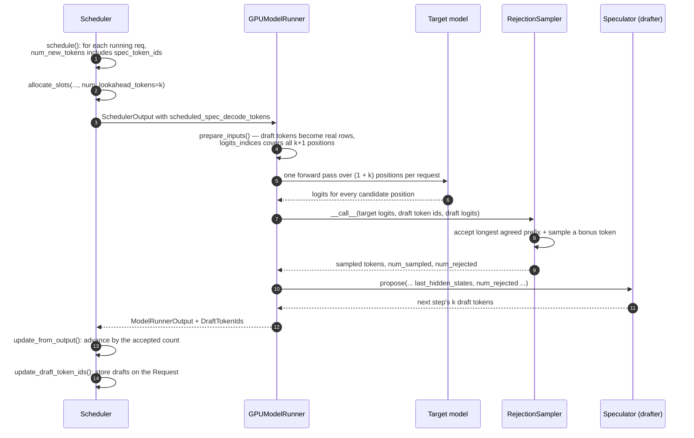
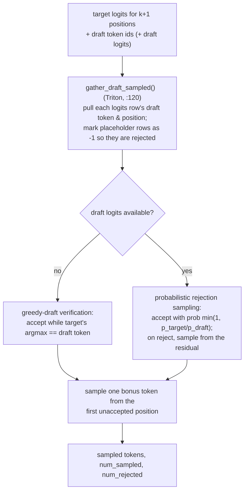

# Feature 05 — Speculative Decoding

> **Code**: `vllm/v1/worker/gpu/spec_decode/` (drafters + rejection sampler),
> `vllm/v1/spec_decode/` (metrics, dynamic lookahead),
> `vllm/v1/core/sched/scheduler.py` (lookahead slot reservation, draft scheduling),
> `vllm/config/` → `SpeculativeConfig`

## 1. The problem

Decode is memory-bandwidth-bound. Generating one token requires streaming **all** the
model's weights through the memory system. For a 70B fp16 model that is 140 GB of traffic
per token — and the arithmetic done with those weights is trivial by comparison. The GPU's
FLOPs sit idle.

Observation: the same weight traffic can serve a batch of *positions* almost as cheaply as
one. If we could evaluate several candidate future tokens in one forward pass, we would get
several tokens for roughly the price of one.

## 2. The idea

1. A cheap **drafter** proposes `k` tokens.
2. The expensive **target** model evaluates all `k+1` positions in **one** forward pass.
3. A **verification** step accepts the longest prefix of the draft that the target agrees
   with, and samples one extra token itself.

So each step yields between 1 and `k+1` tokens. With acceptance rate `α` and `k` drafts, the
expected tokens per step is `(1 − α^(k+1)) / (1 − α)`.

**Crucially the output distribution is unchanged.** Rejection sampling (Leviathan et al.
2023; Chen et al. 2023) guarantees the accepted sequence is distributed exactly as the
target model's own sampling would be. Speculative decoding is a pure latency optimisation —
never a quality trade-off. That is why the symptom of a *broken* implementation is lost
speedup, not wrong answers (see
[issue deep dive 6](../../issue-deep-dives/06-difficult-eagle-draft-kernel-block-size.md)).



## 3. Drafting methods in this tree

`vllm/v1/worker/gpu/spec_decode/` contains one subpackage per method, each registering a
`SpeculatorConfig` (`speculator_config.py:25`) and a `BaseSpeculator` implementation
(`speculator.py:74`):

| Directory | Method |
| --- | --- |
| `eagle/` | EAGLE / EAGLE3 — a small transformer head that drafts from the target's hidden states |
| `autoregressive/`, `standalone_ar/` | a separate, smaller draft **model** run autoregressively |
| `extract_hidden_states.py` | MTP-style multi-token-prediction heads shipped inside the target checkpoint |
| `dflash/`, `dflash2/`, `dspark/`, `dspine/`, `fly.py` | newer research drafters with their own window/verification policies |
| `ngram`-style methods | prompt lookup: find the current suffix earlier in the context and copy what followed |

The common interface is just two methods (`speculator.py:100`, `:96`):

```python
def propose(self, input_batch, attn_metadata, slot_mappings,
            last_hidden_states, aux_hidden_states,
            num_sampled, num_rejected, last_sampled, ...) -> torch.Tensor
def capture(self) -> None   # CUDA graph capture for the drafter
```

`propose` returns the draft token ids. Note what it takes: `last_hidden_states` and
`aux_hidden_states` — EAGLE-class drafters consume the target's internal activations, which
is why they are both cheap and accurate, and why they must run *inside* the same model
runner step rather than as a separate engine.

## 4. The end-to-end step with spec decode



### Scheduler-side obligations

| Obligation | Code |
| --- | --- |
| Reserve KV slots for not-yet-verified drafts | `num_lookahead_tokens` passed to `allocate_slots`, `scheduler.py:894` |
| Trim drafts to what fits the budget | `scheduler.py:991-1006` |
| Pad fresh decode rows to `1 + num_spec_tokens` so the CUDA graph shape stays uniform | `scheduler.py:1342-1364` |
| Reserve `max_num_new_slots_for_drafting` out of the input budget | `draft_slots`, `scheduler.py:722` |
| Clear `request.spec_token_ids` after scheduling them | `scheduler.py:1006` |
| Accept the worker's new drafts | `update_draft_token_ids`, `scheduler.py:2960` |

Note the comment at `scheduler.py:1004`: new spec tokens are installed by
`update_draft_token_ids` *before the next step*, not during scheduling — the drafter runs on
the worker, after sampling.

### Why `num_computed_tokens` can go *backwards*

If 1 of 3 drafts is accepted, the KV written for the 2 rejected positions is garbage and
must be discarded. `update_from_output` advances `num_computed_tokens` by the **accepted**
count, not the scheduled count. The stale KV is simply overwritten next step because the
slot mapping is recomputed from `num_computed_tokens`. This is the single most common source
of confusion when reading the spec-decode paths.

## 5. Rejection sampling

`vllm/v1/worker/gpu/spec_decode/rejection_sampler.py:152`.



Method selection is via `SpeculativeConfig.rejection_sample_method`
(`rejection_sampler.py:168-188`): `"block"` enables block verification, `"fly"` enables
entropy-gated FLy verification, `"synthetic"` replays configured acceptance rates (a
benchmarking aid, not for production).

The placeholder handling at `:113` is a good example of the care these paths need:

```python
# Drafts are only proposed after sampling past the prefill, so any draft
# slots in a step starting within the prefill are placeholders (e.g. the
# padded first step after a P/D remote KV load).
is_placeholder = (local_pos > 0) & (pos - local_pos < prefill_len)
token_id = tl.where(is_placeholder, -1, token_id)
```

Padded rows must be *rejected*, not accepted — otherwise a disaggregated-prefill request
would emit junk on its first decode step.

## 6. Adaptive and dynamic policies

Fixed `k` is wasteful: when acceptance is low, drafting costs more than it saves.

| Mechanism | Code | What it does |
| --- | --- | --- |
| Online acceptance estimation | `OnlineAcceptanceEstimator`, `spec_decode/acceptance_estimator.py:342` | fits observed per-position acceptance and predicts the benefit of drafting |
| Adaptive verification | `AdaptiveVerificationManager`, `spec_decode/adaptive_verification.py:227` | uses measured step-cost curves to choose how many draft positions to verify per request |
| Dynamic lookahead | `vllm/v1/spec_decode/dynamic/` | varies `k` per request per step |
| Skip drafting | `Scheduler.can_skip_drafts` / `_drafts_unused`, `scheduler.py:497` | when the batch is large enough that the GPU is already compute-saturated, drafting is pure overhead — so skip it |

That last one is the important intuition: **speculative decoding helps at low batch sizes
and hurts at high ones.** At batch size 1 the GPU is idle and drafts are nearly free; at
batch size 256 the decode step is already compute-bound and the extra `k` positions per
request are real work.

## 7. Metrics

`vllm/v1/spec_decode/metrics.py` and `RequestSpecDecodeMetrics`
(`vllm/v1/metrics/stats.py:355`):

| Metric | Meaning |
| --- | --- |
| `vllm:spec_decode_num_drafts` | number of draft *batches* proposed |
| `vllm:spec_decode_num_draft_tokens` | total tokens proposed |
| `vllm:spec_decode_num_accepted_tokens` | total accepted |
| `vllm:spec_decode_num_accepted_tokens_per_pos` | accepted count **by draft position** |
| acceptance length | mean tokens emitted per step |

The per-position breakdown is the diagnostic that matters. A healthy EAGLE3 setup decays
smoothly across positions (e.g. 0.78 / 0.60 / 0.45). A **cliff** after position 1 means the
drafter's own state is wrong from its second autoregressive step onward — which is exactly
the fingerprint in
[issue deep dive 6](../../issue-deep-dives/06-difficult-eagle-draft-kernel-block-size.md),
where the drafter read the KV cache with the wrong page size.

## 8. Configuration

```bash
vllm serve meta-llama/Llama-3.1-70B-Instruct \
  --speculative-config '{"method": "eagle",
                         "model": "yuhuili/EAGLE3-LLaMA3.1-Instruct-70B",
                         "num_speculative_tokens": 3}'
```

| Field | Meaning |
| --- | --- |
| `method` | which drafter (`eagle`, `eagle3`, `ngram`, `mtp`, draft-model, …) |
| `model` | the draft checkpoint, when the method needs one |
| `num_speculative_tokens` | `k` |
| `enable_adaptive_verification` | let the runtime pick how much to verify |
| `rejection_sample_method` | verification algorithm |
| `draft_tensor_parallel_size` | TP for the drafter (often 1 even when the target is sharded) |

## 9. What tends to go wrong

- **Acceptance collapse after position 1** → the drafter's attention metadata, KV layout, or
  rotary cache differs from the target's. The tree has fixes for all three:
  kernel block sizes (#64777), rope/YaRN cache bounds (#63432), nested-config overrides
  (#58094).
- **Non-uniform batch shapes** → spec decode wants `1 + k` rows per request; mixing padded
  and unpadded rows breaks full CUDA graphs. Hence the padding logic at `scheduler.py:1342`
  and the care at `:1393-1404` when mamba alignment clips a padded row.
- **Structured output + spec decode** → the grammar bitmask must be computed for every draft
  position, and rejected drafts must be rolled back in the FSM
  (`StructuredOutputGrammar.rollback`, `vllm/v1/structured_output/backend_types.py:65`).
- **Slower with spec decode on** → check batch size. At high concurrency, turn it off.
