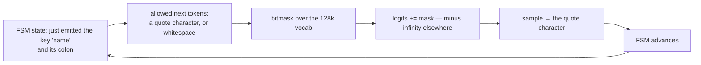
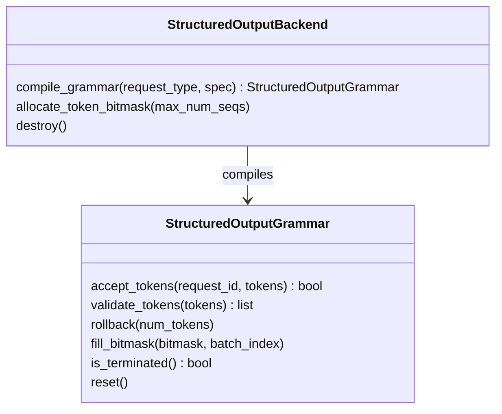
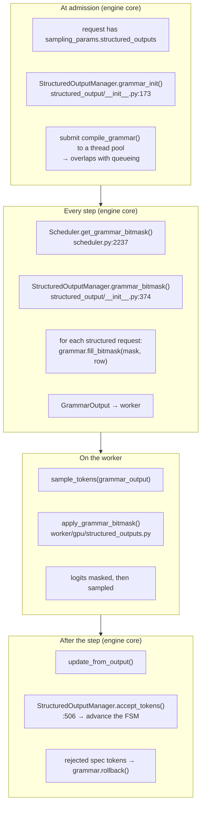

# Feature 06 — Structured Output (Guided Decoding)

> **Code**: `vllm/v1/structured_output/` (manager + backends),
> `vllm/v1/worker/gpu/structured_outputs.py` (applying the mask),
> `vllm/v1/core/sched/scheduler.py:2237` (`get_grammar_bitmask`),
> `vllm/reasoning/` (reasoning-parser interaction)

## 1. The problem

Applications need machine-readable output: a JSON object matching a schema, a function call
with the right argument types, a value from a fixed enum. Prompting for it works most of the
time, which is the worst possible failure mode — you still need a parser *and* a retry path.

The fix is to make invalid output **impossible** rather than unlikely: at every decode step,
mask out every token that cannot appear next in a valid document.

## 2. The idea

A grammar (JSON schema, regex, EBNF, or "valid JSON") compiles to a state machine. At any
state, only some vocabulary tokens keep the document valid. Build a **bitmask** over the
vocabulary — one bit per token — and apply it to the logits before sampling:

```text
logits[~allowed] = -inf
```

Sampling then cannot produce an invalid token, with no effect on the relative probabilities
of the allowed ones.



## 3. Backends

`vllm/v1/structured_output/` wraps four engines behind one interface:

| Backend | File | Notes |
| --- | --- | --- |
| XGrammar | `backend_xgrammar.py` | the default; C++ core, very fast mask generation, supports a large JSON-schema subset |
| Guidance (`llguidance`) | `backend_guidance.py` | Rust core, broad grammar support including lark-style EBNF |
| Outlines | `backend_outlines.py` | regex-first, mature |
| LM Format Enforcer | `backend_lm_format_enforcer.py` | token-prefix-based enforcement |

The contract is in `backend_types.py`:



`accept_tokens` (`:35`), `rollback` (`:65`) and `validate_tokens` (`:51`) are the interesting
three: they exist because of speculative decoding. The engine must be able to advance the
FSM over several tokens, discover that some were rejected, and *rewind*.

`StructuredOutputOptions` (`:19`) enumerates the request types: JSON schema, JSON object,
regex, grammar, choice, structural tag.

## 4. Where it hooks into the engine



### The overlap trick

In `EngineCore.step` (`vllm/v1/engine/core.py:713-718`):

```python
future = self.model_executor.execute_model(scheduler_output, non_block=True)
grammar_output = self.scheduler.get_grammar_bitmask(scheduler_output)
with self.log_error_detail(scheduler_output):
    model_output = self._wait_for_output(future)
    if model_output is None:
        model_output = self.model_executor.sample_tokens(grammar_output)
```

The forward pass is launched **first**, then the CPU builds the bitmask while the GPU is
busy, and only then does sampling happen. Mask construction — which is pure CPU work over
possibly hundreds of FSMs — is therefore free in wall-clock terms. This is why `sample_tokens`
is a separate executor call from `execute_model` at all.

### Mask layout with speculative decoding

`grammar_bitmask` (`:374`) allocates
`max_batch_size * (1 + max_num_spec_tokens)` rows (`:396`) and gives each request a
fixed-width block of `mask_stride` rows (`:387`, `:403`):

```text
mask_stride = max_num_spec_tokens + 1     (non-diffusion)
```

One row per draft position plus one for the bonus token. Each row is the mask for the FSM
state reached *if all preceding drafts in that request were accepted*.

### Parallel fill

For large batches without spec decode (`:408-440`), bitmask filling is sharded across a
thread pool in batches of `fill_bitmask_parallel_batch_size`. The FSM libraries release the
GIL in their native code, so this actually scales.

## 5. Interaction with reasoning models

A reasoning model emits free-form chain-of-thought before its answer. Constraining the
*thinking* to a JSON schema would destroy it. So the mask is applied only after reasoning
ends:

| Piece | Code |
| --- | --- |
| Detect the reasoning parser for the request | `_get_reasoner`, `structured_output/__init__.py:116` |
| Find where reasoning ended | `_masked_reasoning_ends`, `:250` |
| Decide the window in which the constraint applies | `_get_constraint_bounds`, `:275` → `ConstraintBounds` (`:41`) |

`apply_bitmask` in the fill loop (`:423`) is `constraint_start == 0` — i.e. apply the mask
only once the request is inside its constrained region.

## 6. Interaction with speculative decoding

Two extra duties:

- **Trim drafts the grammar forbids** before they are verified:
  `StructuredOutputManager.trim_spec_tokens` (`:349`).
- **Order of operations.** The bitmask for draft position *i* depends on the tokens at
  positions `< i`, which come from the drafter. `EngineCore.step_with_batch_queue`
  (`core.py:786-804`) therefore *defers* sampling when
  `scheduler_output.pending_structured_output_tokens` is set, retrieves the worker's draft
  token ids, calls `update_draft_token_ids_in_output`, and only then computes the bitmask.
  The bug fixed in `#66081` ("non-deferred structured-output draft retrieval") lived exactly
  here.

## 7. Usage

```python
from pydantic import BaseModel
from vllm import LLM, SamplingParams

class Person(BaseModel):
    name: str
    age: int

llm = LLM("Qwen/Qwen3-8B")
out = llm.generate(
    "Extract: Ada Lovelace was 36.",
    SamplingParams(
        max_tokens=100,
        structured_outputs={"json": Person.model_json_schema()},
    ),
)
```

Over HTTP, the OpenAI-compatible `response_format` field maps onto the same machinery:

```json
{
  "model": "Qwen/Qwen3-8B",
  "messages": [{"role": "user", "content": "Extract: Ada Lovelace was 36."}],
  "response_format": {
    "type": "json_schema",
    "json_schema": {"name": "person", "schema": {"...": "..."}}
  }
}
```

Backend choice: `--structured-outputs-config '{"backend": "guidance"}'` (or `xgrammar`,
`outlines`, `lm-format-enforcer`).

## 8. Costs and failure modes

| Cost | Where it lands |
| --- | --- |
| Grammar compilation | once per request, off-thread; a pathological schema can still take seconds |
| Mask fill | per request per step on the CPU, overlapped with the GPU forward |
| Mask apply | one kernel over `[rows, vocab/32]`, negligible |

| Failure mode | Cause |
| --- | --- |
| "schema not supported" | the chosen backend's JSON-schema subset does not cover a construct (`$ref` cycles, some `anyOf` forms). Try another backend |
| Output is valid but truncated | the grammar permits a valid document that hits `max_tokens` first; raise it |
| Degraded quality | over-constrained schemas can force unnatural token choices; prefer permissive schemas where possible |
| Slow first token | grammar compilation on the critical path for a huge schema |
