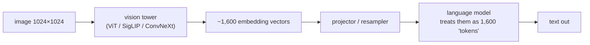
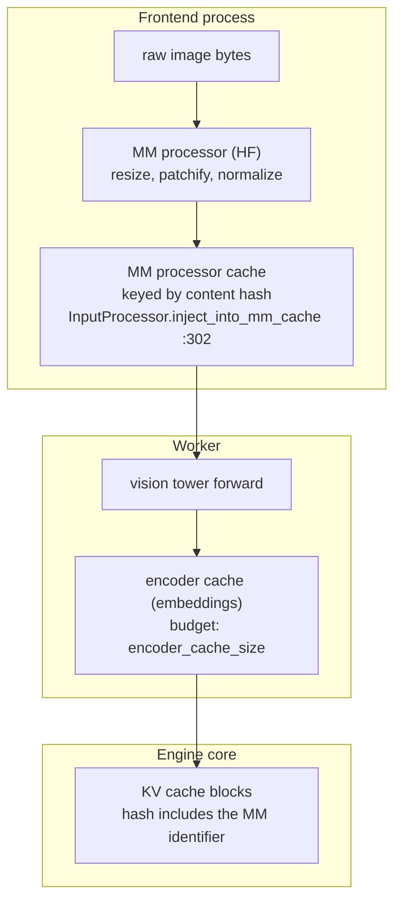
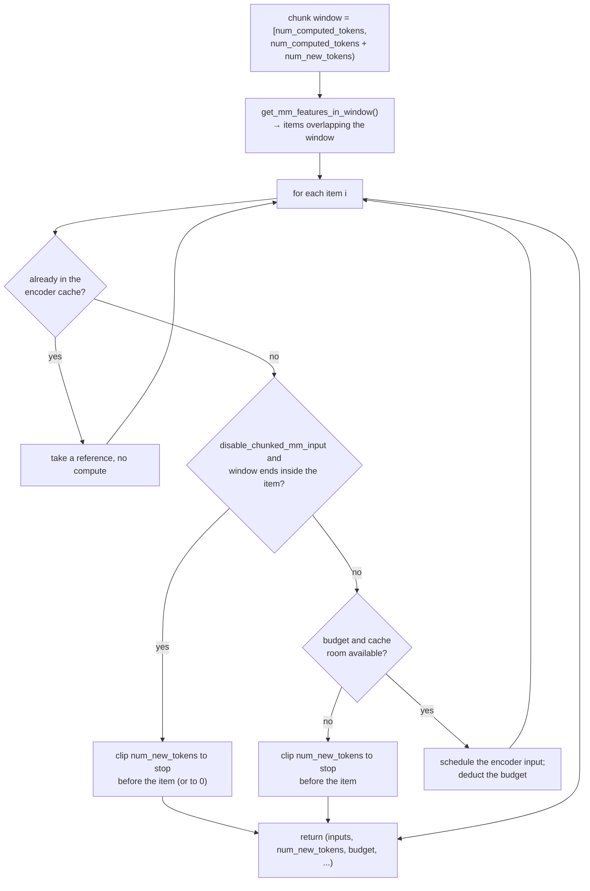

# Feature 07 — Multimodal Inputs and the Encoder Cache

> **Code**: `vllm/multimodal/` (processing, registry, hashing),
> `vllm/v1/core/encoder_cache_manager.py`,
> `vllm/v1/core/sched/scheduler.py:2041` (`_try_schedule_encoder_inputs`),
> `vllm/v1/worker/gpu/mm/`, `vllm/v1/worker/mm_encoder_model_runner.py`

## 1. The shape of the problem

A vision-language model has two stages with completely different costs:



Three awkward facts follow:

1. **One image is worth hundreds or thousands of tokens** in the LLM's sequence. A 4-image
   prompt can be 6,000 tokens before any text.
2. **The vision tower is expensive and non-incremental.** It processes the whole image in
   one pass; it cannot be chunked the way the LLM can.
3. **Embeddings are reusable.** The same image sent twice should be encoded once.

So vLLM needs a *second* cache — for encoder outputs — with its own budget, sitting
alongside the KV cache.

## 2. Prompt representation: placeholders

A multimodal prompt is still a flat token sequence. Image positions are marked by repeated
placeholder tokens, and the model's forward pass substitutes the real embeddings at those
positions.

```text
text tokens:      [ Describe ] [ this ] [ image ] [ : ]
placeholders:                                          [] × 1600
more text:                                                       [ in ] [ detail ]
```

The bookkeeping object is `MultiModalFeatureSpec` with an `mm_position`
(`offset`, `length`) and an `identifier`. The scheduler only ever sees these:

| Field | Meaning |
| --- | --- |
| `mm_position.offset` | first token index of the item in the prompt |
| `mm_position.length` | how many placeholder tokens it spans |
| `mm_position.get_num_embeds()` | how many embedding vectors it produces |
| `identifier` | content hash of the input — the cache key |

## 3. Three caches, not one



| Cache | Caches | Keyed by | Managed by |
| --- | --- | --- | --- |
| MM processor cache | pixel tensors after preprocessing | content hash | `vllm/multimodal/cache.py`, frontend |
| Encoder cache | encoder **output embeddings** | `mm_feature.identifier` | `EncoderCacheManager`, `vllm/v1/core/encoder_cache_manager.py:18` |
| KV cache | the LLM's K/V for the placeholder positions | block hash, with the MM identifier mixed into `extra_keys` | `BlockPool` |

That last row is important: `_gen_mm_extra_hash_keys`
(`vllm/v1/core/kv_cache_utils.py:512`) mixes the image's identifier into the block hash, so
two requests with identical placeholder *token ids* but different *images* cannot collide in
the prefix cache.

## 4. The encoder cache manager

`vllm/v1/core/encoder_cache_manager.py:18`. A refcounted, hash-keyed store with a fixed
budget, mirroring the block pool's design at a coarser granularity:

| Method | Line | Role |
| --- | --- | --- |
| `check_and_update_cache(request, input_id)` | `:111` | is this item already cached? if so, take a reference |
| `can_allocate(...)` | `:148` | does the budget have room for this item? |
| `allocate(request, input_id)` | `:211` | reserve space and record ownership |
| `free_encoder_input(request, input_id)` | `:259` | release one item once the LLM has consumed its positions |
| `free(request)` | `:300` | release everything a request holds (also used to undo partial reservations) |
| `get_freed_mm_hashes()` | `:312` | hashes the worker may now drop — shipped in `SchedulerOutput.free_encoder_mm_hashes` |

`EncoderDecoderCacheManager` (`:392`) is the variant for true encoder-decoder models
(Whisper), where encoder output feeds cross-attention rather than being spliced into the
decoder's token stream.

## 5. Scheduling encoder work

Every step the scheduler must decide which encoder inputs to run, under a separate
`encoder_compute_budget` (`max_num_encoder_input_tokens`). That is
`_try_schedule_encoder_inputs` (`scheduler.py:2041`), whose docstring lists the admission
conditions:

> An encoder input will be scheduled if:
>
> - Its output tokens overlap with the range of tokens being computed in this step [...]
> - It is not already computed and stored in the encoder cache.
> - It is not exist on remote encoder cache (via ECConnector)
> - There is sufficient encoder token budget to process it.
> - The encoder cache has space to store it.
>
> If an encoder input cannot be scheduled due to cache or budget limitations, the method
> adjusts `num_new_tokens` to schedule only the decoder tokens up to just before the
> unschedulable encoder input.



Two mechanisms are worth naming:

- **Clipping the decoder chunk to end before an unschedulable item.** The LLM cannot process
  placeholder positions whose embeddings do not exist yet, so the chunk is shortened. This
  keeps progress going without needing the encoder work.
- **`disable_chunked_mm_input`.** Models with *bidirectional* attention across the image
  tokens must see the whole item in one forward pass; a half-item prefill produces different
  embeddings than the full item would. The guard at `:2122` handles it — and the case where
  a **prefix cache hit lands inside the item** (so the chunk *starts* inside it, with
  nothing to roll back to) is the subject of
  [issue deep dive 4](../../issue-deep-dives/04-difficult-mm-item-split-on-prefix-hit.md).

## 6. Freeing encoder entries

Once the LLM has computed KV for all of an item's placeholder positions, the embeddings are
dead. `Scheduler._free_encoder_inputs` (`:2926`) detects that and releases them; the hashes
travel to the worker in `SchedulerOutput.free_encoder_mm_hashes` so the worker can drop its
copies.

This matters for memory: an image's embeddings are `num_embeds × hidden_size × dtype` bytes
— for 1,600 embeds at hidden size 4,096 in bf16, ~13 MB per image. A handful of concurrent
multi-image requests will exhaust a small encoder cache, at which point the scheduler starts
clipping chunks and throughput drops. `--encoder-cache-size` is the dial.

## 7. On the worker

| Piece | Code |
| --- | --- |
| Run the encoder for scheduled items, store embeddings | `vllm/v1/worker/gpu/mm/` |
| Splice embeddings into the LLM's input at placeholder positions | model's `get_input_embeddings` / `forward` |
| Encoder-only serving (embedding models for images) | `vllm/v1/worker/mm_encoder_model_runner.py` |
| CUDA graphs for the encoder | `vllm/v1/worker/encoder_cudagraph.py` |

Note the eager-mode carve-out in `execute_model`
(`vllm/v1/worker/gpu/model_runner.py:1910-1914`): encoder-decoder models run **non-compiled**
on steps that schedule encoder inputs, because that step mutates the cross-attention cache
with dynamically shaped encoder output.

## 8. Operational notes

| Flag | Effect |
| --- | --- |
| `--limit-mm-per-prompt '{"image": 4}'` | reject prompts with more items than this; also sizes profiling |
| `--max-num-encoder-input-tokens` | per-step encoder compute budget |
| `--encoder-cache-size` | embedding cache capacity |
| `--disable-chunked-mm-input` | forbid splitting an item across chunks |
| `--mm-processor-cache-gb` | frontend preprocessing cache size |

Metrics: `MultiModalCacheStats` (`vllm/v1/metrics/stats.py:174`) reports queries and hits for
the MM caches, so you can tell "encoder is slow" from "encoder cache is thrashing".
