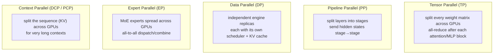
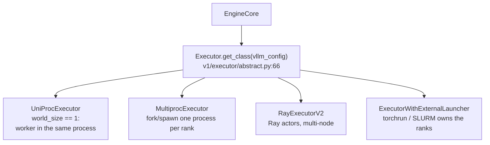
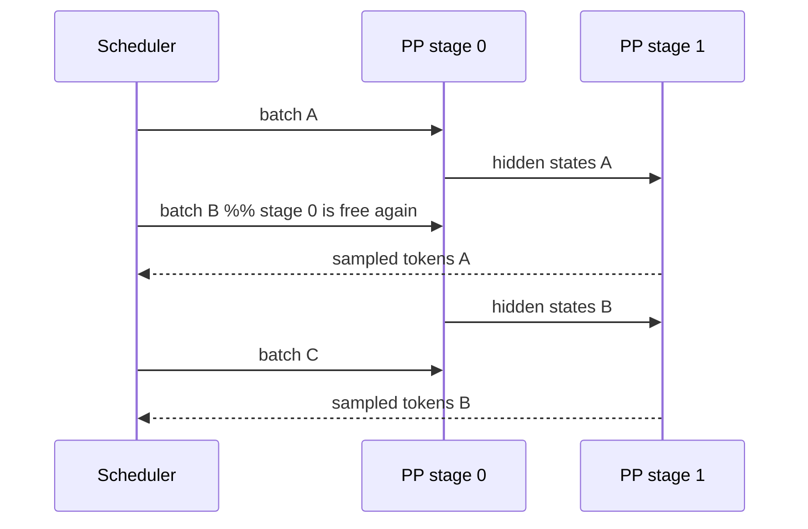
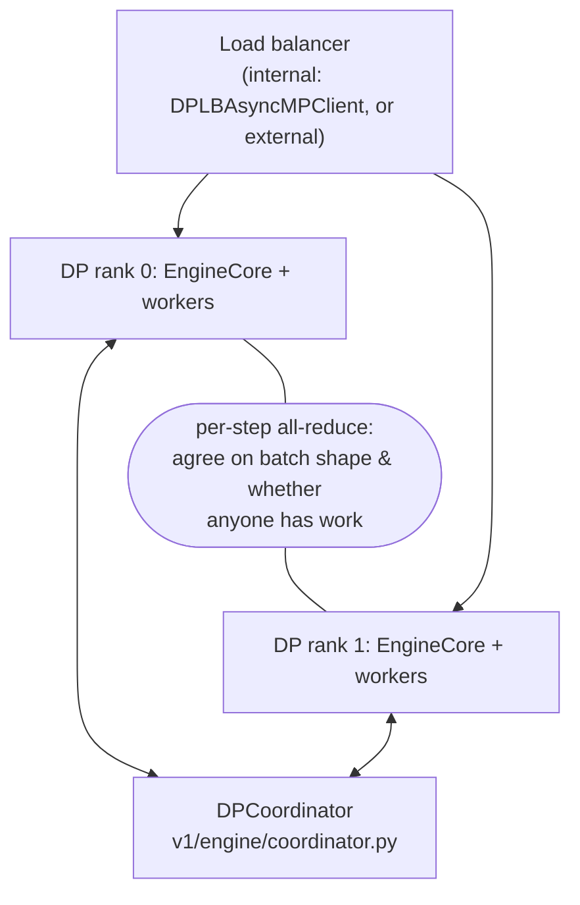
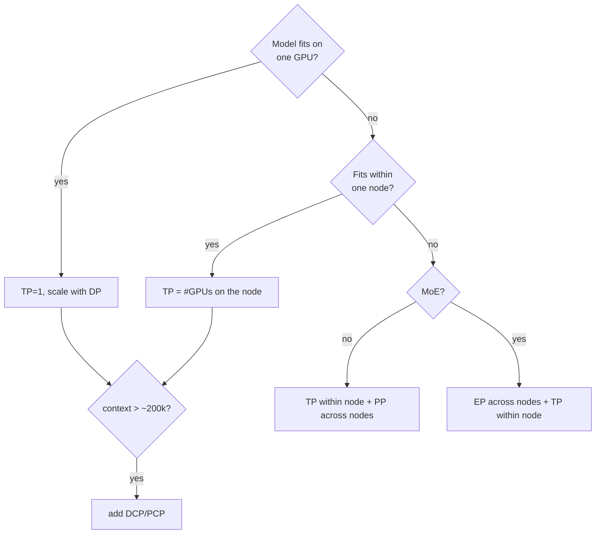

# Feature 08 — Distributed Execution and Parallelism

> **Code**: `vllm/distributed/parallel_state.py` (process groups),
> `vllm/v1/executor/` (executors), `vllm/v1/worker/gpu_worker.py` (workers),
> `vllm/model_executor/layers/linear.py` (TP sharding),
> `vllm/distributed/device_communicators/` (fast collectives)

## 1. The axes

vLLM composes several orthogonal kinds of parallelism. Understanding which axis a given
problem lives on is most of distributed debugging.



| Axis | Splits | Communication per layer | Use when |
| --- | --- | --- | --- |
| TP | weight matrices (within a layer) | 2 all-reduces per transformer block | model does not fit on one GPU; latency-sensitive |
| PP | layers | 1 point-to-point per stage boundary | model does not fit on one *node*; inter-node links are slow |
| DP | requests | none in the model; only coordination | you have spare GPUs and want throughput |
| EP | MoE experts | all-to-all in MoE layers | large sparse MoE models |
| DCP/PCP | the KV sequence | attention-internal collectives | extremely long contexts |

`world_size = TP × PP` within one engine; DP multiplies whole engines.

## 2. Tensor parallelism in the layers

TP is implemented entirely inside the linear layers
(`vllm/model_executor/layers/linear.py`), so model definitions need no TP logic:

| Layer | Shards | Needs |
| --- | --- | --- |
| `ColumnParallelLinear` | output dim | no input comm; output is sharded |
| `RowParallelLinear` | input dim | all-reduce on output |
| `QKVParallelLinear` | heads across ranks | — (column-parallel specialisation) |
| `MergedColumnParallelLinear` | fused gate/up projections | — |
| `VocabParallelEmbedding` | vocab dim | all-reduce / gather for the LM head |

```mermaid
flowchart LR
    X["hidden states<br/>(replicated)"]
    QKV["QKVParallelLinear<br/>heads split across ranks"]
    ATT["Attention<br/>each rank: its own heads,<br/>its own KV cache slice"]
    O["RowParallelLinear (o_proj)"]
    AR1(["all-reduce"])
    G["MergedColumnParallelLinear<br/>gate_up_proj"]
    ACT["SiLU · mul"]
    DN["RowParallelLinear (down_proj)"]
    AR2(["all-reduce"])
    Y["hidden states<br/>(replicated)"]

    X --> QKV --> ATT --> O --> AR1 --> G --> ACT --> DN --> AR2 --> Y
```



The KV cache is **also** sharded by TP: each rank stores only its own heads' K/V. So
`num_kv_heads` per rank is `total_kv_heads / tp_size`, which is why TP size must divide the
KV head count (or vLLM replicates KV heads to make it fit).

## 3. Process groups

`vllm/distributed/parallel_state.py` wraps `torch.distributed` in `GroupCoordinator`
(`:427`), with one accessor per axis:

| Accessor | Line | Group |
| --- | --- | --- |
| `get_world_group()` | `:1517` | everyone |
| `get_tp_group()` | `:1613` | tensor parallel |
| `get_pp_group()` | `:1665` | pipeline parallel |
| `get_dp_group()` | `:1702` | data parallel |
| `get_ep_group()` | `:1710` | expert parallel |
| `get_etp_group()` | `:1621` | expert tensor parallel |
| `get_dcp_group()` | `:1647` | decode context parallel |
| `get_pcp_group()` | `:1734` | prefill context parallel |
| `get_eplb_group()` | `:1722` | expert-parallel load balancing |

`GroupCoordinator` is more than a thin wrapper: it dispatches to the fastest available
transport per operation via `vllm/distributed/device_communicators/` —
custom all-reduce (a hand-written CUDA kernel that beats NCCL for small payloads),
NCCL/RCCL, shared-memory for intra-node, PyNCCL for graph-safe collectives, and
`torch.distributed` as the fallback.

Collectives are also exposed as **custom ops** (`all_reduce` at `:199`, `all_gather` at
`:229`, `reduce_scatter` at `:211`) with fake/meta implementations, so `torch.compile` can
trace through a TP model without the compiler trying to reason about the communication.

## 4. Executors — who owns the worker processes



`MultiprocExecutor` (`vllm/v1/executor/multiproc_executor.py:150`) is the default for
multi-GPU single-node:

- `WorkerProc` (`:743`) is the child-process wrapper. Each child sets its device, joins the
  process groups, loads its shard of weights, and enters a loop reading work items.
- Work arrives over a `MessageQueue` (shared-memory ring buffer with a ZMQ fallback), set up
  in `_init_message_queues` (`:750`).
- `execute_model` (`:431`) broadcasts the `SchedulerOutput` to all ranks and returns a
  `FutureWrapper` (`:93`) so the engine can overlap other work.
- Only the **output rank** returns sampled tokens (`_get_output_rank`, `:684`) — under PP
  that is the last stage; everyone else returns `None`.
- A monitor thread watches for worker death (`monitor_death_pipe`, `:970`); a dead worker
  takes the whole engine down rather than hanging, via the registered failure callback
  (`register_failure_callback`, `:425`).

**All ranks run the same plan.** There is no "driver computes, workers obey" asymmetry in
the scheduling sense: each rank independently derives its batch from the same
`SchedulerOutput`. This is what keeps collectives aligned — and why any rank-dependent
decision (a cache-capability probe, a shape choice, a random draw) is a potential deadlock.

## 5. Pipeline parallelism

Stage *i* computes layers `[start_i, end_i)` and sends hidden states to stage *i+1* as
`IntermediateTensors`. With one micro-batch in flight, PP is a pure loss — all but one stage
idle. The fix is several micro-batches in flight, which is what
`EngineCore.step_with_batch_queue` (`vllm/v1/engine/core.py:745`) provides.



The scheduler takes on an extra constraint here: `next_decode_eligible_step`
(`scheduler.py:793`) enforces `pp_size` steps between consecutive decodes of the *same*
request, matching the worker's sampled-token broadcast cadence:

```python
if self.current_step < request.next_decode_eligible_step:
    # PP+async: enforce `pp_size` steps between same-req decodes
    # to match worker-side sampled-tokens broadcast slot ring cadence.
```

Transport for stage boundaries lives in `vllm/distributed/pp_transport/`.

## 6. Data parallelism

Each DP rank is a **complete engine**: own scheduler, own KV cache, own workers. They do not
share memory. What they do share is a need to *step in lockstep*, because MoE expert-parallel
all-to-all and some other collectives span DP ranks.



Three mechanisms keep ranks aligned:

| Mechanism | Code |
| --- | --- |
| Agreeing on the padded batch shape and CUDA-graph bucket each step | `dispatch_cg_and_sync_dp`, `vllm/v1/worker/gpu/dp_utils.py:232` |
| Running a *dummy* batch when a rank has no work, so it still participates in collectives | `EngineCore.execute_dummy_batch`, `core.py:1207` |
| Aligning prefill cadence across ranks so one rank is not prefilling while others decode | `_should_throttle_prefills`, `core.py:694`; `defer_prefills`, `scheduler.py:749` |

Internal load balancing uses live request counts published by each engine
(`_maybe_publish_request_counts`, `core.py:1807`).

**If a DP job hangs, suspect divergence.** One rank took a different branch, so it is in a
different collective than its peers. The fixes merged in this tree for
"mismatched collectives on duplicate resume" ([#55229](../../issue-deep-dives/12-difficult-dp-duplicate-resume-hang.md)) and "offline DP ranks' collectives
aligned with async scheduling" (#64457) are both exactly this class of bug.

## 7. Expert parallelism and EPLB

For MoE models, experts are distributed across ranks; tokens are routed with an all-to-all
dispatch, experts run locally, and an all-to-all combine brings results back
(`vllm/model_executor/layers/fused_moe/`).

Real traffic routes unevenly, so some ranks get more tokens than others and the step takes
as long as the slowest rank. **EPLB** (expert-parallel load balancing,
`vllm/distributed/eplb/`) measures per-expert load and periodically *rearranges* which
expert lives on which rank. `vllm/distributed/elastic_ep/` goes further and changes the DP
size at runtime.

## 8. Context parallelism

For very long contexts, even the KV cache for one sequence may not fit, and attention over
it is slow. DCP (decode context parallel) and PCP (prefill context parallel) shard the
*sequence* across ranks; each rank attends over its shard and the partial results are
combined (`merge_attn_states`). This surfaces in the KV layer as
`resolve_dcp_kv_block_size` (`vllm/v1/core/kv_cache_utils.py:730`) — a DCP-sharded group's
hashes must be viewed at `block_size × dcp_world_size`, because each block's KV is split
across ranks (see `FullAttentionManager.find_longest_cache_hit:920`).

## 9. Choosing a configuration



Rules of thumb:

- TP needs fast interconnect (NVLink). Across PCIe or Ethernet, TP's per-layer all-reduces
  dominate; use PP instead.
- TP reduces latency (more GPUs on the same token); DP increases throughput (more tokens in
  flight). Pick by SLO.
- PP adds latency per stage boundary and needs several in-flight batches to pay off.
- DP replicates the weights, so it costs memory that TP does not.
