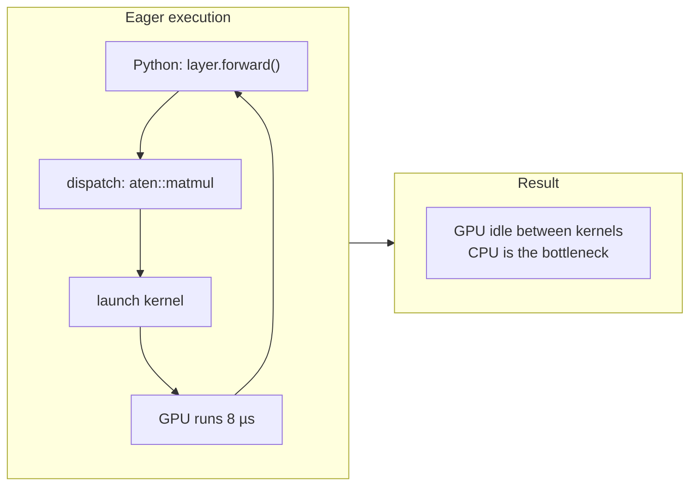
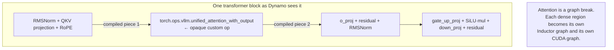
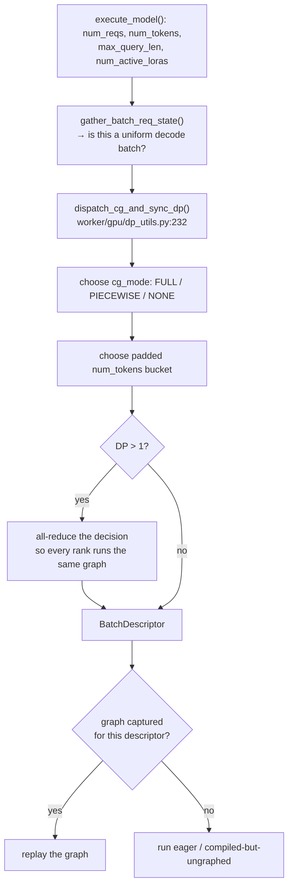
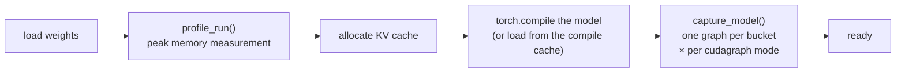

# Feature 09 — `torch.compile` and CUDA Graphs

> **Code**: `vllm/compilation/` (backends, decorators, piecewise, graph capture),
> `vllm/config/compilation.py` (`CompilationMode`, `CUDAGraphMode`),
> `vllm/v1/worker/gpu/cudagraph_utils.py`, `vllm/v1/worker/gpu/dp_utils.py:232`
> (runtime dispatch)

## 1. The problem: CPU overhead dominates decode

A decode step for a 70-layer model issues thousands of tiny CUDA kernels. Each one costs
Python interpretation, PyTorch dispatch, and a launch — single-digit microseconds, but
multiplied by thousands. For small batches the GPU finishes each kernel before the CPU can
queue the next, and the GPU starves.



Two complementary fixes:

1. **`torch.compile`** — fuse and specialise the *kernels*, removing dispatch overhead and
   memory round-trips.
2. **CUDA graphs** — record the whole launch sequence once and replay it with a single CPU
   call, removing launch overhead entirely.

vLLM uses both, and the interesting engineering is in making them coexist with a paged KV
cache whose shapes change every step.

## 2. `CompilationMode`

`vllm/config/compilation.py:38`:

| Mode | Value | Meaning |
| --- | --- | --- |
| `NONE` | 0 | fully eager |
| `STOCK_TORCH_COMPILE` | 1 | plain `torch.compile` |
| `DYNAMO_TRACE_ONCE` | 2 | one Dynamo trace, no recompilation |
| `VLLM_COMPILE` | 3 | **the default**: custom Inductor backend with caching, piecewise compilation, shape specialisation and custom passes |

## 3. How a model opts in

Models are decorated, not wrapped:

```python
@support_torch_compile          # vllm/compilation/decorators.py:120
class LlamaModel(nn.Module):
    ...
```

`support_torch_compile` (`vllm/compilation/decorators.py:120`) replaces the class's
`__call__` with a dispatcher that, on first invocation, compiles the module with vLLM's
backend and thereafter routes to the compiled artifact. `@ignore_torch_compile` (`:63`)
opts a subclass back out.

The decorator declares which argument dims are **dynamic** (the token count) so Inductor
specialises on everything else. Compilation artifacts are cached on disk, keyed by a hash of
the `VllmConfig` and the model source (`_model_hash_key`, `:265`;
`vllm/compilation/caching.py`), so a server restart does not pay compilation again.

## 4. Piecewise compilation — the central trick

Attention cannot be traced usefully: it reads the paged KV cache through a block table, its
metadata changes per step, and its kernels are hand-written. So vLLM makes attention
**opaque** and compiles everything around it.



This is why `Attention.forward`
(`vllm/model_executor/layers/attention/attention.py:594-621`) goes through
`torch.ops.vllm.unified_attention_with_output` rather than calling the backend directly, and
why attention metadata is fetched from a context variable rather than passed as an argument:
the compiler must not see it.

Implementation: `vllm/compilation/piecewise_backend.py`,
`vllm/compilation/partition_rules.py` (which ops split a graph),
`vllm/compilation/backends.py` (the Inductor driver).

### Custom passes

`vllm/compilation/passes/` adds vLLM-specific fusions on top of Inductor:
RMSNorm + quantization fusion, all-reduce + RMSNorm fusion (sequence-parallel models),
attention + quantization fusion, activation-quant fusion. These are the fusions that a
general-purpose compiler cannot know are safe.

## 5. CUDA graphs

A CUDA graph records a kernel launch sequence (and its arguments) and replays it with one
call. Requirements: **fixed shapes** and **fixed memory addresses**.

vLLM satisfies both:

- **Fixed addresses** — the persistent batch. `InputBuffers` / `InputBatch`
  (`vllm/v1/worker/gpu/input_batch.py`) and `BlockTables`
  (`vllm/v1/worker/gpu/block_table.py`) are allocated once at startup; every step writes
  *into* them. The KV cache tensors never move either.
- **Fixed shapes** — bucketing. A set of token counts is captured at startup
  (`capture_model`, `vllm/v1/worker/gpu/model_runner.py:1163`) and each real batch is padded
  up to the nearest captured bucket.

### `CUDAGraphMode` — `vllm/config/compilation.py:129`

| Mode | Behaviour |
| --- | --- |
| `NONE` | no graphs |
| `PIECEWISE` | one graph per compiled piece between attention ops; attention runs outside graphs |
| `FULL` | one graph for the entire forward pass, attention included |
| `FULL_DECODE_ONLY` | `(FULL, NONE)` — full graphs for uniform decode batches, eager for mixed batches |
| `FULL_AND_PIECEWISE` | `(FULL, PIECEWISE)` — full graphs for decode, piecewise for mixed |

The tuple-valued modes are the interesting ones: they carry **two** runtime modes and pick
between them per step (`decode_mode()` / `mixed_mode()`, `:140-145`). Full graphs are the
fastest but require the attention backend to tolerate capture — which it only does for
uniform shapes. Prefill and mixed batches fall back.

`AttentionCGSupport` (`vllm/v1/attention/backend.py:567`) is how a backend declares what it
can take, and `has_full_cudagraphs()` / `requires_piecewise_compilation()` (`:166`, `:153`)
are how the engine reconciles the user's request with the backends' capabilities.

## 6. Runtime dispatch



`BatchDescriptor` (`vllm/forward_context.py:30`) is the cache key: token count, request
count, uniformity, query length, active LoRA count. Anything that changes behaviour must be
in that key — if it is not, a batch will be dispatched to a graph that was captured under
different assumptions. The fix "Count base requests in the specialized CUDA graph LoRA key"
([#67787](../../issue-deep-dives/09-medium-lora-cudagraph-key-base-requests.md)) in this
tree is exactly a wrongly computed component in this key.

## 7. Startup cost



Capture costs time and memory: each graph holds its own kernel-argument buffers, and vLLM
measures that cost explicitly (`profile_cudagraph_memory`,
`vllm/v1/worker/gpu/model_runner.py:1143`). The ordering matters — the KV cache is allocated
*before* graphs are captured, so graph memory comes out of the remaining margin. Anything
allocated after profiling erodes it; the fix "release warmup's blocks before CUDA graph
capture" ([#66523](../../issue-deep-dives/13-difficult-extensible-kv-cache-capture-oom.md))
in this tree addresses exactly that interaction.

| Flag | Effect |
| --- | --- |
| `--enforce-eager` | disable both compilation and graphs. The first thing to try when triaging a suspected compile bug |
| `-O.mode=0..3` / `--compilation-config` | set `CompilationMode` and pass custom options |
| `--cuda-graph-sizes` | which token-count buckets to capture |
| `-O.cudagraph_mode=FULL_AND_PIECEWISE` | pick the graph strategy |

## 8. Practical consequences

- **Measure with a warm engine.** The first few steps include compilation and capture.
- **`--enforce-eager` is the bisection tool.** If a bug vanishes, it is in compilation,
  fusion, or graph capture — not in the engine logic.
- **Beware of anything shape-dependent on the Python side.** If a code path branches on a
  value that is not in the `BatchDescriptor`, graphs will be replayed under wrong
  assumptions and you get silent corruption rather than an error.
- **Padding is real work.** A batch of 3 tokens padded to a 64-token bucket does 64 tokens
  of compute. The bucket list is a trade-off between capture cost and padding waste.
- **Per-step Python work is not graphed.** Scheduling, metadata building and sampling run on
  the CPU every step regardless, which is why a stray expensive call there (see
  [issue deep dive 2](../../issue-deep-dives/02-medium-nvml-reinit-per-layer-per-step.md))
  can wreck throughput even with full graphs enabled.
