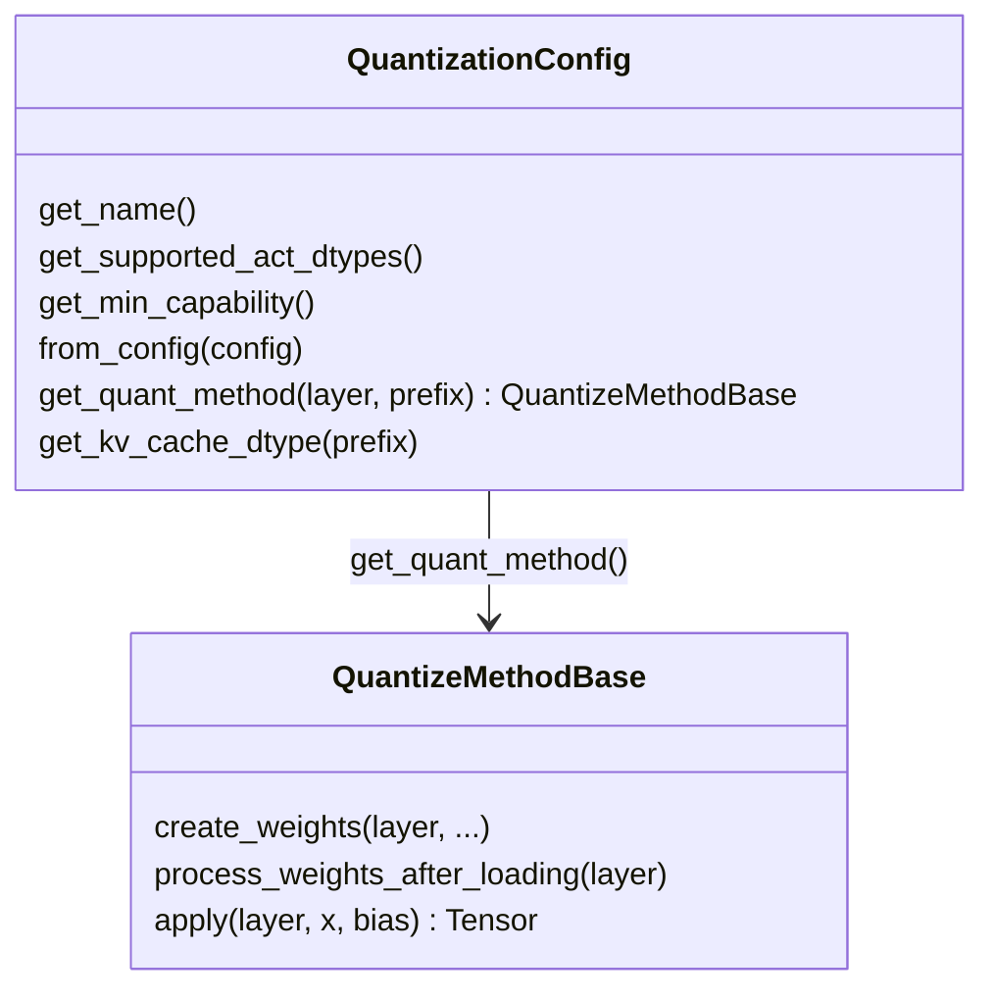
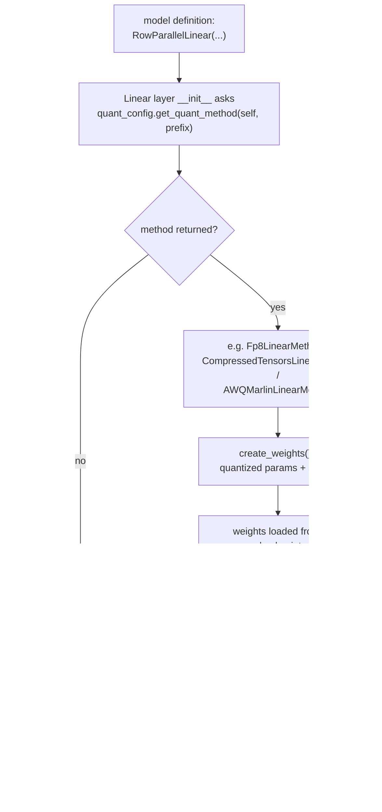
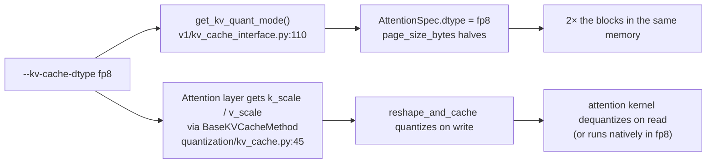

# Feature 10 — Quantization

> **Code**: `vllm/model_executor/layers/quantization/` (one module per scheme),
> `vllm/model_executor/layers/quantization/base_config.py` (the interface),
> `vllm/model_executor/layers/quantization/kv_cache.py` (KV cache quantization),
> `csrc/quantization/` (the kernels)

## 1. Why

Two independent wins:

| Target | Effect |
| --- | --- |
| **Weights** | 4× smaller at int4 vs fp16 → the model fits on fewer GPUs, and decode (weight-bandwidth-bound) gets proportionally faster |
| **Activations** | lets the matmul itself run in a lower-precision tensor-core path (fp8/int8/fp4) → higher prefill throughput |
| **KV cache** | 2× more tokens in the same memory at fp8 → more concurrent requests |

These are separate decisions. "W4A16" means 4-bit weights with fp16 activations: good for
memory-bound decode, no compute speedup. "W8A8" quantizes both and speeds up compute too.

## 2. The plug-in architecture

Every scheme implements two interfaces from
`vllm/model_executor/layers/quantization/base_config.py`:



- `QuantizationConfig` (`:121`) is parsed from the checkpoint's config
  (`get_config_filenames`, `:165`; `from_config`, `:171`) and validated against the device
  (`get_min_capability`, `:154` — e.g. fp8 needs SM89+).
- `get_quant_method(layer, prefix)` (`:215`) returns **per layer**, so a checkpoint can
  quantize attention projections but keep the LM head in fp16, or keep some experts dense.
  The `prefix` is the layer's dotted name, which is how ignore-lists work.
- `QuantizeMethodBase.create_weights` (`:47`) allocates the *quantized* parameter shapes
  plus scales/zero-points. `apply` (`:56`) calls the kernel.
- `process_weights_after_loading` (`:83`) is the repack hook: Marlin-style kernels want a
  specific interleaved layout, so the checkpoint layout is transformed once after load
  rather than per forward.

## 3. Where it attaches



The model definition is unaware of all of this. This is the single most important structural
point: **adding a quantization scheme does not require touching any model file.**

## 4. The schemes in this tree

| Module | Scheme | Typical use |
| --- | --- | --- |
| `fp8.py` | FP8 W8A8 (E4M3), per-tensor and per-channel | SM89+ (H100, L40S); the default modern choice |
| `modelopt.py`, `modelopt_block_quant.py` | NVIDIA TensorRT Model Optimizer checkpoints (FP8, NVFP4) | Blackwell-era NVFP4 |
| `mxfp4.py` | MXFP4 block-scaled 4-bit | gpt-oss-class models |
| `compressed_tensors/` | the `llm-compressor` family: W4A16, W8A8-int8, W8A8-fp8, 2:4 sparsity | Red Hat / Neural Magic checkpoints |
| `auto_awq.py`, `awq_triton.py` | AWQ W4A16 | widely available community checkpoints |
| `auto_gptq.py` | GPTQ W4A16 / W3A16 | ditto |
| `quark/` | AMD Quark | ROCm |
| `fbgemm_fp8.py` | FBGEMM fp8 | — |
| `experts_int8.py`, `moe_wna16.py`, `w4afp8.py` | MoE-specific expert quantization | large MoE models |
| `torchao.py` | TorchAO integration | experimental schemes |
| `turboquant/`, `online/`, `inc/` | runtime/online quantization | quantize at load time from an fp16 checkpoint |

Marlin / Machete / CUTLASS kernels under `csrc/quantization/` back several of these; the
Python side picks the fastest available kernel for the shape and device.

## 5. KV cache quantization

A separate axis, because the KV cache is written by the attention layer rather than by a
linear layer.



`KVQuantMode` (`vllm/v1/kv_cache_interface.py:40`) enumerates the modes, with predicates for
the awkward variants: `is_per_token_head()` (`:72`), `is_nvfp4()` (`:81`),
`is_octave()` (`:86`), `is_turboquant()` (`:95`), `is_ultraquant()` (`:105`).
`BaseKVCacheMethod` (`quantization/kv_cache.py:45`) owns the `k_scale`/`v_scale` parameters,
loaded from the checkpoint when it was calibrated or defaulted to 1.0.

Two practical notes:

- Scales live on the `Attention` module (`_init_kv_cache_quant`,
  `vllm/model_executor/layers/attention/attention.py:184`), and `set_default_quant_scales`
  (`:160`) handles checkpoints without calibration data.
- Backend support is not uniform. Not every attention backend accepts every KV dtype, and
  capability checks gate the choice — the NVML performance bug in
  [issue deep dive 2](../../issue-deep-dives/02-medium-nvml-reinit-per-layer-per-step.md)
  lived in exactly that check, on the fp8 KV cache path.

## 6. Accuracy

Rough expectations for a well-calibrated checkpoint, as a starting point for your own
evaluation:

| Scheme | Typical quality impact |
| --- | --- |
| FP8 W8A8 | near-lossless on most benchmarks |
| INT8 W8A8 (SmoothQuant-style) | small, usually acceptable |
| W4A16 (AWQ/GPTQ) | small-to-moderate; sensitive to calibration data |
| NVFP4 / MXFP4 | model-dependent; validate per model |
| KV cache fp8 | small; matters more at long context |

The repo's own validation convention is visible in the MoE refactor issue quoted in
[issue deep dive 7](../../issue-deep-dives/07-difficult-moe-padded-output-shared-expert.md):
`gsm8k` across a matrix of ~16 models, before and after. For anything that touches numerics,
that is the bar.

## 7. Usage

```bash
# Pre-quantized checkpoint — scheme is auto-detected from its config
vllm serve RedHatAI/Meta-Llama-3.1-70B-Instruct-FP8

# Force a scheme
vllm serve <model> --quantization awq_marlin

# Quantize the KV cache independently of the weights
vllm serve <model> --kv-cache-dtype fp8
```

`--quantization` is rarely needed: `QuantizationConfig.from_config` reads
`quantization_config` out of the HF config, and `override_quantization_method` (`:176`) lets
a scheme claim a checkpoint when a faster kernel is available (e.g. AWQ → AWQ-Marlin on
supported hardware).

## 8. Failure modes

| Symptom | Likely cause |
| --- | --- |
| "Quantization scheme X requires capability Y" | `get_min_capability` rejected the GPU |
| Garbage output immediately | wrong scale loading or a repack mismatch in `process_weights_after_loading` |
| Slower than fp16 | a W4A16 scheme on a prefill-heavy workload: weights are smaller but the matmul still runs at fp16 |
| Shape error in a MoE layer | padding/alignment: MoE kernels often require hidden dims aligned to a multiple, and the padding must be undone before downstream adds — exactly the bug in [issue deep dive 7](../../issue-deep-dives/07-difficult-moe-padded-output-shared-expert.md) |
