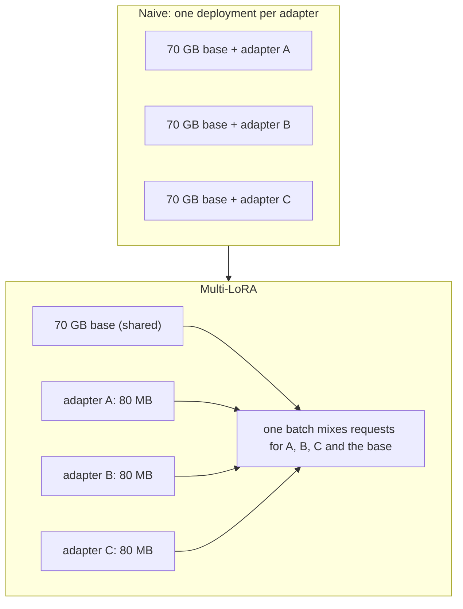
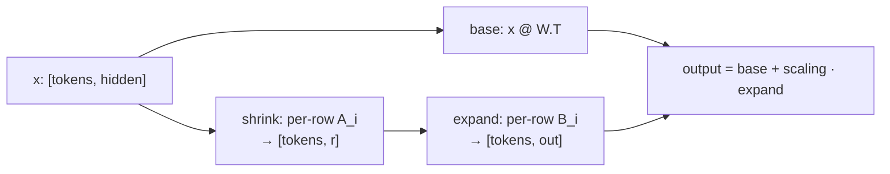
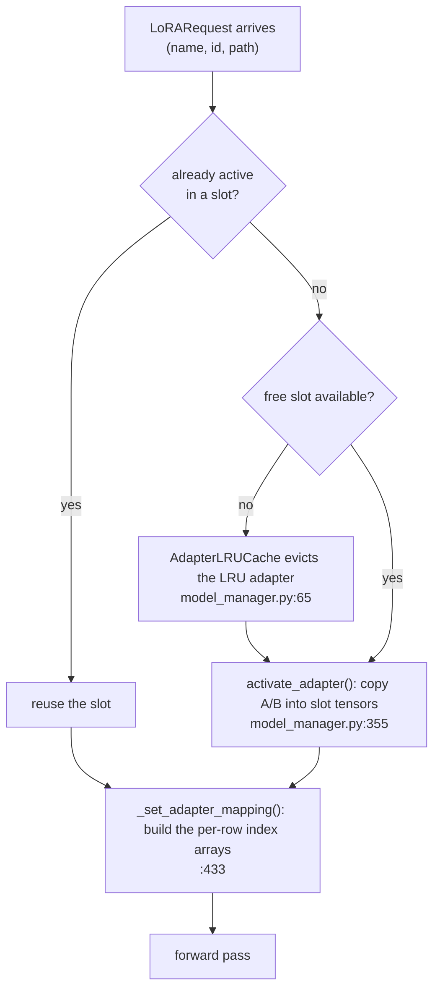

# Feature 11 — Multi-LoRA Serving

> **Code**: `vllm/lora/` (model manager, layer wrappers, Punica kernels),
> `vllm/v1/worker/lora_model_runner_mixin.py`, `vllm/v1/worker/gpu/lora_utils.py`,
> `vllm/v1/core/sched/scheduler.py:1105-1116` (the scheduling constraint)

## 1. The problem

LoRA fine-tunes a base model by learning low-rank deltas: `W' = W + B·A` where `A` is
`[r, in]` and `B` is `[out, r]`, with `r` typically 8–64. The adapter is tiny — tens of MB
versus tens of GB for the base.

If you have 50 customer-specific adapters over one base model, you do **not** want 50 copies
of the base model. You want one base model, 50 adapters resident, and the ability to serve
requests for *different adapters in the same batch*.



## 2. The hard part: heterogeneous batches

A batch has rows belonging to different adapters (and some to none). Computing
`x @ A_i.T @ B_i.T` with a Python loop over adapters would serialise the batch and destroy
throughput. The solution is **grouped/segmented GEMM** kernels — one kernel launch that
applies different small matrices to different row ranges, driven by an index array.

That is what the Punica-style kernels do (`vllm/lora/punica_wrapper/`):

| Kernel | Operation |
| --- | --- |
| `shrink` (SGMV / BGMV) | `x @ A_i.T` for each row's adapter → `[tokens, r]` |
| `expand` | `(x @ A_i.T) @ B_i.T` → `[tokens, out]`, accumulated into the base output |



The index array is built once per step from the batch's adapter assignment
(`LoraState.make_lora_inputs`, called at `vllm/v1/worker/gpu/model_runner.py:1963`).

## 3. Layer wrappers

`vllm/lora/layers/` wraps each TP-aware base layer:

| Wrapper | Wraps |
| --- | --- |
| `column_parallel_linear.py` | `ColumnParallelLinear`, `MergedColumnParallelLinear`, `QKVParallelLinear` |
| `row_parallel_linear.py` | `RowParallelLinear` |
| `replicated_linear.py` | `ReplicatedLinear` |
| `vocab_parallel_embedding.py` | embedding + LM head |
| `fused_moe.py` | MoE experts (LoRA over experts) |
| `logits_processor.py` | the LM-head path |
| `classifier.py`, `custom_layer.py` | pooling heads, model-specific layers |

`BaseLayerWithLoRA` (`vllm/lora/layers/base.py`) defines the contract; swapping happens in
`LoRAModelManager._create_lora_modules` (`vllm/lora/model_manager.py:476`), which walks the
module tree, matches target module names (`_match_target_modules`, `:812`) and replaces
matched modules in place.

Sharding interacts: a column-parallel base layer needs its LoRA `B` sharded the same way,
and a row-parallel layer needs `A` sharded. The wrappers own that, including the fiddly
packed cases (`_register_packed_modules`, `:850`;
`_create_merged_loras_inplace`, `:870`) where `q`, `k`, `v` adapters must be stacked to
match a fused `QKVParallelLinear`.

## 4. Adapter residency

`LoRAModelManager` (`vllm/lora/model_manager.py:76`) manages a fixed number of **slots** in
GPU memory:



| Config | Meaning |
| --- | --- |
| `--max-loras` | how many adapters may be **active in one batch** |
| `--max-cpu-loras` | how many are kept in host memory, swapped into slots on demand |
| `--max-lora-rank` | the largest `r` the slot tensors are sized for |

`pin_adapter` (`:426`) exempts an adapter from LRU eviction — useful for a hot default
adapter.

## 5. The scheduler constraint

This is the part that surprises people. `--max-loras` is a **hard scheduling constraint**,
not just a memory setting. From `vllm/v1/core/sched/scheduler.py:1105-1116`:

```python
if (
    self.lora_config
    and request.lora_request
    and (
        len(scheduled_loras) == self.lora_config.max_loras
        and request.lora_request.lora_int_id not in scheduled_loras
    )
):
    # Scheduling would exceed max_loras, skip.
    skip_request(request_queue)
    continue
```

`scheduled_loras` is built from **all running requests**, not just the ones scheduled this
step (`:1021-1030`), with the comment:

```python
# Record the LoRAs of all running requests, including those not
# scheduled in this step, which can join a later batch.
```

So with `--max-loras 4` and 10 adapters in flight, requests for the 5th-through-10th adapter
*wait* — they are skipped, not rejected, and admitted once a slot frees. If you see
LoRA requests with high queueing time and a mostly-idle GPU, this is why. Raise
`--max-loras` (it costs slot memory and CUDA-graph variants, not much else).

## 6. Interaction with prefix caching

The adapter is part of the KV cache's identity. `_gen_lora_extra_hash_keys`
(`vllm/v1/core/kv_cache_utils.py:580`) mixes the adapter into the block hash, so two requests
with identical tokens but different adapters cannot share blocks. Correct, and a reason
LoRA deployments see lower prefix-cache hit rates than single-model ones.

## 7. Interaction with CUDA graphs

The number of active adapters changes the kernels that run, so it must be part of the graph
dispatch key. `get_num_active_loras_for_dispatch`
(`vllm/v1/worker/gpu/lora_utils.py:38`) computes it and
`execute_model` passes it into `dispatch_cg_and_sync_dp`
(`vllm/v1/worker/gpu/model_runner.py:1902-1925`). `get_lora_capture_cases` (`:20`) decides
which LoRA counts to capture graphs for.

Getting this key wrong gives you a graph captured for one adapter count replayed for
another; [deep dive 9](../../issue-deep-dives/09-medium-lora-cudagraph-key-base-requests.md) (#67787) in
this tree is precisely that bug.

## 8. Usage

Offline:

```python
from vllm import LLM, SamplingParams
from vllm.lora.request import LoRARequest

llm = LLM("meta-llama/Llama-3.1-8B-Instruct", enable_lora=True, max_loras=4)
llm.generate(
    "Summarise:",
    SamplingParams(max_tokens=100),
    lora_request=LoRARequest("sql-adapter", 1, "/path/to/adapter"),
)
```

Server:

```bash
vllm serve meta-llama/Llama-3.1-8B-Instruct \
  --enable-lora --max-loras 4 --max-lora-rank 32 \
  --lora-modules sql=/path/to/sql-lora chat=/path/to/chat-lora
```

Then request the adapter by using its name as the `model`:

```json
{"model": "sql", "prompt": "SELECT"}
```

Adapters can also be loaded and unloaded at runtime
(`/v1/load_lora_adapter`, `/v1/unload_lora_adapter`, under
`vllm/entrypoints/serve/lora/`), and `LoRAResolver` (`vllm/lora/resolver.py`) supports
resolving an unknown adapter name on first use.

## 9. Failure modes

| Symptom | Cause |
| --- | --- |
| LoRA requests queue while the GPU is idle | `--max-loras` too low (see §5) |
| "rank exceeds max_lora_rank" | adapter's `r` is larger than configured |
| Adapter id collision / wrong adapter applied | reusing a `lora_int_id` for a different adapter — rejected at startup since #67970 |
| Startup rejection with batch-sharded sampling | some sampling paths are incompatible with LoRA and are now rejected up front (#56074) rather than failing mid-run |
| Base-model requests behave oddly in a LoRA batch | base rows must be assigned "no adapter" in the index arrays; this interacts with the CUDA-graph key (see §7) |
