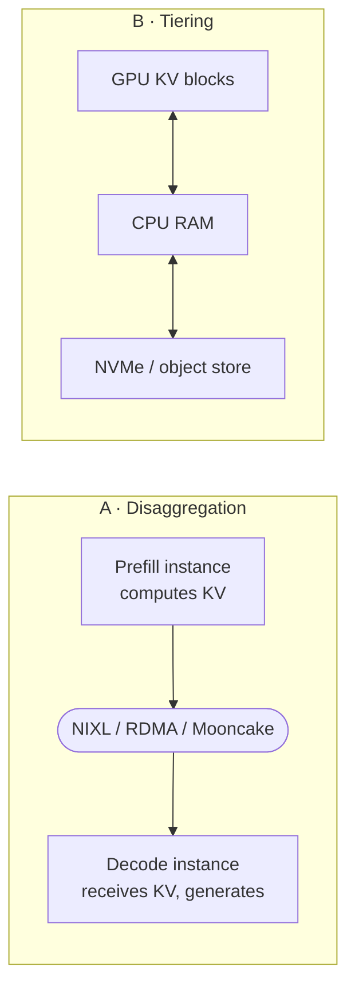
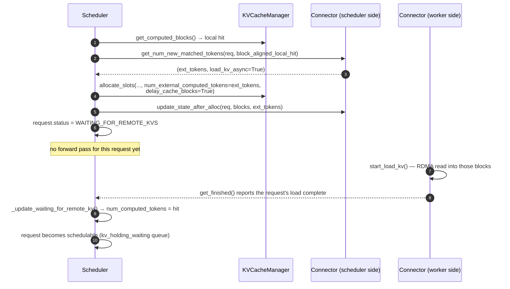
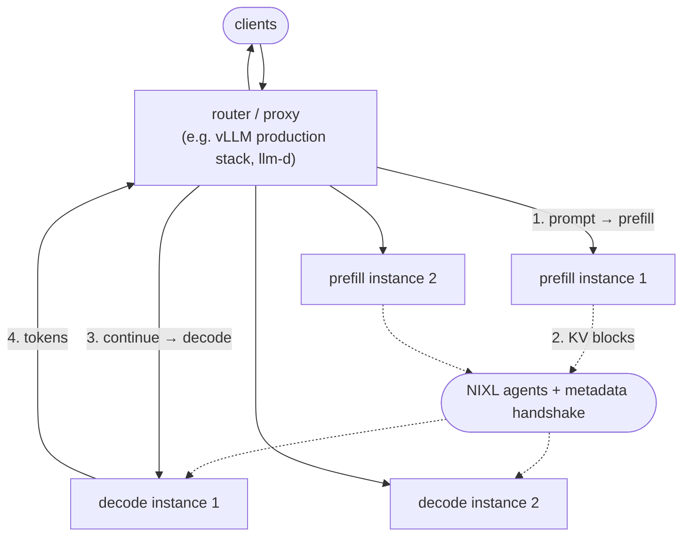
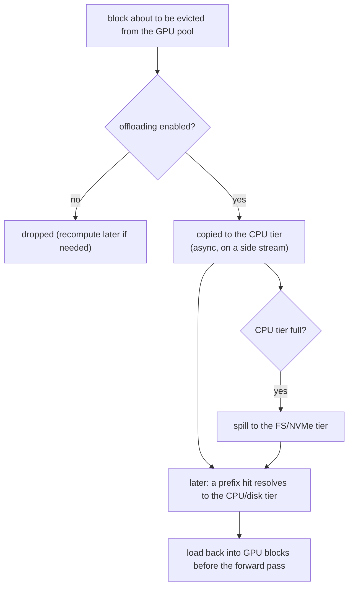

# Feature 12 — KV Connectors, Disaggregated Prefill, and KV Offloading

> **Code**: `vllm/distributed/kv_transfer/kv_connector/v1/` (connectors),
> `vllm/distributed/kv_transfer/kv_connector/v1/base.py` (the interface),
> `vllm/v1/kv_offload/`, `vllm/v1/simple_kv_offload/`,
> and the connector state machine inside `vllm/v1/core/sched/scheduler.py`

## 1. Two problems, one abstraction

**Problem A — prefill and decode want different machines.** Prefill is compute-bound and
bursty; decode is bandwidth-bound and steady. Running both on the same GPU means each
interferes with the other: a long prefill spikes everyone's TPOT, and decode's thin batches
waste the compute you bought for prefill. Separating them lets you size and scale each
independently.

**Problem B — the GPU KV cache is small.** A 1 MB/token cache on 80 GB holds maybe 60k
tokens of context. Host RAM is 10–100× larger and 10× cheaper; NVMe larger still. A
conversation resumed after 10 minutes could hit a cached prefix if that prefix were somewhere
cheaper than GPU memory.

Both are the same operation: **move KV blocks somewhere else and bring them back**. vLLM
exposes one interface for it, `KVConnectorBase_V1`.



## 2. The interface

`vllm/distributed/kv_transfer/kv_connector/v1/base.py:182`. A connector has two halves,
distinguished by `KVConnectorRole` (`:140`): a **scheduler-side** half that participates in
admission decisions, and a **worker-side** half that moves bytes.

| Method | Line | Side | Called |
| --- | --- | --- | --- |
| `get_num_new_matched_tokens(request, num_local_hit)` | `:548` | scheduler | during admission — "how many more tokens can you supply?" Returns `(tokens, load_is_async)` |
| `update_state_after_alloc(request, blocks, num_external)` | `:601` | scheduler | after `allocate_slots` succeeded — "here are the blocks to fill" |
| `start_load_kv(forward_context)` | `:365` | worker | at the start of a forward pass — kick off reads |
| `wait_for_save()` | `:418` | worker | after a forward pass — ensure writes are durable |
| `get_finished()` | `:430` | worker | which transfers completed, which failed |



The `WAITING_FOR_REMOTE_KVS` state is the crux: the request **holds blocks but runs no
forward pass**, sometimes for many steps. That creates a deadlock hazard the scheduler must
manage explicitly (see §4).

## 3. Connectors in this tree

| Connector | Transport / tier |
| --- | --- |
| `nixl/` | NVIDIA NIXL — RDMA/GPU-direct, the reference disaggregation transport |
| `mooncake/`, `mooncake_store/` | Mooncake transfer engine and KV store |
| `lmcache_connector.py`, `lmcache_integration/`, `lmcache_mp_connector.py` | LMCache — multi-tier KV caching |
| `moriio/`, `umbp/`, `flexkv_connector.py` | alternative transports |
| `hf3fs/` | distributed filesystem tier |
| `offloading/`, `offloading_connector.py`, `simple_cpu_offload_connector.py` | CPU/disk offload |
| `hisparse/` | hierarchical sparse attention tiering (hot/resident/source pools) |
| `multi_connector.py` | compose several connectors into a tier hierarchy |
| `example_connector.py` | the minimal implementation to copy when writing your own |

Also in the same family: `vllm/distributed/ec_transfer/` does the equivalent for **encoder**
caches (multimodal embeddings), and `vllm/distributed/aux_output_connector/` for auxiliary
outputs.

## 4. Why the scheduler code is complicated

The in-flight-load state introduces hazards that ordinary scheduling does not have. Each of
these is a named mechanism in `vllm/v1/core/sched/scheduler.py`:

| Hazard | Mechanism | Code |
| --- | --- | --- |
| An async load holds blocks and cannot be preempted → it can deadlock with an in-flight prefill | admit it only if it fits within `free − other in-flight reservations` | `reserved_blocks` / `_inflight_prefill_reserved_blocks`, `:1466-1476`, `:3527` |
| Too many simultaneous loads saturate the fabric | `max_async_kv_loads_per_step`, `max_num_inflight_kv_loads` | `:1056-1059`, `:1075-1082` |
| A load's blocks must not be zeroed or cached while being written | `delay_cache_blocks=True`, `skip_zeroing_group_ids` | `:1488-1493` |
| A local sub-block hit racing a longer remote hit | present a **block-aligned** local hit to the connector; truncate the partial tail if remote wins | `:1146-1201` |
| A transfer fails or returns corrupt blocks | reset `num_computed_tokens` to force recomputation | `_handle_invalid_blocks`, `:3815`; `_update_requests_with_invalid_blocks`, `:3696` |
| A decode-side preemption re-requests KV already fetched | connector-side dedup | fixed in #67497 |

The sub-block alignment comment at `:1146` is a good example of the reasoning density here:

```python
# Present a block-aligned local hit to the connector so
# a strictly longer remote hit can supersede a local
# sub-block tail without racing its copy-on-write.
```

## 5. Disaggregated serving topology



The handshake metadata (agent addresses, memory registration) is exchanged at startup;
`EngineCore._set_kv_connector_handshake_metadata` (`vllm/v1/engine/core.py:952`) publishes it
and `Executor.get_kv_connector_handshake_metadata`
(`vllm/v1/executor/abstract.py:286`) collects it from the workers.

Tuning it is a bandwidth exercise: a prefill instance producing 100k tokens/s of KV at
1 MB/token needs 100 GB/s of fabric. That is why these deployments use RDMA and why the
`#66011` ("decline remote prefill reads after the producer's KV lease expired") and `#61499`
("report failed pulls per request with several KV cache groups") fixes in this tree are
about lifetime and error reporting rather than throughput — the throughput part is the easy
part.

## 6. KV offloading (tiering)

`vllm/v1/kv_offload/` and `vllm/v1/simple_kv_offload/` implement a GPU → CPU → disk
hierarchy over the same connector interface:



The economics: loading 1 MB/token from host RAM over PCIe 5 (~50 GB/s) is far cheaper than
recomputing prefill for that token. Offloading extends the effective prefix-cache capacity
by one to two orders of magnitude, which for conversational workloads is the difference
between a 20% and an 80% hit rate.

Bugs in this area are overwhelmingly about *ordering and accounting* rather than transfer:
"return lazily offloaded GPU blocks to the eviction end" (#59383), "report the final SWA tail
in `first_live_chunk_idx`" (#68359), "report FS-tier short writes as a likely full disk"
(#66278).

## 7. Observability

| Signal | Where |
| --- | --- |
| External (connector) prefix-cache queries/hits, by source tier | `connector_prefix_cache_stats`, recorded at `scheduler.py:1539` |
| Requests by KV-fetch stage | `_kv_fetch_counts` → `SchedulerStats.num_kv_fetch_reqs_by_stage` |
| Failed receives / invalid blocks | `KVConnectorOutput.failed_recving`, `.invalid_block_ids` (`vllm/v1/outputs.py:217`) |
| Connector-specific metrics | `kv_connector/v1/metrics.py` |

## 8. Writing your own connector

Start from `example_connector.py`, implement the five methods in §2, and register it in
`kv_transfer/kv_connector/factory.py`. The invariants to respect:

1. `get_num_new_matched_tokens` must be **cheap** — it runs inside the scheduling loop, for
   every candidate request.
2. Report only tokens you can actually deliver. Over-reporting leads to blocks allocated for
   data that never arrives, and a request stuck in `WAITING_FOR_REMOTE_KVS`.
3. Respect block alignment. Partial-block hits interact with copy-on-write; the scheduler
   deliberately hands you a block-aligned figure, and expects a block-aligned answer in the
   replay-window cases (`scheduler.py:1167-1179`).
4. Report failures through `get_finished()` rather than raising. The scheduler knows how to
   recompute; it does not know how to recover from an exception in a worker thread.
