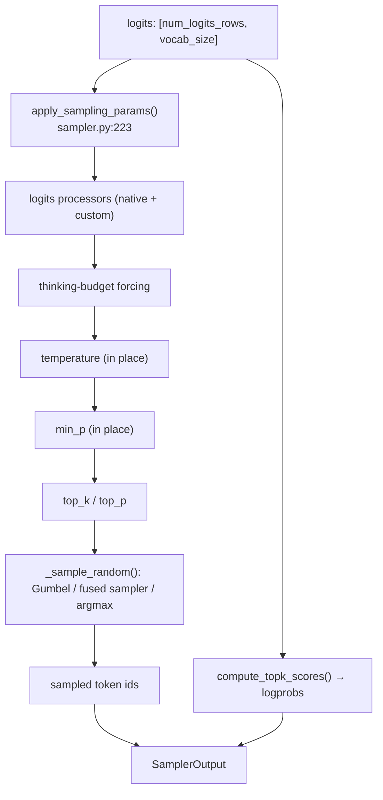

# Feature 13 — Sampling and Logits Processors

> **Code**: `vllm/v1/worker/gpu/sample/` (sampler, penalties, logprobs),
> `vllm/v1/sample/ops/` (top-k/top-p kernels),
> `vllm/sampling_params.py` (the public API), `csrc/sampler.cu` (penalty kernel)

## 1. Where sampling happens

**On the GPU, inside the model runner, in one batched pass over all requests.** Not in
Python, not per request. `GPUModelRunner.sample_tokens`
(`vllm/v1/worker/gpu/model_runner.py:2262`) calls `Sampler.__call__`
(`vllm/v1/worker/gpu/sample/sampler.py:131`).

This matters because every sampling parameter is per request, but the batch is one tensor.
So every parameter is stored as a **GPU-resident tensor indexed by batch row**
(`SamplingStates`, `vllm/v1/worker/gpu/sample/states.py`), and every operation is a batched
kernel that reads its parameters from those tensors.



## 2. The pipeline, in order

From `Sampler.apply_sampling_params` (`:223-273`). The ordering is deliberate and
load-bearing:

| Stage | Code | Notes |
| --- | --- | --- |
| Fast path | `:235` | if **no** row in the batch needs any processing, return the logits untouched |
| Upcast | `:239` | `logits` copied to fp32. Penalties and temperature on fp16 logits lose precision |
| Logits processors | `:252` | the extensible stage; see §3 |
| Thinking-budget forcing | `:257` | runs **last** among processors — comment: *"Forcing runs last so no stage can overwrite the forced end marker or weaken it by scaling"* |
| Temperature | `:260` | in place; `temperature == 0` marks a greedy row |
| `min_p` | `:265` | in place; drops tokens below a fraction of the top probability |
| `top_k` / `top_p` | `:271` | may return a new tensor |
| Sampling | `:314` | Gumbel-max, a fused backend sampler, or argmax per row |

### Why the fast path matters

`if not np.any(self.needs_logits_processing[idx_mapping_np]): return logits` — a batch of
pure-greedy requests skips the fp32 copy and every kernel. On a 128k vocab with 256 rows the
fp32 copy alone is 128 MB of traffic.

### Greedy and random in one batch

`_sample_random` (`:325`) handles mixed batches. Greedy rows are those with
`temperature == 0`; they take an argmax path (`greedy_argmax.py`) while random rows go
through Gumbel-max (`gumbel.py`) — adding Gumbel noise to logits and taking the argmax is
equivalent to sampling from the softmax, and it is branch-free and graph-friendly.

The fused-sampler eligibility check at `:304-312` is a nice illustration of the constraints:
a FlashInfer/XPU fused sampler is used **only** when there are no greedy rows, no
per-request seeds, and no need for post-processed logprobs — because the fused kernel does
not expose the intermediate distribution.

## 3. Logits processors

`vllm/v1/worker/gpu/sample/logits_processor/` plus the per-feature modules:

| Processor | File | Parameter |
| --- | --- | --- |
| Repetition / presence / frequency penalties | `penalties.py` + `csrc/sampler.cu` | `repetition_penalty`, `presence_penalty`, `frequency_penalty` |
| Logit bias | `logit_bias.py` | `logit_bias` |
| Bad words | `bad_words.py` | `bad_words` |
| `min_p` | `min_p.py` | `min_p` |
| Thinking budget | `thinking_budget.py` | forces an end-of-thinking marker after N tokens |
| Watermarking | `watermark.py`, `vllm/v1/watermarking/` | statistical watermarking of outputs |
| Trace replay | `trace_replay.py` | force a recorded token sequence (determinism testing) |

All of them share a `LogitsContext` (`sampler.py:241`) carrying the batch index mappings,
`input_ids`, positions and sequence-length bounds — everything a processor needs to know
*which* row it is working on and what that row has generated so far.

Custom processors can be registered, which is how application-specific constraints are added
without forking the sampler.

### The penalty kernel

`csrc/sampler.cu` implements `apply_repetition_penalties_`, a grid-strided kernel over
`[num_seqs, vocab_size]`. It is a nice small example of the C++ side, and the subject of
[issue deep dive 1](../../issue-deep-dives/01-medium-dual-chunk-attention-empty-batch-crash.md)
— where an empty batch (`num_seqs == 0`) produced a zero-sized grid and crashed the engine.

## 4. Logprobs

Requesting logprobs changes what the engine must keep:

| Request | Effect |
| --- | --- |
| `logprobs=k` | top-k logprobs for each **sampled** position |
| `prompt_logprobs=k` | logprobs for every **prompt** position — requires logits for the whole prompt, not just the last token |

`compute_topk_scores` (`sampler.py:174`) produces `LogprobsTensors`
(`vllm/v1/outputs.py:91`) on the GPU; `vllm/v1/engine/logprobs.py` converts them to the
public `Logprob` objects in the frontend process.

`logprobs_mode` controls *which* logits are reported: `raw_logprobs`, `processed_logprobs`,
`raw_logits`, `processed_logits`. "Raw" means before the sampling pipeline; "processed" means
after penalties/temperature/top-k. The distinction matters for anyone computing training
signals from served logprobs.

`prompt_logprobs` has an architectural consequence worth knowing:
`KVCacheManager.prefix_cache_lookup_enabled` (`vllm/v1/core/kv_cache_manager.py:250`)
*disables prefix-cache reads* for such requests, because a cache hit means those prompt
positions are never recomputed and so produce no logits.

## 5. NaN detection

`num_nans = get_num_nans(logits) if self.compute_nans else None` (`:147`), with the comment:

```python
# NOTE(woosuk): We intentionally compute num_nans before sampling to make clear
# that num_nans is computed before applying penalties and temperature.
```

Counting NaNs *before* the pipeline distinguishes "the model produced NaNs" (a weight,
quantization, or kernel problem) from "the sampling pipeline produced NaNs" (a parameter
problem). The count surfaces as `ModelRunnerOutput.num_nans_in_logits` and feeds the
corrupted-request metrics.

## 6. Parallel sampling (`n > 1`)

Handled in the **frontend**, not the engine core:
`vllm/v1/engine/parallel_sampling.py` fans one user request with `n=k` out into `k`
engine requests sharing the prompt, and merges their outputs back into a single
`RequestOutput` with `k` `CompletionOutput`s. The shared prompt hits the prefix cache, so the
duplication is cheap.

## 7. The parameters, and where each is handled

| `SamplingParams` field | Handled by |
| --- | --- |
| `temperature` | `SamplingStates.apply_temperature` |
| `top_p`, `top_k` | `vllm/v1/sample/ops/topk_topp_sampler.py`, `topk_topp_triton.py`; the CUDA top-k path is the subject of [deep dive 10](../../issue-deep-dives/10-difficult-topk-nan-sign-key.md) |
| `min_p` | `sample/min_p.py` |
| `repetition_penalty`, `presence_penalty`, `frequency_penalty` | `sample/penalties.py` + `csrc/sampler.cu` |
| `logit_bias` | `sample/logit_bias.py` |
| `bad_words` | `sample/bad_words.py` |
| `seed` | per-row seeds in `SamplingStates`; forces the non-fused path |
| `n` | frontend, `parallel_sampling.py` |
| `max_tokens`, `min_tokens`, `stop_token_ids` | engine core, `Scheduler.update_from_output` |
| `stop` (strings) | **frontend**, `OutputProcessor` — needs detokenised text |
| `logprobs`, `prompt_logprobs` | `sample/logprob.py`, `sample/prompt_logprob.py` |
| `structured_outputs` | [feature 06](06-structured-output.md) |
| `detokenize=False` | skips the detokenizer entirely |

## 8. Debugging sampling

1. **Set `temperature=0` first.** Greedy output is deterministic (up to batch-shape
   nondeterminism in the kernels), which separates "model is wrong" from "sampling is
   random".
2. **Check `logprobs` with `logprobs_mode="raw_logprobs"`** to see the model's distribution
   before any processor touched it.
3. **Watch `num_nans_in_logits`.** Non-zero means the problem is upstream of the sampler.
4. **Remember batch-shape nondeterminism.** Reduction order in a GEMM depends on batch size,
   so the same prompt in a different batch can produce a different token at a near-tie.
   `--enforce-eager` plus batch size 1 is the most reproducible configuration.
