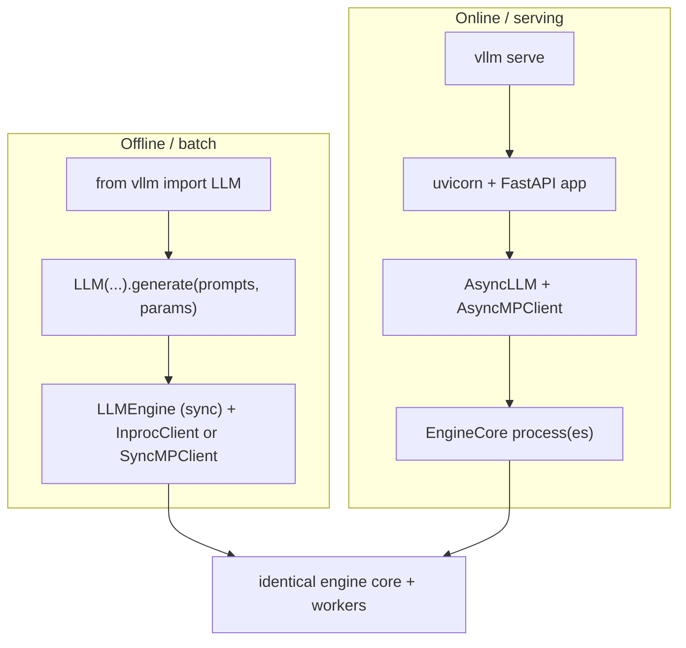
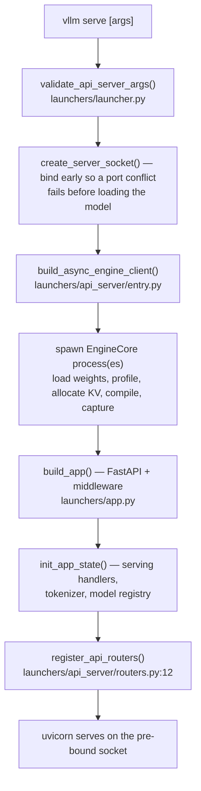
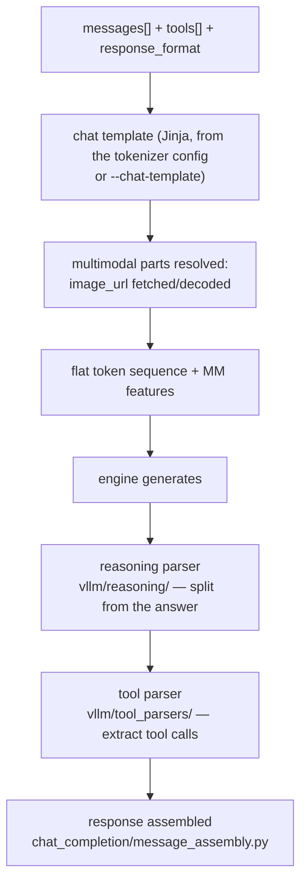
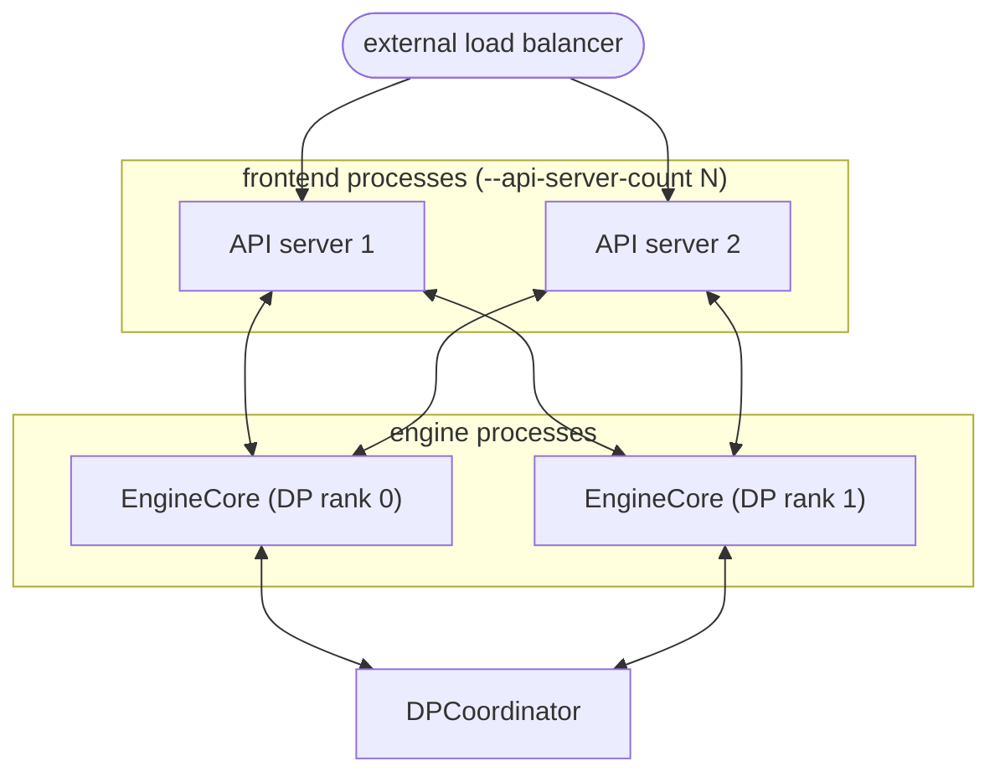

# Feature 14 — Entrypoints: `LLM`, `vllm serve`, and the HTTP Surface

> **Code**: `vllm/entrypoints/llm.py` (offline), `vllm/entrypoints/cli/` (CLI),
> `vllm/entrypoints/launchers/` (server bootstrap),
> `vllm/entrypoints/openai/` (OpenAI-compatible protocol),
> `vllm/entrypoints/serve/` (operational routes)

## 1. Two ways in



The engine below the entrypoint is the same. Choose offline for batch jobs and evaluation,
online for serving.

## 2. The offline API

`vllm/entrypoints/llm.py:62`:

```python
from vllm import LLM, SamplingParams

llm = LLM("meta-llama/Llama-3.1-8B-Instruct",
          tensor_parallel_size=2,
          gpu_memory_utilization=0.9)

outputs = llm.generate(
    ["Hello, my name is", "The capital of France is"],
    SamplingParams(temperature=0.8, max_tokens=64),
)
for out in outputs:
    print(out.outputs[0].text)
```

`LLM.generate` (`:427`) adds every prompt up front, then drives
`LLMEngine.step()` (`vllm/v1/engine/llm_engine.py:323`) in a loop until all requests finish,
with a progress bar. Because all prompts are queued before the first step, the scheduler sees
the full workload and packs batches optimally — this is why offline throughput beats serving
throughput on the same hardware.

Other methods on `LLM`: `chat()` (applies the chat template), `encode()` (pooling/embedding
models), `beam_search()`, `classify()`, `score()`, plus `sleep()`/`wake_up()` for RL
workflows that need the GPU back between rollouts.

## 3. The CLI

`vllm/entrypoints/cli/main.py` dispatches subcommands:

| Command | File | Purpose |
| --- | --- | --- |
| `vllm serve` | `cli/serve.py` | start the OpenAI-compatible server |
| `vllm chat`, `vllm complete` | `cli/openai.py` | interactive client against a running server |
| `vllm bench ...` | `cli/benchmark/` | latency / throughput / serving benchmarks |
| `vllm run-batch` | `cli/run_batch.py` | OpenAI batch-API-style offline file processing |
| `vllm collect-env` | `cli/collect_env.py` | environment report for bug reports |
| `vllm preload`, `vllm download-kernels` | `cli/preload.py`, `cli/download_kernels.py` | warm caches ahead of serving |

## 4. Server bootstrap



Routes are registered **conditionally on what the model supports**
(`routers.py:12`): `"generate" in supported_tasks` enables the completion routes, pooling
tasks enable `/pooling`, `/embeddings`, `/score`, `/classify`, and
`VLLM_SERVER_DEV_MODE` unlocks the dev and RL routers. Asking for `/v1/embeddings` on a
generate-only model gives a 404 by construction rather than a confusing runtime error.

## 5. The routes

| Route | Handler package | Notes |
| --- | --- | --- |
| `POST /v1/chat/completions` | `openai/chat_completion/` | the main path: `api_router.py` → `serving.py` → `stream_processor.py` |
| `POST /v1/completions` | `openai/completion/` | legacy text completion |
| `POST /v1/responses` | `openai/responses/` | the Responses API, incl. `harmony.py` for gpt-oss-style channels |
| `GET /v1/models` | `openai/models/` | includes LoRA adapters as models |
| `POST /v1/embeddings`, `/pooling`, `/score`, `/classify` | `entrypoints/pooling/` | pooling models |
| `POST /v1/audio/transcriptions`, `/translations` | `entrypoints/speech_to_text/` | Whisper-class models |
| `POST /tokenize`, `/detokenize` | `serve/tokenize/` | tokenizer utilities |
| `GET /health`, `/load`, `/ping` | `serve/` | liveness and load |
| `GET /metrics` | Prometheus exposition | see [feature 15](15-metrics-and-observability.md) |
| `POST /v1/load_lora_adapter`, `/v1/unload_lora_adapter` | `serve/lora/` | runtime adapter management |
| `POST /sleep`, `/wake_up`, `/reset_prefix_cache`, `/start_profile`, `/stop_profile` | `serve/dev/`, `serve/profile/` | dev-mode operations |
| `/invocations` | `serve/sagemaker/` | SageMaker compatibility |

Other protocol surfaces alongside OpenAI's: `entrypoints/anthropic/`,
`entrypoints/cohere/`, `entrypoints/grpc_server.py`, `entrypoints/mcp/` (Model Context
Protocol), and `rust/` — an experimental Rust frontend that replaces the Python HTTP layer
for lower overhead.

## 6. Chat templating, tools, and reasoning

A chat request is more than messages in, text out:



Parsers are per-model-family and selected with `--reasoning-parser` /
`--tool-call-parser`, because each family emits a different format (Hermes, Mistral, Llama
3.1 JSON, Qwen, DeepSeek-R1 `<think>`, gpt-oss channels). Streaming makes them harder: a
tool call must be parsed incrementally from a token stream, which is why
`ParserEngine` scans for the tool name incrementally (#67156 in this tree) rather than
waiting for the whole call.

## 7. Scaling the frontend



Tokenisation, detokenisation and HTTP serialisation are the frontend's bottleneck, and they
are Python. `--api-server-count` runs several frontend processes against the same engine(s);
`EngineCoreOutputs` are keyed by `client_index` so each frontend receives only its own
requests' outputs. `--data-parallel-size` scales the engines. `launchers/dp_supervisor.py`
supervises the combination.

## 8. Operational endpoints worth knowing

| Endpoint / API | Use |
| --- | --- |
| `/health` | liveness; fails if the engine core has died |
| `/load` | current load, for prefix-aware or least-loaded routing |
| `sleep()` / `wake_up()` | release GPU weights+KV between RL rollouts without restarting |
| `reset_prefix_cache()` | clear the prefix cache (succeeds only when idle) |
| `start_profile()` / `stop_profile()` | capture a torch profiler trace |
| `/v1/load_lora_adapter` | add an adapter at runtime |
| checkpoint / pause APIs | `EngineCore.pause_scheduler` (`core.py:1011`), used for weight updates in RL |

## 9. Common friction

| Symptom | Cause |
| --- | --- |
| High TTFT with low GPU utilisation | frontend CPU-bound. Raise `--api-server-count` |
| 404 on `/v1/embeddings` | the model's `supported_tasks` do not include pooling; routes are registered conditionally |
| Chat output contains raw template markers | wrong or missing chat template; pass `--chat-template` |
| Tool calls not parsed | `--tool-call-parser` not set, or set to the wrong family. Returns 400 since #63843 rather than failing silently |
| Port in use discovered after a 5-minute model load | it should not be — the socket is bound before loading (`create_server_socket`). If you see it, you are not on the `vllm serve` path |
