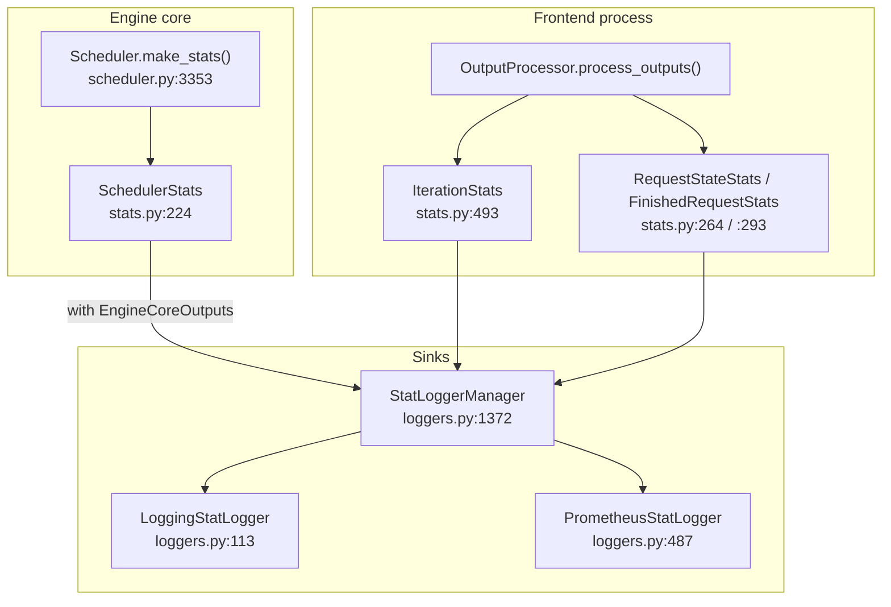
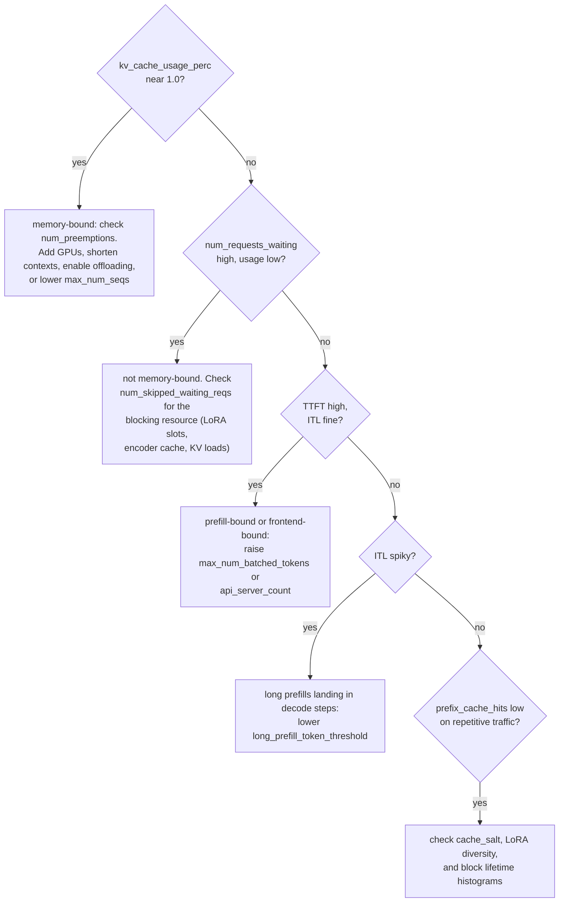

# Feature 15 — Metrics and Observability

> **Code**: `vllm/v1/metrics/stats.py` (the stat dataclasses),
> `vllm/v1/metrics/loggers.py` (logging + Prometheus),
> `vllm/tracing/` (OpenTelemetry), `vllm/profiler/`

## 1. Two streams of statistics

Everything splits into **scheduler state** (a snapshot of the engine right now) and
**iteration/request events** (things that happened).

Why the split matters: `SchedulerStats` is produced **in the engine core** and travels with
the outputs; `IterationStats` is produced **in the frontend** from those outputs. Anything
that must be counted even when a request never produces another output — a preemption
followed by an abort, for instance — has to live in `SchedulerStats`. That is exactly the
bug analysed in
[issue deep dive 3](../../issue-deep-dives/03-medium-preemption-metric-lost-on-abort.md).

## 2. `SchedulerStats` — `vllm/v1/metrics/stats.py:224`

| Field | Meaning |
| --- | --- |
| `num_running_reqs` | requests in the running batch |
| `num_waiting_reqs` | waiting and *not* deferred |
| `num_skipped_waiting_reqs` | deferred by a transient constraint (LoRA slots, encoder budget, blocked status) |
| `num_preempted_reqs` | preemptions since the previous stats, **counted at preemption time** |
| `num_kv_fetch_reqs_by_stage` | requests per KV-connector fetch stage |
| `kv_cache_usage` | fraction of blocks in use |
| `prefix_cache_stats` | local prefix-cache queries/hits |
| `connector_prefix_cache_stats` | external (connector) queries/hits |
| `kv_cache_eviction_events` | block lifetime / idle-before-evict samples |
| `spec_decoding_stats` | drafts, draft tokens, accepted tokens, per-position acceptance |
| `waiting_lora_adapters` / `running_lora_adapters` | per-adapter queue depth |
| `cudagraph_stats` | which graph bucket each step used |
| `iteration_records` | per-step prefill/decode composition (`SchedulerIterationDetails`, `:198`) |

The distinction between `num_waiting_reqs` and `num_skipped_waiting_reqs` is operationally
useful: a large *skipped* count means requests are blocked on a specific resource
(adapters, encoder cache, KV loads), not on raw capacity.

## 3. The Prometheus surface

Exposed at `GET /metrics`. The metrics defined in `loggers.py`:

### Gauges — current state

| Metric | Meaning |
| --- | --- |
| `vllm:num_requests_running` | running batch size |
| `vllm:num_requests_waiting` | queue depth |
| `vllm:num_requests_waiting_by_reason` | queue depth broken down by why |
| `vllm:num_requests_kv_fetch_by_stage` | in-flight KV fetches by stage |
| `vllm:kv_cache_usage_perc` | **the saturation signal** |
| `vllm:lora_requests_info` | per-adapter running/waiting |
| `vllm:engine_sleep_state` | sleep-mode state |
| `vllm:cache_config_info` | static config, as labels |

### Counters — cumulative

| Metric | Meaning |
| --- | --- |
| `vllm:prompt_tokens`, `vllm:generation_tokens` | token throughput |
| `vllm:prompt_tokens_cached`, `..._by_source` | how many prompt tokens came from cache, by tier |
| `vllm:prefix_cache_queries` / `vllm:prefix_cache_hits` | local prefix cache |
| `vllm:external_prefix_cache_queries` / `..._hits` | connector prefix cache |
| `vllm:mm_cache_queries` / `vllm:mm_cache_hits` | multimodal caches |
| `vllm:num_preemptions` | preemption count — **the memory-pressure signal** |
| `vllm:request_success` | finished requests, labelled by finish reason |
| `vllm:corrupted_requests` | requests that hit NaN logits |
| `vllm:admission_rejections` | requests rejected by admission control |
| `vllm:iteration_tokens_total` | tokens per engine step |

### Histograms — latency distributions

| Metric | Meaning |
| --- | --- |
| `vllm:time_to_first_token_seconds` | **TTFT** |
| `vllm:inter_token_latency_seconds` | **ITL** — gap between consecutive tokens |
| `vllm:time_per_output_token_seconds` (`vllm:request_time_per_output_token_seconds`) | **TPOT** — mean per request |
| `vllm:e2e_request_latency_seconds` | end to end |
| `vllm:request_queue_time_seconds` | time in the waiting queue |
| `vllm:request_prefill_time_seconds`, `vllm:request_decode_time_seconds`, `vllm:request_inference_time_seconds` | phase breakdown |
| `vllm:request_prompt_tokens`, `vllm:request_generation_tokens` | size distributions |
| `vllm:request_num_preemptions` | preemptions per request |
| `vllm:kv_block_lifetime_seconds`, `vllm:kv_block_reuse_gap_seconds`, `vllm:kv_block_idle_before_evict_seconds` | cache behaviour — how long blocks live, how long before reuse, how long idle before eviction |
| `vllm:request_params_max_tokens`, `vllm:request_params_n` | what clients are asking for |

Spec-decode metrics come from `SpecDecodingStats`
(`vllm/v1/spec_decode/metrics.py`): `vllm:spec_decode_num_drafts`,
`..._num_draft_tokens`, `..._num_accepted_tokens`, `..._num_accepted_tokens_per_pos`.

## 4. The log line

`LoggingStatLogger` (`loggers.py:113`) emits the periodic summary — throughput, running and
waiting counts, KV usage, prefix hit rate, preemptions. Two details:

- The interval clock restarts on empty intervals (#55474) so an idle period does not
  distort the next window's rates.
- `num_preemptions` is accumulated from `scheduler_stats`, not from `iteration_stats`
  (`loggers.py:238`) — see §1.

`AggregatedLoggingStatLogger` (`:372`) and `PerEngineStatLoggerAdapter` (`:447`) handle the
multi-engine (DP) case, aggregating or splitting per engine index.

## 5. Tracing and profiling

| Tool | Code | Use |
| --- | --- | --- |
| OpenTelemetry spans | `vllm/tracing/` | per-request spans with queue/prefill/decode timings; enable with `--otlp-traces-endpoint` |
| Torch profiler | `vllm/profiler/`, `/start_profile` + `/stop_profile` | kernel-level traces; set `VLLM_TORCH_PROFILER_DIR` |
| Iteration details | `SchedulerIterationDetails`, `stats.py:198` | per-step prefill/decode composition; `--enable-logging-iteration-details` |
| CUDA graph stats | `CUDAGraphStat` | which bucket each step dispatched to; `--observability-config` → `cudagraph_metrics` |
| KV cache events | `BlockPool.take_events`, `block_pool.py:925` | `BlockStored` / `BlockRemoved` streams for prefix-aware routers |

## 6. Reading the metrics in practice

The four numbers to put on a dashboard first: **`kv_cache_usage_perc`**,
**`num_requests_waiting`**, **`num_preemptions` rate**, and the **TTFT/ITL** histograms.
Together they distinguish every common saturation mode.

## 7. Adding a metric

1. Add the field to `SchedulerStats` (engine-core state) or `IterationStats` (frontend
   events) in `vllm/v1/metrics/stats.py`.
2. Populate it where the event happens — `Scheduler.make_stats` (`scheduler.py:3353`) for
   the former, `OutputProcessor` for the latter.
3. Register the Prometheus object in `PrometheusStatLogger.__init__` and increment it in
   `record()` / `log()` (`loggers.py:1150` onward).
4. If it is in the log line, add it to `LoggingStatLogger`.

Pick the stream carefully. If the event can occur for a request that never produces another
output — preemption, abort, eviction, rejected KV load — it **must** be in `SchedulerStats`,
or it will be silently lost.
