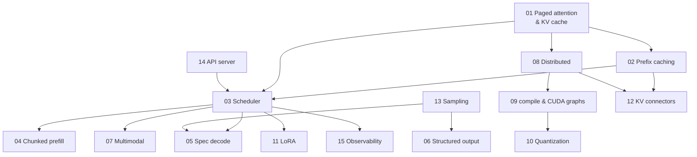

# Feature Documents

One document per major feature. Each is self-contained, starts from "what problem does this
solve", and includes at least one flowchart of the real control flow with `file:line`
anchors into this checkout.

## Core engine

| Document | Read it if you want to understand |
| --- | --- |
| [01-paged-attention-and-kv-cache.md](01-paged-attention-and-kv-cache.md) | How KV memory is blocked, allocated, and read by kernels |
| [02-prefix-caching.md](02-prefix-caching.md) | Content hashing, cache hits, eviction, hybrid-model complications |
| [03-continuous-batching-and-scheduler.md](03-continuous-batching-and-scheduler.md) | The scheduling algorithm, token budget, preemption |
| [04-chunked-prefill.md](04-chunked-prefill.md) | Why long prompts don't stall decodes |
| [05-speculative-decoding.md](05-speculative-decoding.md) | Drafters, verification, rejection sampling, acceptance metrics |
| [06-structured-output.md](06-structured-output.md) | JSON-schema / grammar-constrained generation |
| [07-multimodal-and-encoder-cache.md](07-multimodal-and-encoder-cache.md) | Images/audio/video: processing, placeholders, encoder budget |
| [13-sampling-and-logits-processors.md](13-sampling-and-logits-processors.md) | The sampling pipeline on the GPU |

## Scale-out and performance

| Document | Read it if you want to understand |
| --- | --- |
| [08-distributed-parallelism.md](08-distributed-parallelism.md) | TP, PP, DP, EP, DCP; executors and worker processes |
| [09-torch-compile-and-cudagraphs.md](09-torch-compile-and-cudagraphs.md) | Compilation modes, piecewise graphs, graph capture and dispatch |
| [10-quantization.md](10-quantization.md) | How a quantized checkpoint becomes quantized kernels |
| [11-lora.md](11-lora.md) | Serving many adapters on one base model |
| [12-kv-connectors-and-disaggregation.md](12-kv-connectors-and-disaggregation.md) | Prefill/decode disaggregation, remote and tiered KV |

## Serving surface

| Document | Read it if you want to understand |
| --- | --- |
| [14-api-server-and-entrypoints.md](14-api-server-and-entrypoints.md) | `LLM`, `vllm serve`, the HTTP layer and its processes |
| [15-metrics-and-observability.md](15-metrics-and-observability.md) | What each metric means and where it is produced |

## Dependency graph between features

Reading in this order means you never hit a forward reference:

