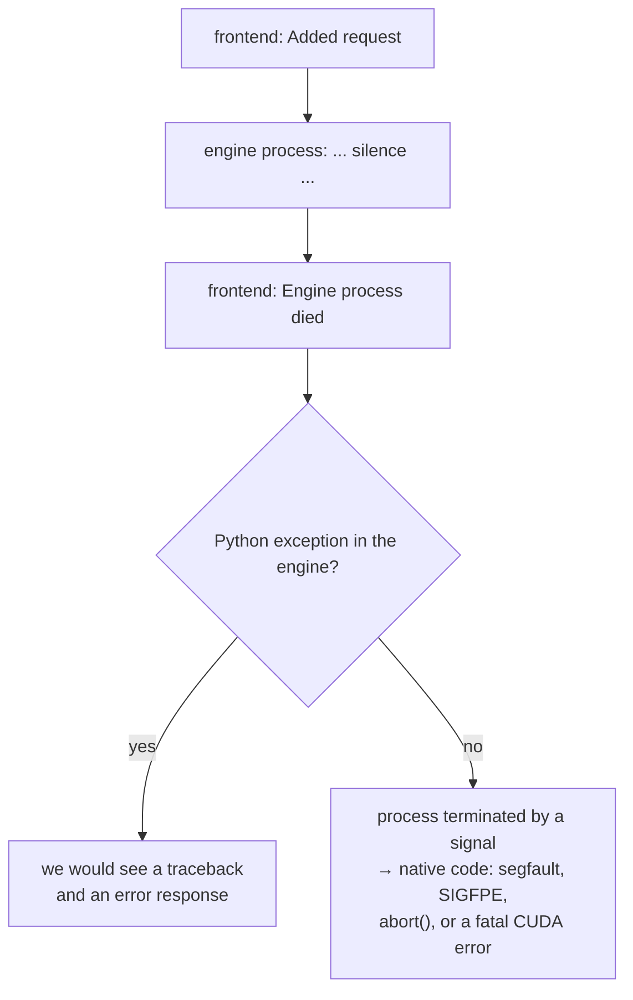
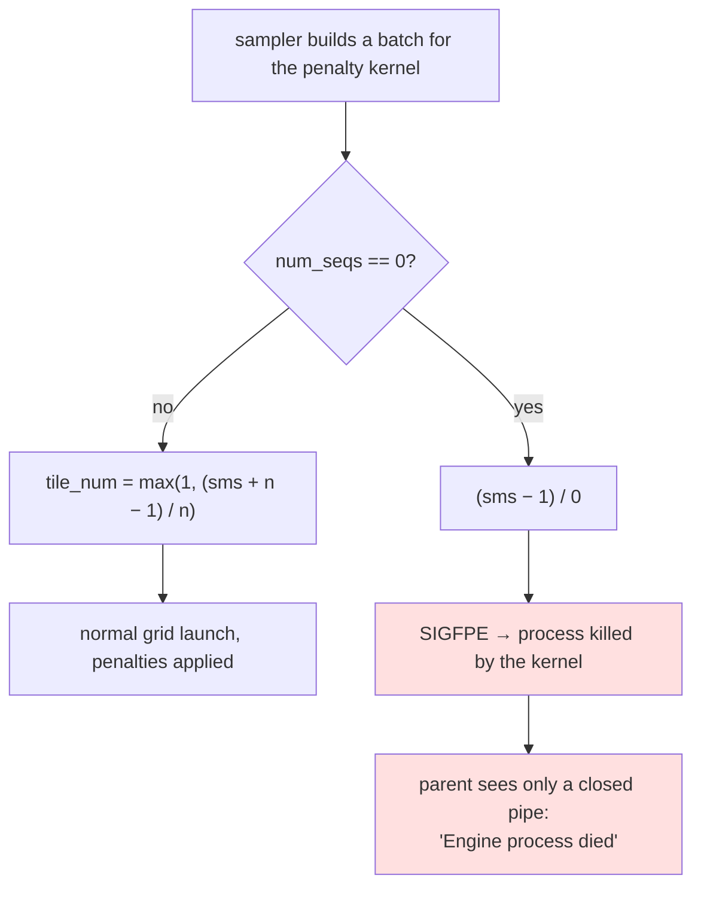

# Deep Dive 1 (Medium) — The Engine Dies on an Empty Batch

| | |
| --- | --- |
| **Issue** | [#20484 — "Since #18437 can't serve any Dual Chunked attention model"](https://github.com/vllm-project/vllm/issues/20484) |
| **Fix PR** | [#20491 — "[BUG] Fix #20484. Support empty sequence in cuda penalty kernel"](https://github.com/vllm-project/vllm/pull/20491) |
| **Fix commit** | `f73d02aadcc0c7f7b300528b32a92dca08e82138` |
| **Files touched** | `csrc/sampler.cu` (+2), `tests/kernels/test_apply_repetition_penalties.py` (+48) |
| **Difficulty** | Medium — the fix is one line; finding it means crossing from Python into a dead C++ process |

---

## 1. The symptom

A user serving `Qwen/Qwen2.5-7B-Instruct-1M` with the dual-chunk attention backend reported
that **the first request kills the server**:

```text
INFO 07-04 11:32:50 [engine.py:317] Added request chatcmpl-0ff807c9...
ERROR 07-04 11:33:12 [client.py:307] RuntimeError('Engine process (pid 3607156) died.')
ERROR 07-04 11:33:12 [client.py:307] NoneType: None
...
vllm.engine.multiprocessing.MQEngineDeadError: Engine loop is not running.
    Inspect the stacktrace to find the original error:
    RuntimeError('Engine process (pid 3607156) died.')
```

Launch command:

```bash
VLLM_ALLOW_LONG_MAX_MODEL_LEN=1 VLLM_ATTENTION_BACKEND=DUAL_CHUNK_FLASH_ATTN \
vllm serve Qwen/Qwen2.5-7B-Instruct-1M --max-model-len 140000 --max-num-seqs 1 \
  --enforce-eager --gpu-memory-utilization 0.65 --enable-prefix-caching
```

Note what the error does **not** contain: a Python traceback from inside the engine. The
engine process did not raise — it *died*. The parent only noticed the pipe closing.

The reporter also bisected it: *"Since commit `5d6d1adf` and PR #18437"*. That is the most
valuable line in the report.

## 2. Reading the symptom



"No traceback + dead process" narrows the search to native code: a kernel, a binding, or an
allocator. Combined with "this started at PR #18437", which touched the penalty kernel, the
search space collapses to `csrc/sampler.cu`.

## 3. The code

`csrc/sampler.cu`, the host-side launcher (current line numbers; the shape is unchanged
since the fix):

```cpp
void apply_repetition_penalties_(
    torch::stable::Tensor& logits,              // [num_seqs, vocab_size], in-place
    const torch::stable::Tensor& prompt_mask,   // [num_seqs, vocab_size]
    const torch::stable::Tensor& output_mask,   // [num_seqs, vocab_size]
    const torch::stable::Tensor& repetition_penalties) {  // [num_seqs]
  ...
  int vocab_size = logits.size(-1);
  int num_seqs = logits.size(0);

  if (num_seqs == 0) return;                    // ← THE FIX

  // Get number of SMs on the current device
  int sms = 0;
  cudaDeviceGetAttribute(&sms, cudaDevAttrMultiProcessorCount,
                         logits.get_device_index());

  // Compute tile_num and tile_size
  int tile_num =
      std::min(vocab_size, std::max(1, (sms + num_seqs - 1) / num_seqs));
  //                                    ^^^^^^^^^^^^^^^^^^^^^^^^^^^^^^ divides by num_seqs
  int tile_size = (vocab_size + tile_num - 1) / tile_num;

  dim3 grid(num_seqs, tile_num);
  dim3 block(std::min(tile_size, 1024));
  ...
}
```

The kernel is a tiled grid: one block row per sequence, `tile_num` block columns over the
vocabulary, with `tile_num` chosen to spread work across the SMs:

```text
tile_num = min(vocab_size, max(1, ceil(sms / num_seqs)))
```

That is a perfectly reasonable heuristic — **for `num_seqs >= 1`**.

## 4. The root cause

With `num_seqs == 0`:

```cpp
(sms + num_seqs - 1) / num_seqs   →   (132 + 0 - 1) / 0   →   integer division by zero
```

On x86-64, integer division by zero raises `SIGFPE`, which by default terminates the
process immediately — no C++ exception, no Python traceback, no stderr. Exactly what the
reporter saw.

Even had the division been survived, `dim3 grid(0, tile_num)` is an invalid launch
configuration: a grid dimension of zero is rejected by the driver.



## 5. Why *this* model and *this* backend?

The kernel is only called when the batch of rows needing penalties is non-empty — which, on
a normal path, it is. So why did a dual-chunk-attention request produce `num_seqs == 0`?

Because on that path the first step produced **no rows needing penalty application**. The
scheduler can legitimately produce a step in which the number of logits rows requiring a
given logits-processor is zero: a pure prefill chunk that does not reach the prompt end
samples nothing, and processor-specific row subsets can be empty independently of the batch
being empty.

The lesson in the "why this model" question is that it is the **wrong question to chase**.
The configuration is a *trigger*, not a cause. The cause is a kernel launcher that is
undefined at the boundary of its input domain, and it would have been hit eventually by any
configuration that produced an empty row set. Fixing it at the boundary fixes it for every
trigger, known and unknown.

## 6. The fix

```diff
--- a/csrc/sampler.cu
+++ b/csrc/sampler.cu
@@ -59,6 +59,8 @@ void apply_repetition_penalties_(
   int vocab_size = logits.size(-1);
   int num_seqs = logits.size(0);
 
+  if (num_seqs == 0) return;
+
   // Get number of SMs on the current device
   int sms = 0;
   cudaDeviceGetAttribute(&sms, cudaDevAttrMultiProcessorCount,
```

Two lines. And it is the *right* two lines, for three reasons:

1. **It is placed before any arithmetic on `num_seqs`.** Clamping `tile_num` afterwards
   would not help — the division has already happened.
2. **Returning is semantically correct.** The operation is in-place over zero rows; doing
   nothing *is* the answer. There is no "empty result" to construct.
3. **It is in the kernel launcher, not in the caller.** A fix in the Python caller
   (`if num_seqs: torch.ops._C.apply_repetition_penalties_(...)`) would protect one call
   site and leave the op a landmine for every future one.

## 7. The test

`tests/kernels/test_apply_repetition_penalties.py` — a new
`test_apply_repetition_penalties_zero_seqs`:

```python
num_seqs = 0
vocab_size = 17
...
logits = torch.randn(num_seqs, vocab_size, dtype=dtype)
prompt_mask = torch.zeros(num_seqs, vocab_size, dtype=torch.bool)
output_mask = torch.zeros(num_seqs, vocab_size, dtype=torch.bool)
repetition_penalties = torch.full((num_seqs,), repetition_penalty, dtype=dtype)

apply_repetition_penalties_torch(logits_torch, prompt_mask, output_mask, repetition_penalties)
apply_repetition_penalties_cuda(logits_cuda, prompt_mask, output_mask, repetition_penalties)
torch.testing.assert_close(logits_torch, logits_cuda, rtol=1e-3, atol=1e-3)

opcheck(torch.ops._C.apply_repetition_penalties_,
        (logits.clone(), prompt_mask, output_mask, repetition_penalties))
```

Three things this test does well:

- It mirrors the existing non-empty test exactly, so the zero case is covered by the same
  harness rather than a bespoke one.
- It compares against the **PyTorch reference implementation** rather than asserting
  "doesn't crash" — so it would also catch a future "fix" that returned garbage.
- It runs `opcheck`, PyTorch's custom-op validator (schema, aliasing, fake-tensor
  consistency), on the empty input too.

## 8. The transferable lesson

> **Guard the boundary case before you compute with it.** A kernel launcher's input domain
> includes zero.

In GPU code this class of bug is especially nasty because the failure is not an exception:

| Zero-size input reaching… | Result |
| --- | --- |
| integer division (`ceil` idioms like `(a + n - 1) / n`) | SIGFPE, process killed |
| `dim3 grid(0, …)` | invalid launch configuration |
| a reduction with no identity element | garbage or NaN |
| `.item()` on an empty tensor | exception (the *good* case) |

A practical habit: every time you write `(x + n - 1) / n` in host code, ask what happens when
`n == 0`. In this file the idiom appears twice in four lines, and the second one
(`(vocab_size + tile_num - 1) / tile_num`) is safe only because `tile_num` is clamped with
`max(1, ...)` — the author was already thinking about it for one divisor and not the other.

And on triage: **"no Python traceback" is information, not an absence of information.** It
tells you the fault is below the Python boundary, which cuts the search space by an order of
magnitude before you have read any code.
