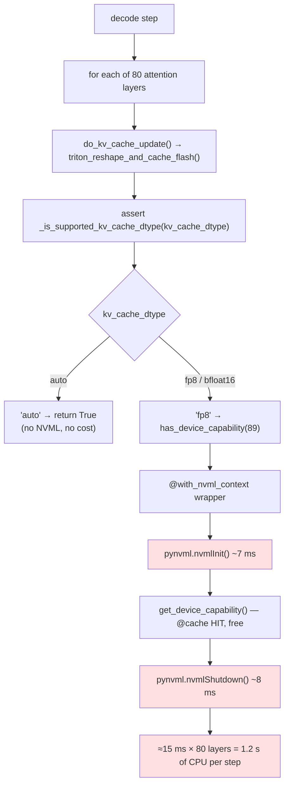

# Deep Dive 2 (Medium) — A 15 ms Library Init, Once Per Layer, Per Step

| | |
| --- | --- |
| **Issue** | [#50381 — "fp8/bfloat16 KV cache does a full NVML init+shutdown per attention layer per step"](https://github.com/vllm-project/vllm/issues/50381) |
| **Fix PR** | [#50393](https://github.com/vllm-project/vllm/pull/50393) |
| **Fix commit** | `4f76c8ad9d8ec06e91ac9c84895e07a1913d7726` |
| **Files touched** | `vllm/platforms/cuda.py` (−1 decorator, +5 comment lines), `tests/cuda/test_cuda_context.py` (+77) |
| **Difficulty** | Medium — trivial fix, but the bug is invisible unless you profile, and the *correct* fix requires knowing why the decorator was there |

---

## 1. The symptom

No crash. No wrong output. Just: **the GPU is not busy, and a third of the engine loop's CPU
samples are in NVIDIA's management library.**

From the report:

> When the KV cache dtype is `fp8` (or `bfloat16`), every KV-cache write calls
> `CudaPlatform.has_device_capability()`, which is wrapped in `with_nvml_context` but **not
> cached**. Each call therefore performs a complete `pynvml.nvmlInit()` / `nvmlShutdown()`
> cycle, measured at **~15.4 ms per call** on my machine.
>
> This runs once per attention layer per forward pass, so the cost scales with layer count
> and decode steps. In a py-spy profile of the engine-core process, `nvmlInitWithFlags` +
> `nvmlShutdown` accounted for roughly a third of engine-loop samples. GPU utilisation is
> visibly non-sustained as a result.
>
> With `--kv-cache-dtype auto` the code path is never reached, so this only affects users who
> explicitly enable an fp8 or bfloat16 KV cache.

The reporter had already done the three things that make a performance report actionable:
profiled it, isolated the trigger condition (`--kv-cache-dtype fp8`, worse with Triton
attention), and traced it to specific source lines.

## 2. The code

Two sibling methods on `NvmlCudaPlatform` in `vllm/platforms/cuda.py`, decorated
**inconsistently** — this is the whole bug:

```python
def with_nvml_context(fn):              # vllm/platforms/cuda.py:196
    @wraps(fn)
    def wrapper(*args, **kwargs):
        pynvml.nvmlInit()
        try:
            return fn(*args, **kwargs)
        finally:
            pynvml.nvmlShutdown()
    return wrapper
```

```python
    @classmethod
    @cache                          # ← cached
    @with_nvml_context
    def get_device_capability(cls, device_id: int = 0) -> DeviceCapability | None:
        ...

    @classmethod
                                    # ← NOT cached
    @with_nvml_context
    def has_device_capability(cls, capability, device_id: int = 0) -> bool:
        try:
            return super().has_device_capability(capability, device_id)
        except RuntimeError:
            return False
```

And the base implementation that `super()` resolves to
(`vllm/platforms/interface.py:541`):

```python
    def has_device_capability(cls, capability, device_id: int = 0) -> bool:
        current_capability = cls.get_device_capability(device_id=device_id)
        if current_capability is None:
            ...
```

So `has_device_capability` **does nothing but call `get_device_capability`**, which is
already cached *and* already brings its own NVML context. The outer `@with_nvml_context`
protects a body that never touches NVML directly.

## 3. The hot path

Why is a capability probe on the forward path at all?
`vllm/v1/attention/ops/triton_reshape_and_cache_flash.py:19`:

```python
def _is_supported_kv_cache_dtype(kv_cache_dtype: str) -> bool:
    if not (kv_cache_dtype in _NATIVE_KV_CACHE_DTYPES
            or is_quantized_kv_cache(kv_cache_dtype)):
        return False
    if kv_cache_dtype.startswith("fp8"):
        return current_platform.has_device_capability(89) or current_platform.is_xpu()
    if kv_cache_dtype == "bfloat16":
        return current_platform.has_device_capability(80) or current_platform.is_xpu()
    return True      # ← "auto" returns here, never touching NVML
```

and `:418`:

```python
    assert _is_supported_kv_cache_dtype(kv_cache_dtype), (
        f"Triton reshape..."
```

An **assert**, inside the Triton reshape-and-cache entry point, which the attention
implementation calls for **every layer on every forward pass**.



The cached `get_device_capability` in the middle is the irony: the *expensive* part was
already optimised away, and the wrapper around the *free* part is what cost 15 ms.

## 4. The fix

```diff
--- a/vllm/platforms/cuda.py
+++ b/vllm/platforms/cuda.py
@@ -741,12 +741,16 @@ class NvmlCudaPlatform(CudaPlatformBase):
             return None
 
     @classmethod
-    @with_nvml_context
     def has_device_capability(
         cls,
         capability: tuple[int, int] | int,
         device_id: int = 0,
     ) -> bool:
+        # No @with_nvml_context here: the base implementation only reads
+        # get_device_capability(), which is cached and brings its own NVML
+        # context. Wrapping this method as well cost an nvmlInit()/
+        # nvmlShutdown() pair on every call, including calls made per attention
+        # layer per step from the Triton reshape-and-cache path.
         try:
             return super().has_device_capability(capability, device_id)
         except RuntimeError:
```

**Remove the decorator. Add a comment explaining why it is absent.**

### Why not just add `@cache`?

That was the obvious alternative and it would have removed the cost too. It is worse:

| Approach | Problem |
| --- | --- |
| `@cache` on `has_device_capability` | Caches a *derived* predicate keyed on `(capability, device_id)` — unbounded in the first argument, and it would still pay the NVML cost on each distinct capability value. It also leaves the misleading decorator in place |
| Hoist the check out of the hot path | Correct and complementary, but a bigger change, and the landmine stays for every other caller of `has_device_capability` |
| **Remove the redundant decorator** | Removes the cost at its source. The method becomes a pure delegation to a cached function, which is what it always claimed to be |

### Why the comment is part of the fix

An absent decorator is invisible. The next person tidying this class will see
`get_device_capability` wrapped and `has_device_capability` not, conclude it is an
oversight, and "fix" it — reintroducing a 15 ms call on the forward path. The comment is
load-bearing: it encodes *why* the asymmetry is correct. This is the right instinct whenever
a fix consists of deleting something.

## 5. The test

`tests/cuda/test_cuda_context.py` (new, 77 lines). The interesting part of the design: it
does not assert a timing threshold (flaky). It asserts a **call count** — that
`has_device_capability` does not invoke `nvmlInit`, by instrumenting the NVML entry points.

That is the right shape for a performance-regression test: timing tests are flaky and
machine-dependent; counting the operation you care about is deterministic.

## 6. The transferable lesson

> **On a per-step path, "cheap-looking" is not cheap. Measure what the hot loop actually
> calls.**

Specifics worth generalising:

1. **Library init/teardown is never cheap.** `nvmlInit()`/`nvmlShutdown()`, CUDA context
   creation, opening a device file, loading a driver module — these are hundreds to thousands
   of times more expensive than they look at a call site. Initialise once per process.

2. **Decorator stacking hides cost.** `@classmethod @cache @with_nvml_context` reads as
   three independent concerns, but their *order* and *presence* determine whether the
   expensive part runs. Two sibling methods differing by one decorator is a smell worth
   checking every time.

3. **A capability probe on a per-layer path is a design error regardless of cost.** Device
   capability cannot change during a process's lifetime. It belongs in a startup check or a
   module-level constant, not in an assertion inside a kernel wrapper. The merged fix removed
   the cost; the deeper fix is to resolve such predicates once at initialisation.

4. **Conditional hot paths hide from benchmarks.** `--kv-cache-dtype auto` returns before
   touching NVML, so the default configuration — and therefore CI and most benchmarking —
   never saw this. When a bug only manifests under a non-default flag, ask which other
   flag-gated paths are unexercised.

A useful habit from this one: when GPU utilisation is low and `nvidia-smi` shows gaps, profile
the **engine-core process with py-spy** before reaching for a GPU profiler. Per-step Python
and native-library overhead does not show up in a CUDA trace at all — it shows up as *absence*
of work, which is exactly the hardest thing to see.
