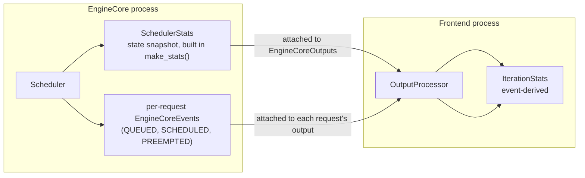
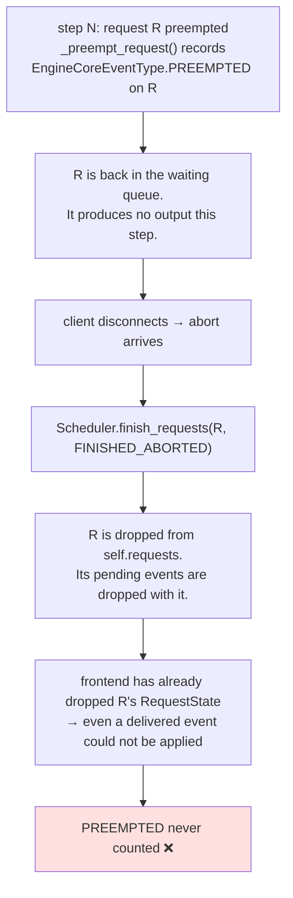
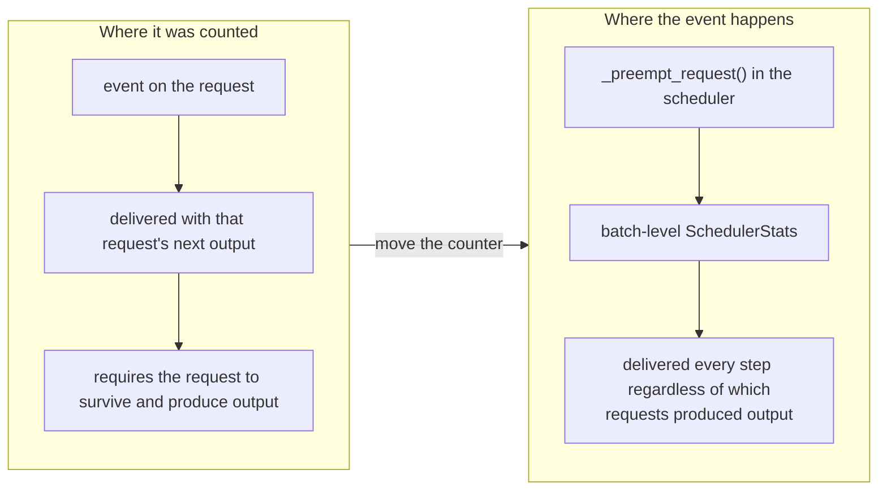

# Deep Dive 3 (Medium) — A Metric That Undercounts Exactly When You Need It

| | |
| --- | --- |
| **PR** | [#65317 — "[Bugfix][Metrics] Count preemptions in the scheduler, not on resume"](https://github.com/vllm-project/vllm/pull/65317) |
| **Fix commit** | `2be71b1831385115258a3158103ae0a711e3e037` |
| **Files touched** | `vllm/v1/core/sched/scheduler.py` (+6), `vllm/v1/metrics/loggers.py` (±8), `vllm/v1/metrics/stats.py` (+4/−2), `tests/v1/core/test_scheduler.py` (+52), `tests/v1/metrics/test_logging_stat_logger.py` (±3) |
| **Difficulty** | Medium — small diff, but it requires understanding the **two-stream statistics architecture** to see why the old location could not work |

---

## 1. The symptom

`vllm:num_preemptions` — the metric you look at to decide whether your deployment is
memory-saturated — **was too low**, and most wrong under exactly the conditions where
preemptions matter: heavy load with clients that disconnect.

From the PR:

> `vllm:num_preemptions` is counted from the request's `PREEMPTED` event, which only reaches
> the frontend with that request's next output. So a request that is preempted and then
> aborted before it resumes is never counted, and the rest are counted late.

Measured, with 2 real preemptions per run:

| Counted | main | with the fix |
| --- | --- | --- |
| 1 API server | 0, 1, 2, 2 | 2, 2, 2, 2 |
| 2 API servers | 0, 1, 1, 2 | 2, 2, 2 |
| no aborts (7 real) | 7 | 7 |

Note the last row: **without aborts, `main` was correct.** That is why this survived. The
bug only appears when a preempted request never comes back — and a load test with
well-behaved clients never produces that.

## 2. Background: the two statistics streams

vLLM produces stats in two places (see
[feature 15](../docs-intro/features/15-metrics-and-observability.md)):



The distinction that matters: **`SchedulerStats` travels with the batch; `EngineCoreEvent`s
travel with an individual request's output.**

A request's events are delivered *inside that request's `EngineCoreOutput`*. No output, no
events.

## 3. The root cause

`PREEMPTED` was counted in the frontend, from the event stream
(`vllm/v1/metrics/stats.py`, pre-fix):

```python
elif event.type == EngineCoreEventType.PREEMPTED:
    self.num_preempted_reqs += 1          # ← removed by this PR
    req_stats.num_preemptions += 1
    lora_states.request_waiting(req_id, lora_name)
```

Now trace the lifetime of a request that is preempted and then aborted:



And for a request that *does* resume, the count still arrives **late** — on the step that
produces its next token, which may be many steps after the preemption. A Prometheus scrape
in between reports the wrong value, and a rate() over a short window attributes the
preemptions to the wrong moment.

The PR states the structural reason plainly:

> An aborted request's events can't be applied on the frontend, which has already dropped
> it, so counting in the scheduler is the simpler fix.



## 4. The fix

Three coordinated edits.

**(a) A counter in the scheduler, drained on read** — `vllm/v1/core/sched/scheduler.py`:

```diff
@@ -252,6 +252,9 @@ class Scheduler(SchedulerInterface):
         # IDs of requests preempted since the last call to schedule().
         self.reset_preempted_req_ids: set[str] = set()
 
+        # Preemptions since the last make_stats(), for the preemption counter.
+        self._num_preempted_reqs = 0
+
```

```diff
@@ -1857,6 +1860,7 @@ class Scheduler(SchedulerInterface):
         request.num_output_placeholders = 0
         request.num_preemptions += 1
         if self.log_stats:
+            self._num_preempted_reqs += 1
             request.record_event(EngineCoreEventType.PREEMPTED, timestamp)
```

```diff
@@ -3375,10 +3379,12 @@ class Scheduler(SchedulerInterface):
         num_running, num_waiting = self.get_request_counts()
         num_deferred = len(self.deferred_waiting)
+        num_preempted_reqs, self._num_preempted_reqs = self._num_preempted_reqs, 0
         return SchedulerStats(
             num_running_reqs=num_running,
             num_waiting_reqs=num_waiting - num_deferred,
             num_skipped_waiting_reqs=num_deferred,
+            num_preempted_reqs=num_preempted_reqs,
```

The swap idiom `a, self._x = self._x, 0` reads **and resets** atomically with respect to the
engine's single-threaded loop. `SchedulerStats.num_preempted_reqs` is therefore a *delta
since the last stats*, not a running total — which is what a Prometheus counter wants to be
`inc()`-ed by.

**(b) The field** — `vllm/v1/metrics/stats.py`:

```diff
     num_skipped_waiting_reqs: int = 0
+    # requests preempted since the previous stats, counted at preemption time
+    num_preempted_reqs: int = 0
```

and the old frontend counter is **deleted**, both its initialisation and its increment. This
matters: leaving a dead field would invite someone to wire it back up.

**(c) Both sinks read from the new place** — `vllm/v1/metrics/loggers.py`:

```diff
-        self.num_preemptions += iteration_stats.num_preempted_reqs
...
         if scheduler_stats is not None:
+            self.num_preemptions += scheduler_stats.num_preempted_reqs
```

```diff
         if scheduler_stats is not None:
+            self.counter_num_preempted_reqs[engine_idx].inc(
+                scheduler_stats.num_preempted_reqs
+            )
...
-        self.counter_num_preempted_reqs[engine_idx].inc(
-            iteration_stats.num_preempted_reqs
-        )
```

### What was deliberately *not* changed

From the PR:

> The `PREEMPTED` event stays as it is for the interval metrics (#13169); only the counter
> moves. [...] `vllm:request_num_preemptions` is unchanged.

The per-request event still drives the per-request histogram and the LoRA waiting/running
state. Two consumers with different requirements: the **aggregate counter** needs
completeness (count every preemption, now), while the **per-request histogram** is inherently
about requests that completed, so the event stream is the correct source for it. The fix
splits them rather than migrating both.

## 5. The test

`tests/v1/core/test_scheduler.py::test_preemption_of_aborted_request_is_counted` — a
precise reconstruction of the failing scenario on CPU, with no model:

```python
# 10 usable blocks: two 80-token requests fill them, so the second request
# is preempted when the first one needs a new block.
scheduler = create_scheduler(max_num_batched_tokens=100, block_size=16,
                             num_blocks=11, enable_prefix_caching=False)
first, second = create_requests(num_requests=2, num_tokens=80, block_size=16)
...
preempting_output = scheduler.schedule()
assert second.status == RequestStatus.PREEMPTED
scheduler.finish_requests([first.request_id, second.request_id],
                          RequestStatus.FINISHED_ABORTED)
# A step with no request outputs still carries the stats.
engine_core_outputs = scheduler.update_from_output(preempting_output,
                                                   ModelRunnerOutput(req_ids=[], ...))
eco = next(iter(engine_core_outputs.values()))
assert not eco.outputs                                   # ← no request outputs at all
assert eco.scheduler_stats.num_preempted_reqs == 1       # ← but the count is there

next_stats = scheduler.make_stats()
assert next_stats.num_preempted_reqs == 0                # ← and it was drained
```

Three properties asserted, each one load-bearing:

1. `assert not eco.outputs` — the step produced **no request outputs**, which is precisely
   the condition under which the old implementation lost the count.
2. `num_preempted_reqs == 1` — the count survived anyway.
3. The follow-up `make_stats()` returns `0` — the drain-on-read semantics hold, so a
   Prometheus counter is not double-incremented.

The PR reports: `main: failed (SchedulerStats has no num_preempted_reqs)` /
`this PR: passed`. Writing the test so that it fails on `main` for the *right* reason is the
discipline that makes a metrics fix reviewable at all.

## 6. The transferable lesson

> **Count an event where it happens, not where you happen to be observing.**

The general shape: a counter was attached to a **delivery channel** (per-request outputs)
rather than to the **occurrence** (the scheduler's preemption path). Any event whose subject
may disappear before the next delivery will be undercounted, and the undercount correlates
with load — the one regime where the metric is load-bearing.

Checklist for any new counter:

| Question | If the answer is bad |
| --- | --- |
| Can the subject of the event vanish before the next delivery? | Count at the source, in state that outlives the subject |
| Is the count delivered on *every* step, or only when something else happens? | Attach it to a batch-level stats object |
| Is it a total or a delta? Who resets it? | Drain-on-read for counter sinks; totals for gauges |
| Does an idle interval distort it? | See the companion fix "restart the logging interval clock on empty intervals" (#55474) |
| Are there several consumers with different completeness needs? | Split the sources, as this PR did, rather than compromising both |

And a broader point: **metrics bugs are hard to notice because the system keeps working.**
Nothing crashes, nothing is slow, no user complains — you simply make capacity decisions
from a number that is wrong in the direction of complacency. The defence is to validate
metrics against ground truth once, deliberately, the way this PR did with a temporary log
line printing the true count.
