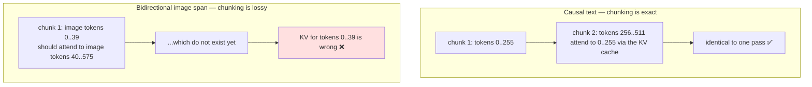
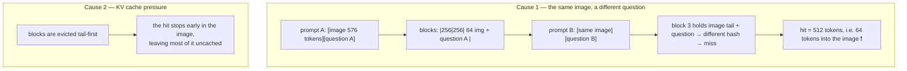
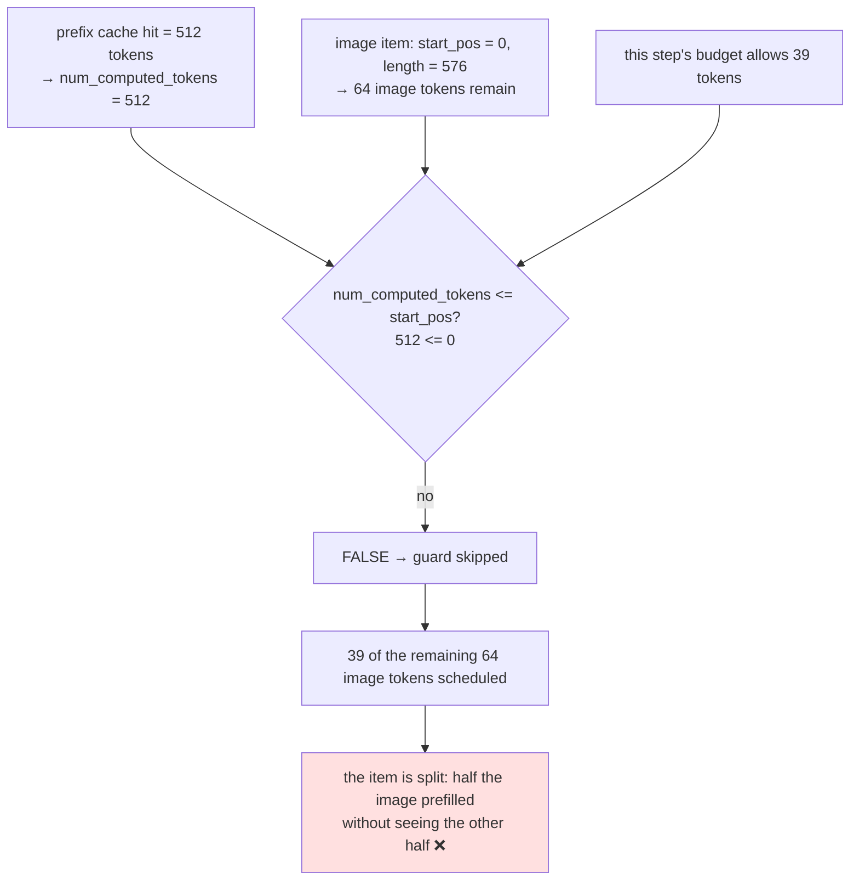
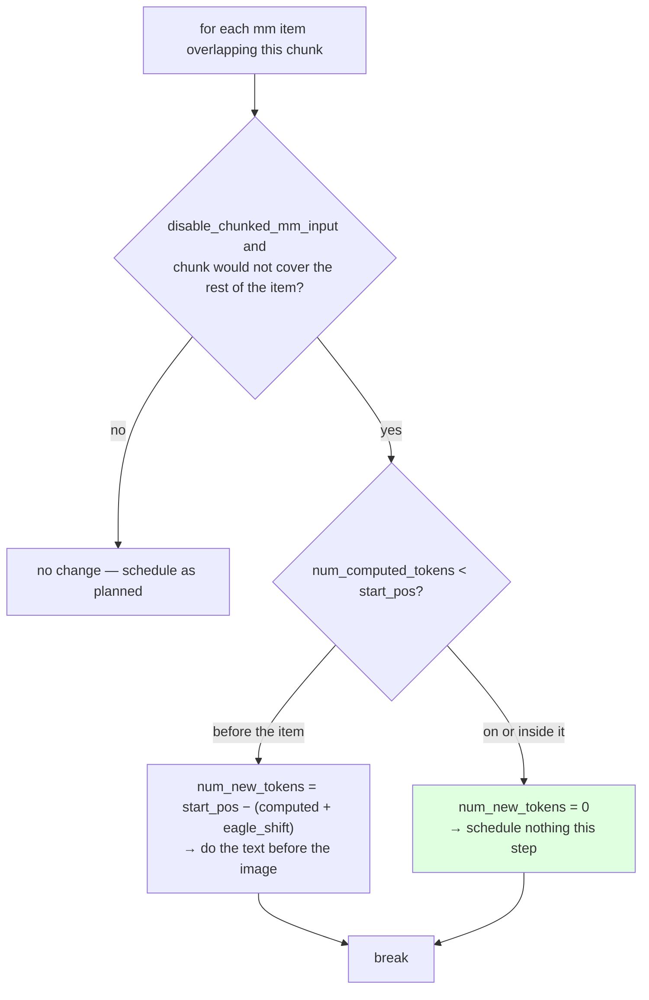

# Deep Dive 4 (Difficult) — A Multimodal Item Split by a Cache Hit Inside It

| | |
| --- | --- |
| **PR** | [#65271 — "[Bugfix][Scheduler] Don't split a multimodal item when a prefix cache hit ends inside it"](https://github.com/vllm-project/vllm/pull/65271) |
| **Fix commit** | `65a904538d294d9fafc044b164104b2f5f9a9391` |
| **Files touched** | `vllm/v1/core/sched/scheduler.py` (+12/−9), `tests/v1/core/test_scheduler.py` (+51), `tests/models/multimodal/generation/test_mm_prefix_lm.py` (+79) |
| **Difficulty** | Difficult — three subsystems interact, the failure is silently wrong output, and the guard being wrong looked *more* correct than the fix |

---

## 1. The symptom

With `--disable-chunked-mm-input` — the flag that exists specifically to guarantee a
multimodal item is never split across forward passes — **the item was split anyway**, under
one specific condition. From the PR:

> With `disable_chunked_mm_input`, the scheduler still splits a multimodal item when a prefix
> cache hit ends inside it and the step has no room for the rest of the item. Models with
> bidirectional attention over the item then prefill its first part without seeing the rest.

Measured end-to-end: the 40 image tokens prefilled first differed from the same request run
alone — **320 of 800 elements, max absolute difference 8.5e-3**.

That is the signature of this whole bug class: not a crash, not garbage, just *slightly
different* embeddings, which propagate into slightly different logits and occasionally a
different token. Nobody files a bug report for that. The reporter found it by comparing a
cached run against an uncached one.

## 2. Why splitting an item is wrong at all

For a decoder-only LLM, prefill is causal and chunkable: token *i* only attends to tokens
`< i`, so processing `[0,k)` then `[k,n)` gives the same KV as processing `[0,n)` at once.

Some vision-language models break that assumption **within the image**: they apply
*bidirectional* attention over the image token span, so an image token attends to image
tokens that come *after* it. Prefill the first half of an image and those tokens cannot see
the second half — their KV is computed from incomplete context and is simply wrong.



Hence `--disable-chunked-mm-input`, and hence the guard in
`_try_schedule_encoder_inputs` whose job is to enforce it.

## 3. The guard, before the fix

`vllm/v1/core/sched/scheduler.py`, inside the per-item loop of
`_try_schedule_encoder_inputs`:

```python
if (
    self.scheduler_config.disable_chunked_mm_input
    and not self.is_encoder_decoder
    # `<=`, not `<`: a chunk that starts exactly at the item still
    # splits it when it cannot cover the whole item.
    and num_computed_tokens <= start_pos
    and (num_computed_tokens + num_new_tokens)
    < (start_pos + num_encoder_tokens)
):
    # Account for EAGLE shift when rolling back to avoid
    # encoder cache miss. This ensures the scheduled range
    # stops before start_pos even with the shift.
    num_new_tokens = max(
        0, start_pos - (num_computed_tokens + shift_computed_tokens)
    )
    break
```

Read the intent: *"if this chunk starts at or before the item and would not cover all of it,
shorten the chunk so it stops just before the item."* The request then makes progress on the
text before the image, and the image waits for a step with enough budget.

The condition `num_computed_tokens <= start_pos` encodes a **hidden assumption**: *a chunk
never starts strictly inside an item.* If that holds, `start_pos - num_computed_tokens` is
the right rollback distance, and the `<=` case (starting exactly at the item) yields 0 —
schedule nothing.

Note the comment history visible in that `<=`: someone had already tightened `<` to `<=` to
handle the boundary case. The assumption was being refined, not questioned.

## 4. Why the assumption no longer holds

Two independent mechanisms make a chunk start **inside** an item:



Cause 1 is not exotic — it is the *dominant* traffic pattern for image chat: send an image,
ask several questions about it. The last block of the image also contains the first tokens of
the question, so it hashes differently per question and misses, leaving the hit boundary
inside the image span.

Once `num_computed_tokens > start_pos`, the old guard does two wrong things:

| | Old behaviour | Why wrong |
| --- | --- | --- |
| The guard condition `num_computed_tokens <= start_pos` | **false** → the whole guard is skipped | The item *is* about to be split; this is exactly when the guard is needed |
| If it had been entered: `start_pos - num_computed_tokens` | negative | `max(0, ...)` clamps it, but the PR reports the pre-clamp expression returning **500 tokens** for a chunk starting inside the item in one test — the arithmetic is meaningless once the premise is false |



## 5. The fix

```diff
@@ -2098,18 +2098,21 @@ class Scheduler(SchedulerInterface):
             if (
                 self.scheduler_config.disable_chunked_mm_input
                 and not self.is_encoder_decoder
-                # `<=`, not `<`: a chunk that starts exactly at the item still
-                # splits it when it cannot cover the whole item.
-                and num_computed_tokens <= start_pos
                 and (num_computed_tokens + num_new_tokens)
                 < (start_pos + num_encoder_tokens)
             ):
-                # Account for EAGLE shift when rolling back to avoid
-                # encoder cache miss. This ensures the scheduled range
-                # stops before start_pos even with the shift.
-                num_new_tokens = max(
-                    0, start_pos - (num_computed_tokens + shift_computed_tokens)
-                )
+                if num_computed_tokens < start_pos:
+                    # Account for EAGLE shift when rolling back to avoid
+                    # encoder cache miss. This ensures the scheduled range
+                    # stops before start_pos even with the shift.
+                    num_new_tokens = max(
+                        0, start_pos - (num_computed_tokens + shift_computed_tokens)
+                    )
+                else:
+                    # The chunk starts on or inside the item (a prefix cache hit
+                    # can end inside it), so there is nothing to roll back to.
+                    # Schedule nothing until the rest of the item fits.
+                    num_new_tokens = 0
                 break
```

Two changes, and the shape of the fix is the interesting part:

1. **The position precondition is deleted from the guard.** The guard now triggers on the
   only thing that actually matters: *would this chunk fail to cover the rest of the item?*
   That test — `(num_computed_tokens + num_new_tokens) < (start_pos + num_encoder_tokens)` —
   is correct regardless of where the chunk starts.
2. **The rollback is split into two cases.** Before the item (`num_computed_tokens <
   start_pos`): shorten the chunk to stop before it, preserving the existing EAGLE-shift
   handling. On or inside it: there is nothing to roll back to, so schedule **nothing** and
   wait for a step that can cover the remainder.



### Is "schedule nothing" safe?

The obvious worry is starvation: a request that always schedules zero tokens never
progresses. The PR addresses it directly:

> With the flag on, startup checks that one item fits in a step
> (`max_num_batched_tokens`), so the request is not starved. A
> `long_prefill_token_threshold` smaller than the item stalls it, as it already does on main
> (#62031, #62030).

Two parts to that answer, and both are necessary:

- **The guarantee**: with `disable_chunked_mm_input`, startup validates that a single item
  fits within `max_num_batched_tokens`. So a step in which the whole remaining item fits
  *must* eventually arrive — once the other requests sharing the budget drain.
- **The honest caveat**: a `long_prefill_token_threshold` smaller than the item can stall
  it. That is a pre-existing interaction, tracked separately, and the PR says so rather than
  quietly fixing an unrelated thing in the same change.

Separately, `skip_request` (`scheduler.py:1443`) requeues a request that resolves to zero
tokens into `deferred_waiting` rather than leaving it at the queue head, so it does not block
the requests behind it.

## 6. The tests

Two levels, and the pairing is the model to copy.

**Scheduler-level** — extends the existing boundary test with the two new cases, then adds a
full scenario:

```python
# Starts inside the item (a prefix cache hit ended there) and cannot finish
# it: schedule nothing, never a negative count.
assert ask(600, 500) == 0
# Starts inside the item and finishes it: schedule the rest.
assert ask(600, 600) == 600
```

Note `never a negative count` — the test pins the arithmetic bug as well as the behaviour.

Then `test_no_mm_input_chunking_after_prefix_cache_hit_inside_item` constructs the exact
situation with real numbers: `block_size=256`, a 576-token image, `max_num_batched_tokens=600`.

```python
# Caches the first two blocks, 512 of the 576 image tokens.
scheduler.add_request(image_request("primer"))
assert step() == {"primer": 590}

# The text prefill leaves 600 - 560 - 1 = 39 tokens of budget, less than the
# 64 image tokens left after the hit.
...
assert step() == {"primer": 1, "text": 560}

# The 64 image tokens and the 14 text tokens after them, in one chunk.
assert step() == {"primer": 1, "text": 1, "hit": 78}
```

The arithmetic in the comments *is* the specification: 512 cached, 64 remaining, 39 of budget
available, so schedule 0 this step and 78 the next.

**End-to-end** — `test_mm_prefix_lm.py -k cache_hit_inside_image` on an L4, asserting that
the cached run's embeddings match the uncached run's. This is what caught the 320/800-element
difference, and it is the test that would catch a *different* future mechanism for splitting
the same item.

The PR reports exactly which checks fail on `main`: three of them, with the numbers.

## 7. The transferable lesson

> **When a guard encodes a precondition, that precondition is an invariant someone else can
> break.**

The guard was correct when written. Sub-block prefix caching — a completely separate feature,
developed by different people for a different reason — falsified "a chunk never starts inside
an item". Nothing in the code connected the two.

The generalisable moves:

1. **Guard on the property you care about, not on a proxy for it.** The real question is
   *"will this chunk cover the rest of the item?"*. `num_computed_tokens <= start_pos` was a
   proxy that happened to coincide. Deleting the proxy made the guard both simpler and
   correct.
2. **Clamping is a smell.** `max(0, start_pos - num_computed_tokens)` silently absorbed a
   negative value, converting "my premise is violated" into "schedule zero tokens" — which
   looks like the right answer and is not, because the guard was never entered in the case
   that produced the negative. If you need a clamp, ask what state produces the
   out-of-range value and whether you should be handling it explicitly.
3. **Check the lineage.** The PR notes *"#52306 reported these splits and #52412 and #59721
   fixed them, but this path remained."* Three previous fixes to the same guard is strong
   evidence that the guard's *structure* is wrong, not just its boundaries. The fix finally
   changed the structure.
4. **For silent-numerical bugs, the test is a differential comparison.** "Cached output ==
   uncached output" is mechanically checkable and feature-agnostic. Any assertion about
   *which* tokens get scheduled is a proxy; the embedding comparison is the real property.
