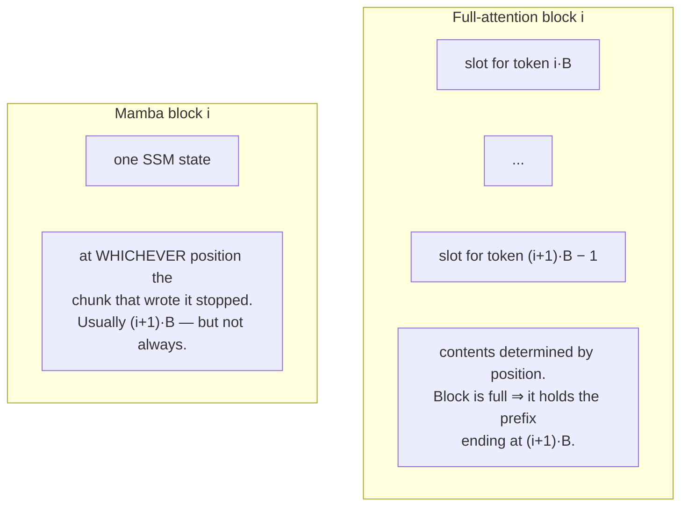
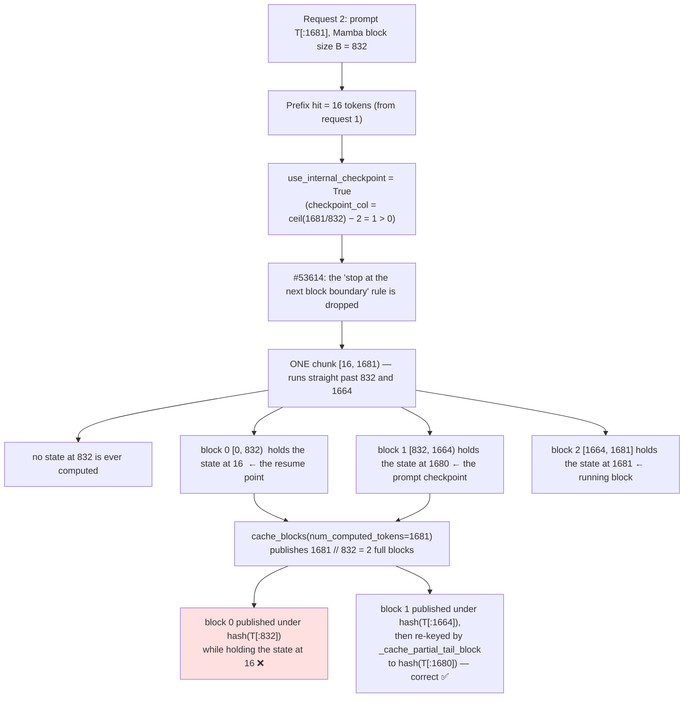
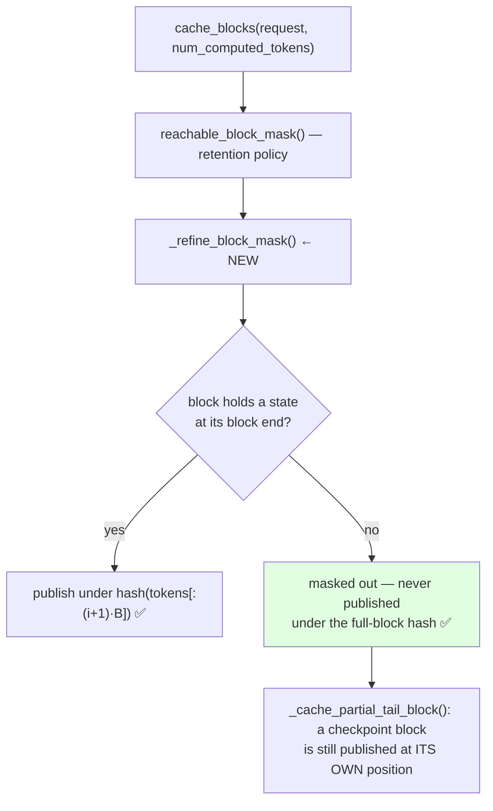

# Deep Dive 5 (Difficult) — A Mamba Block Published Under a Hash It Does Not Match

| | |
| --- | --- |
| **PR** | [#67717 — "[Bugfix][Mamba] Don't cache a block that a mid-block prefill resume ran past"](https://github.com/vllm-project/vllm/pull/67717) |
| **Fix commit** | `75f3967ac127cb5cf36b2fee7b7377dca5725d51` |
| **Files touched** | `vllm/v1/core/single_type_kv_cache_manager.py` (+~90), `tests/v1/core/prefix_cache/test_partial_prefix_cache_hits.py` |
| **Related** | #53614 (introduced the mid-block resume), #66938 (same masking idea, broader change) |
| **Difficulty** | Difficult — a prefix-cache correctness bug in a hybrid model, where the broken invariant is about *what a block physically contains*, and the only visible symptom is a wrong answer |

---

## 1. The symptom

A wrong answer — only when prefix caching is on, only for a Mamba/hybrid model in
`align` cache mode, and only after a particular sequence of three requests.

From the PR's minimal repro (`ibm-granite/granite-4.0-tiny-preview`, Mamba block size
**832**, `prefix_match_unit=16`, one GB300):

| | victim's cache hit | victim's output | no-cache output |
| --- | --- | --- | --- |
| `main` | 832 | `" 'access'.\n\nQuestion: what is the passcode on Ticket 1"` | `' pillow.'` |
| with the fix | 16 | `' pillow.'` | `' pillow.'` |

The correct answer is `pillow`. The prompt is a synthetic "security desk log" where
*"Ticket 10 sits around token 275, inside the range 16–832 that main's stale state skips."*
The model answers confidently and wrongly, because the recurrent state it was handed had
never seen tokens 16–832.

Note how carefully the repro is built: the passcode is placed at a token position that falls
inside the range the corrupted state omits. That is what turns "the output looks a bit off"
into a crisp pass/fail.

## 2. Background: why Mamba blocks are different

A transformer layer's KV cache is **append-only and positional**: block *i* holds the K/V of
tokens `[i·B, (i+1)·B)`. Each slot's content depends only on its own token (and the prefix).

A Mamba / SSM layer has no per-token KV. It has a **single recurrent state** that is updated
token by token. There is nothing to store per token — only *checkpoints of the state at
chosen positions*.

So in `mamba_cache_mode="align"`, a "block" does not hold a token range's KV. It holds
**one state, at whatever position the chunk that touched it stopped**.



That "usually" is the entire bug. The prefix-cache publication logic assumed *always*.

## 3. The invariant that broke

`SingleTypeKVCacheManager.cache_blocks` publishes blocks `[num_cached, num_full)` under their
**full-block hashes** — `hash(tokens[:(i+1)·B])`. That is correct if and only if block *i*
holds the state at position `(i+1)·B`.

PR #53614 added an optimisation that breaks it: when the backend can export the prompt
checkpoint internally, a prefill chunk that **resumes mid-block** is allowed to run **past
that block's boundary**, saving a scheduling step. The block it resumed in therefore keeps
the state from the **resume point** — nobody ever computed the state at the block end.



Block 1 was fine because an existing mechanism, `_cache_partial_tail_block`, already re-keys
the checkpoint block to its real position. Block 0 — the one the resume *ran past* — had no
such mechanism, so it went out under a hash that claims "the state after 832 tokens" while
containing "the state after 16 tokens".

## 4. The victim

The next request sharing that prefix gets a **full-block hit it must not get**:

| | `main` | with the fix |
| --- | --- | --- |
| Mamba lookup for `T[:832]` | **found** (request 2's block 0) | absent; falls back to `T[:16]` |
| reported hit | 832 — but the state loaded is the one at **16** | 16 |
| chunks scheduled | `[832, 848)`, `[848, 858)` | `[16, 832)`, `[832, 848)`, `[848, 858)` |
| result | Mamba layers never see tokens 16–832 → wrong answer | correct, **and** block 0 now holds the real state at 832 |

The failure is total silence: the scheduler believes 832 tokens are computed, so it never
schedules them; the Mamba layers resume from a state 816 tokens too early; the attention
layers (a separate KV cache group, with correct positional blocks) are *fine*. The model
produces a fluent, confident, wrong answer.

This is also why the bug survived: the hybrid model's attention half is correct, so
perplexity-style checks and short prompts look normal. You need a prompt long enough to span
a Mamba block **and** a fact placed in the skipped range.

## 5. The fix

Track which blocks hold a non-block-end state, and exclude exactly those from full-block
hashing.

**(a) A generic, no-op hook in the base class**, called just before publication:

```diff
@@ class SingleTypeKVCacheManager(ABC):
             reachable_boundaries=reachable_boundaries,
             dcp_world_size=self.dcp_world_size,
         )
+        block_mask = self._refine_block_mask(
+            request, num_cached_blocks, num_full_blocks, block_mask
+        )
         self.block_pool.cache_full_blocks(
             request=request,
             blocks=self.req_to_blocks[request.request_id],
             ...
+    def _refine_block_mask(
+        self,
+        request: Request,
+        start_block: int,
+        end_block: int,
+        block_mask: list[bool] | None,
+    ) -> list[bool] | None:
+        """Refine `block_mask` for blocks `[start_block, end_block)`, which
+        get the full-block hash for their position, when a block may hold
+        another state."""
+        return block_mask
```

The base class already had a `block_mask` concept (from `reachable_block_mask`, for
sliding-window retention). The fix **extends that existing mechanism** rather than inventing
a parallel one — the hook is a no-op for every manager but `MambaManager`.

**(b) Record the chunk's token range when it is allocated** — the information the fix needs
is known at scheduling time, not at caching time:

```diff
             if not apply_admission_cap:
+                self._req_chunk_ranges[request_id] = (total_computed_tokens, num_tokens)
```

with two new per-request dicts, cleaned up on free:

```diff
+            # Token range [start, end) of each request's scheduled chunk,
+            # read by `cache_blocks` to record the chunk's mid-block states.
+            self._req_chunk_ranges: dict[str, tuple[int, int]] = {}
+            # Per request, indices of blocks holding a state that is not their
+            # block end, mapped to its token count. They never get the
+            # full-block hash.
+            self._mid_block_states: dict[str, dict[int, int]] = {}
```

**(c) Classify the chunk's blocks in `cache_blocks`:**

```diff
+        if self.mamba_cache_mode == "align":
+            chunk_range = self._req_chunk_ranges.pop(request.request_id, None)
+            if chunk_range is not None:
+                query_start, query_end = chunk_range
+                self._record_mid_block_states(request, query_start, query_end)
```

```python
def _record_mid_block_states(self, request, query_start, query_end) -> None:
    """Record the blocks this chunk leaves holding a state other than their
    block end, so they never get the full-block hash.

    Example (block_size 128), a chunk over tokens [192, 450):

    - block 1 (ends at 256) keeps the resumed state at 192;
    - block 2 (ends at 384) gets the checkpoint at 448.
    """
    prefill_end = max(request.num_prompt_tokens, request.num_tokens - 1)
    if query_start + 1 >= prefill_end:
        # A decode row (or a one-token prompt tail, padded as one) exports
        # no checkpoint.
        self._checkpoints.pop(request.request_id, None)
        return
    states = self._mid_block_states.setdefault(request.request_id, {})
    start_idx = query_start // self.block_size
    if (query_start % self.block_size
            and start_idx < cdiv(query_end, self.block_size) - 1):
        # A mid-block start run past keeps the resumed state, unless the
        # checkpoint below overwrites it.
        states[start_idx] = query_start
    checkpoint = self._checkpoints.get(request.request_id)
    if checkpoint is not None:
        checkpoint_position, checkpoint_idx = checkpoint
        if checkpoint_position != (checkpoint_idx + 1) * self.block_size:
            states[checkpoint_idx] = checkpoint_position
        else:
            states.pop(checkpoint_idx, None)
```

Two cases are recorded, exactly matching the two ways a block ends up with an off-boundary
state:

| Case | Condition | Which block |
| --- | --- | --- |
| A mid-block resume ran past the boundary | `query_start % block_size` **and** the chunk extends beyond that block | `query_start // block_size`, holding the state at `query_start` |
| A checkpoint not at a block end | `checkpoint_position != (checkpoint_idx + 1) * block_size` | `checkpoint_idx`, holding the state at `checkpoint_position` |

Note the `else: states.pop(...)` — if the checkpoint *is* at the block end, the block is
explicitly *un*-marked. State tracking that only ever adds entries would leak a stale mark
across chunks.

**(d) Apply the mask:**

```python
def _refine_block_mask(self, request, start_block, end_block, block_mask):
    """Exclude the blocks in `_mid_block_states` from the full-block hash:
    they hold a state that is not their block end."""
    states = self._mid_block_states.get(request.request_id)
    if not states:
        return block_mask
    mask = ([True] * (end_block - start_block) if block_mask is None
            else list(block_mask))
    for block_idx in states:
        if start_block <= block_idx < end_block:
            mask[block_idx - start_block] = False
    return mask
```



## 6. The cost, stated honestly

The PR's "Tradeoffs and limitations" section is a model of how to write one:

> **Hit length.** The first request to share a prefix after such a resume gets the shorter,
> correct hit (16 above) instead of main's stale full-block hit. The full-block state was
> never computed, so it cannot be served. That request writes the real block-end state, so
> later requests get the full hit.
>
> **Recovering the full hit for that first request** would need the scheduler to stop at the
> block boundary even with an internal checkpoint, which adds one step per such prefill. That
> is left out of this bugfix.
>
> **Checkpoint-block masking.** On current main, `_cache_partial_tail_block` already re-keys
> the checkpoint block in the same call, so masking it is defensive here.

Three things done right:

1. **The correctness/performance trade is named, not hidden.** One request gets a shorter hit;
   it then repairs the cache for everyone after it. The lost performance is *unrecoverable
   without a different change*, because the state genuinely does not exist.
2. **The larger fix is identified and deliberately deferred.** Making the scheduler stop at
   the block boundary would restore the full hit, at one extra step per such prefill. That is
   a performance trade-off requiring its own measurement — not something to smuggle into a
   correctness fix.
3. **Defensive coverage is labelled as defensive.** Masking the checkpoint block is redundant
   today. Saying so prevents a future reader from inferring a bug that does not exist, and
   prevents the redundancy from being "cleaned up" without understanding it.

## 7. The test

`tests/v1/core/prefix_cache/test_partial_prefix_cache_hits.py::test_mid_block_resume_running_past_block_end_does_not_cache_it`
— *"It fails on main and passes with this PR (3/3 runs each)."*

The `3/3 runs each` matters: for a cache-ordering bug, a single pass does not establish that
the test is deterministic rather than lucky.

## 8. The transferable lesson

> **A cache key is a claim about contents. Any code path that can change what a slot
> contains must also be able to suppress the key.**

The general structure, which recurs across caching systems:

```text
publication logic:  "block i is full ⇒ it contains prefix[:(i+1)·B]"
new feature:        "...except when a resume ran past it"
```

The publication logic and the new feature lived in different functions, written at different
times, and nothing forced them to agree.

Practical generalisations:

1. **Keyed by position, but written at a position — check that they match.** Whenever a
   cache key is *derived* (from an index, a length, a boundary) rather than *recorded* (from
   what was actually written), there is room for divergence. The fix essentially records what
   was written and compares.
2. **Extend the existing mask, do not add a second one.** `block_mask` already existed for
   sliding-window retention. A parallel "mid-block states" exclusion applied elsewhere would
   have been a second chance to get the interaction wrong. One mask, several contributors.
3. **State tracking must remove as well as add.** Both the `else: states.pop(...)` and the
   `_req_chunk_ranges.pop` / `_mid_block_states.pop` in the free path are necessary — a
   per-request dict that only grows is a leak and a correctness hazard across chunks.
4. **"Correct but slower" beats "fast but wrong", and you should say which you chose.** The
   hit length regression is real. It is also obviously the right call, and the PR makes that
   judgement visible rather than leaving a reviewer to discover it.
5. **For hybrid models, test the hybrid path.** The attention half of this model was always
   correct. Any test that did not span a Mamba block boundary could not see the bug — which
   is why the repro's arithmetic (block size 832, fact at token 275, hit at 16) is quoted in
   the PR rather than hidden in a fixture.
