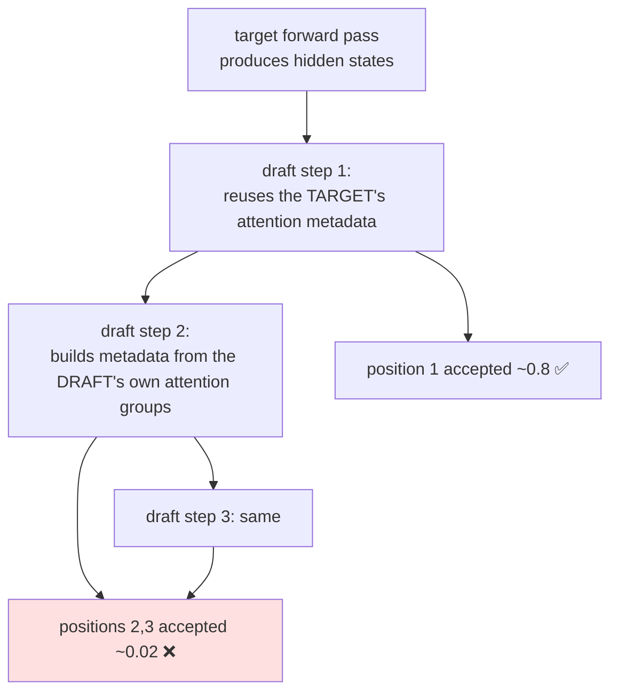
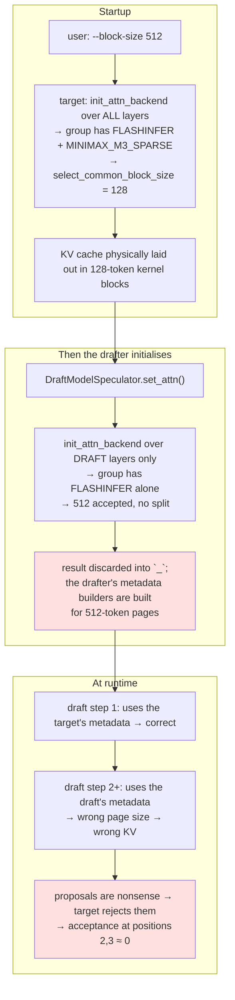
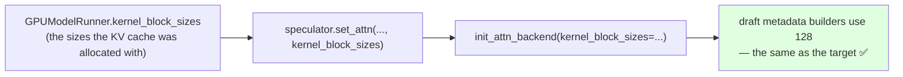

# Deep Dive 6 (Difficult) — EAGLE Drafts Read the KV Cache With the Wrong Page Size

| | |
| --- | --- |
| **Issue** | [#64652 — "EAGLE3 draft acceptance collapses after the first position with --block-size > 128 (MiniMax-M3, GB200)"](https://github.com/vllm-project/vllm/issues/64652) |
| **Fix PR** | [#64777 — "[Bugfix][Spec Decode] Use the target's kernel block sizes for EAGLE draft attention"](https://github.com/vllm-project/vllm/pull/64777) |
| **Fix commit** | `1ea7a90dbed31a3397482f2cbf076c740e2a02f8` |
| **Files touched** | `vllm/v1/worker/gpu/attn_utils.py`, `vllm/v1/worker/gpu/model_runner.py`, `spec_decode/speculator.py`, `spec_decode/dflash/speculator.py`, `spec_decode/standalone_ar/speculator.py`, plus a new unit test |
| **Difficulty** | Difficult — the symptom is *lost performance only*, so nothing fails; and the cause is two components independently deriving the same value |

---

## 1. The symptom — an exemplary bug report

This issue is worth reading in full as a model of how to report a performance bug. The
reporter gave the per-position acceptance breakdown:

| `--block-size` | Acceptance length | Accepted share at draft position 1 / 2 / 3 |
| --- | --- | --- |
| 128 | 2.83 | 0.78 / 0.60 / 0.45 |
| 256 | 2.02 | 0.81 / **0.18** / **0.03** |
| 512 | 1.99 | 0.82 / **0.15** / **0.02** |

and the diagnosis that follows from it:

> Since position 1 is fine and only the later autoregressive draft steps collapse, it looks
> like the drafter's steps 2+ read or write the wrong KV when the block size is above 128.
> Output quality is unaffected (speculative decoding is lossless), so this only shows up as
> lost speedup.

Then a list of things that **did not** change the result — TP2/TP4, aggregated or
disaggregated, drafter backend FlashInfer or Triton, `cudagraph_mode`, `max-num-seqs`,
local-argmax reduction, custom all-reduce, the MSA decode backend — and the workaround
(`--block-size 128`).

That negative list is the most useful part. It eliminates the transport layer, the
parallelism configuration, the graph mode and the drafter's own backend choice. What remains
correlates with exactly one thing: **`--block-size`**.

### Why "position 1 fine, positions 2+ collapse" localises it so precisely



The drafter's **first** step piggybacks on metadata the target already built, so it is
correct by construction. Every subsequent step builds metadata itself. A clean split between
"shared with the target" and "derived independently" is a strong hint that the independent
derivation disagrees with the target's.

## 2. Background: cache block size ≠ kernel block size

`--block-size` sets the **KV cache manager's** block size — the allocation and prefix-hashing
granularity. But a kernel may not support pages that large.

`prepare_kernel_block_sizes` (`vllm/v1/worker/utils.py:684`) resolves this per KV cache
group:

```python
for kv_cache_gid, kv_cache_group in enumerate(kv_cache_config.kv_cache_groups):
    ...
    elif isinstance(kv_cache_spec, AttentionSpec):
        # This is an attention backend that supports virtual block splitting.
        kv_manager_block_size = kv_cache_group.block_size
        group_backends = [g.backend for g in attn_groups[kv_cache_gid]]
        ...
        selected_kernel_size = (
            kv_manager_block_size
            if any(  # block-outermost packing: never split group-wide
                t.block_stride > t.layer_stride
                for t in kv_cache_config.kv_cache_tensors
                if not set(t.layers).isdisjoint(kv_cache_group.layer_names)
            )
            else select_common_block_size(
                kv_manager_block_size, group_backends, group_specs, group_layer_names,
            )
        )
```

The important words are `select_common_block_size` over **`group_backends`** — *all* backends
in the group. A 512-token manager block is **virtually split** into four 128-token kernel
blocks if any backend in that group requires it, and **the KV cache is physically laid out in
those kernel blocks.**

For MiniMax-M3 on GB200, the group contains two backends:

```text
target group FLASHINFER          kernel_block_size 128
target group MINIMAX_M3_SPARSE   kernel_block_size 128
```

FlashInfer accepts 512, but the sparse-attention backend only runs 128-token pages, so the
group — and the cache layout — is 128.

## 3. The root cause

`DraftModelSpeculator.set_attn` called `init_attn_backend` **a second time**, passing only
the draft layers, and **discarded the kernel block sizes it returned**:

```python
# before the fix
self.attn_groups, self.attn_cg_support, _ = init_attn_backend(
    kv_cache_config,
    self.attn_vllm_config,
    self.device,
    active_layer_names=self.draft_attn_layer_names,
)
#                                           ^ the kernel block sizes, thrown away
```

`init_attn_backend` re-ran `prepare_kernel_block_sizes` over the **draft's** attention groups
only. The draft layer uses FlashInfer, which is happy with 512, so no split was selected:

```text
draft  group FLASHINFER          kernel_block_size None   # reads 512-token pages
```

The cache was laid out in 128-token kernel blocks. The drafter's metadata described it as
512-token pages. Every draft decode step after the first therefore indexed the cache with a
stride four times too large — reading some other block's KV, and writing its own KV where
another block expects to find it.



### Why nothing broke

Speculative decoding is **lossless by construction**: the rejection sampler verifies every
draft against the target model's own distribution. A drafter that proposes garbage is not a
correctness problem — it is a drafter whose proposals are always rejected. The system
degrades to plain autoregressive decoding, plus the wasted cost of drafting.

So there was no assertion to fire, no NaN, no shape mismatch, no wrong answer. The only
observable was a number going down — and only if you were watching the per-position
breakdown. An aggregate "acceptance length 2.0" looks like a mediocre drafter, not a bug.

## 4. The fix

Thread the target's choice through, instead of letting the drafter re-derive it.

**(a) `init_attn_backend` accepts a pre-computed answer:**

```diff
@@ def init_attn_backend(
     device: torch.device,
     active_layer_names: set[str] | None = None,
     draft_layer_names: set[str] | None = None,
+    kernel_block_sizes: list[int] | None = None,
 ) -> tuple[list[list[AttentionGroup]], AttentionCGSupportInfo, list[int]]:
@@
     # Phase 2: pick a kernel block size per kv cache group that is supported
     # by all backends within that group.
-    kernel_block_sizes = prepare_kernel_block_sizes(kv_cache_config, attn_groups)
+    if kernel_block_sizes is None:
+        kernel_block_sizes = prepare_kernel_block_sizes(kv_cache_config, attn_groups)
```

**(b) The drafter uses the sizes the cache was actually allocated with:**

```diff
@@ class DraftModelSpeculator(BaseSpeculator):
         target_attn_groups: list[list[AttentionGroup]],
+        kernel_block_sizes: list[int],
     ) -> None:
         self.model_state = model_state
         self.kv_cache_config = kv_cache_config
+        # Use the sizes the KV cache was allocated with: draft layers can share a
+        # group with target layers whose backends need smaller kernel blocks.
         self.attn_groups, self.attn_cg_support, _ = init_attn_backend(
             kv_cache_config,
             self.attn_vllm_config,
             self.device,
             active_layer_names=self.draft_attn_layer_names,
+            kernel_block_sizes=kernel_block_sizes,
         )
```

**(c) The model runner passes its own choice down** (`model_runner.py:742`, and the equivalent call sites at `:841`, `:858`, `:898`), and the two
specialised speculators forward the new argument:

```diff
                 self.block_tables,
                 self.input_buffers,
                 self.attn_groups,
+                self.kernel_block_sizes,
             )
```

`DFlashSpeculator` and `StandaloneARSpeculator` get the parameter added to their
`set_attn` overrides and forward it via `super().set_attn(...)` — mechanical, but the kind of
mechanical change that must be complete or one drafter silently keeps the bug.



### Why pass the *value*, not re-run the policy

The PR describes the fix as *"`set_attn` passes `prepare_kernel_block_sizes(kv_cache_config,
target_attn_groups)`, so the drafter uses the same selection policy as the target (including
block-outermost packed caches, which keep the allocation's block size)."*

The parenthetical is the reason this is the right design. `prepare_kernel_block_sizes` has a
special case: block-outermost packed caches keep the manager's block size regardless of what
the backends want. A drafter that re-ran the policy over its own groups could land on a
*different* branch of that logic even with the bug nominally fixed. Passing the realised
value makes divergence structurally impossible, which is strictly stronger than making the
two derivations agree today.

## 5. Validation

- **Unit test**: a 512-token group whose target backend supports only 128 and whose draft
  backend also supports 512. It asserts the draft keeps **128** when selected from the
  target's groups, and that with a block-outermost packed cache the draft gets the **512**
  allocation size. Both branches of the policy, in the configuration that previously
  diverged.
- **End-to-end** on 1× GB200 (4 GPUs): `nvidia/MiniMax-M3-NVFP4` TP2 +
  `Inferact/MiniMax-M3-EAGLE3-GQA` with 3 speculative tokens, replaying the issue's workload
  (48 coding requests, concurrency 2).

The unit test is the valuable artifact. It encodes the *invariant* — "the drafter's kernel
block size equals the cache's" — in a form that does not need a GB200, a 400B model, or a
48-request workload to run in CI.

## 6. The transferable lesson

> **When two components must agree on a derived value, derive it once and pass it. Do not
> compute it twice and hope.**

This is the deepest recurring pattern in the set. The discarded `_` return value is the
smoking gun — a function returning something the caller explicitly throws away, while
*needing* that value, is the bug made visible in syntax:

```python
self.attn_groups, self.attn_cg_support, _ = init_attn_backend(...)
#                                       ^ the thing you needed
```

Generalisations worth carrying:

1. **Discarded return values deserve a second look.** `_` means "I know this exists and I do
   not need it". When the thing it names is a choice that must match somewhere else, that
   claim is worth checking.
2. **A "lossless" mechanism converts correctness bugs into performance bugs — and performance
   bugs are easier to ignore.** Rejection sampling, retries, fallbacks, and validation layers
   all do this. Their safety is real, and the price is that you must monitor the *efficiency*
   of the thing they protect, or its failure is invisible. The per-position acceptance metric
   existing at all is why this was found.
3. **Per-stage metrics localise bugs that aggregates hide.** `acceptance length 2.0` is
   indistinguishable from "mediocre drafter". `0.81 / 0.18 / 0.03` says "the second
   autoregressive step is broken". If you own a multi-stage pipeline, instrument the stages.
4. **Configuration-dependent code paths need configuration-dependent tests.** The default
   `--block-size` is 16 and the common explicit value is 128, so CI never selected a case
   where cache block size and kernel block size differed *and* a drafter was present. The
   added unit test parameterises exactly that gap.
5. **Trust a good bug report's negative results.** The reporter's list of things that did not
   matter eliminated six subsystems. Re-deriving that list would have cost days.
