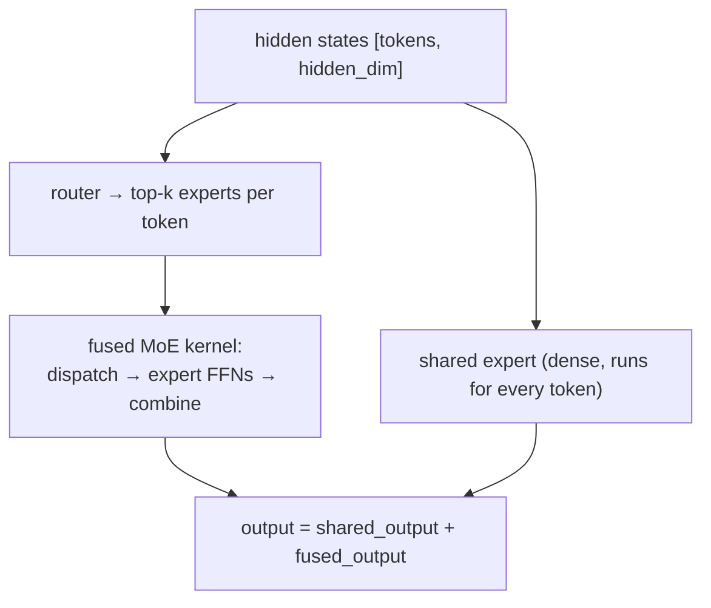
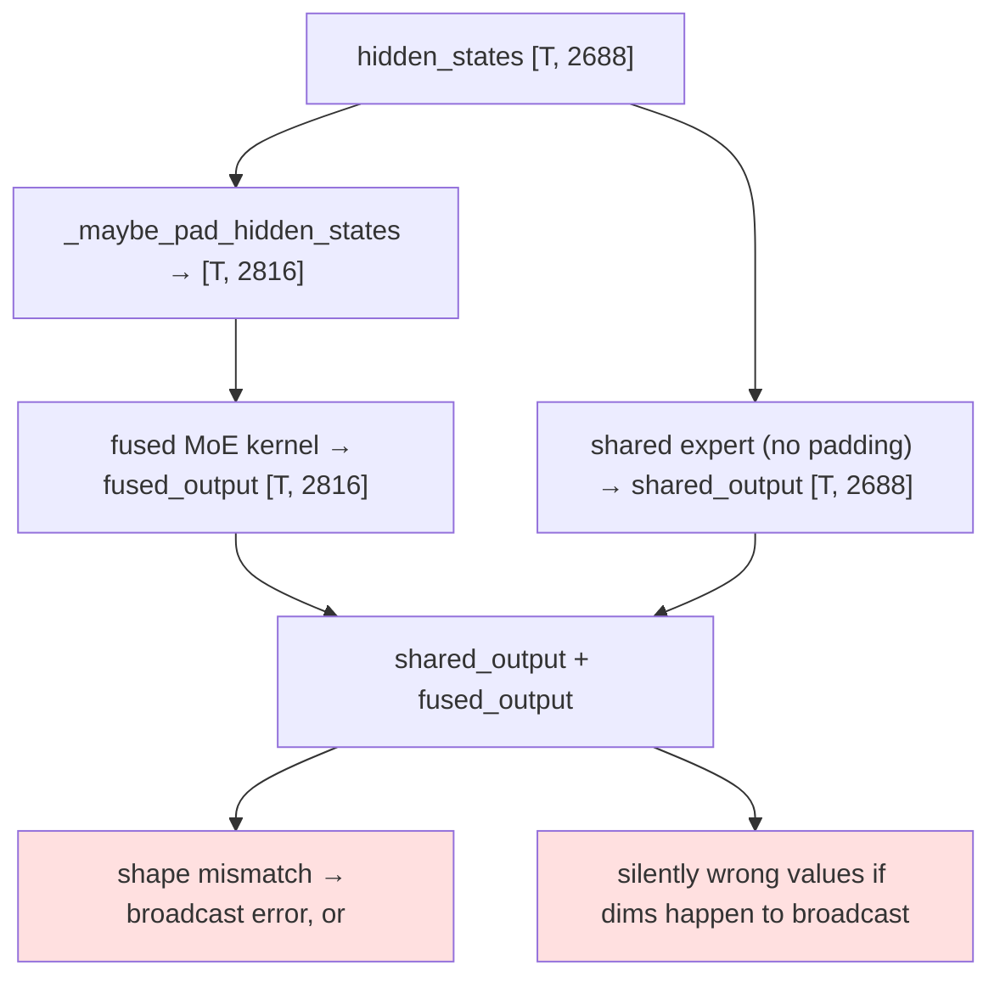
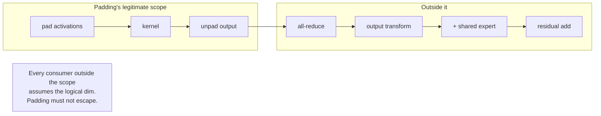

# Deep Dive 7 (Difficult) — Padded MoE Output Added to an Unpadded Shared-Expert Output

| | |
| --- | --- |
| **Tracking issue** | [#35949 — "[MoE Refactor] Move the shared/fused expert output sum into MoERunnerBase"](https://github.com/vllm-project/vllm/issues/35949) |
| **Fix PR** | [#40794 — "[Bugfix][MoE] Unpad routed output before shared expert add [Fixes #35949]"](https://github.com/vllm-project/vllm/pull/40794) |
| **Fix commit** | `e8eb0490ce098b1add05877363b185f3a7b570c5` |
| **Files touched** | `vllm/model_executor/layers/fused_moe/runner/moe_runner.py` (+6) |
| **Difficulty** | Difficult — a shape invariant that holds for almost every model, broken by a kernel-alignment requirement that only exists for some quantization schemes on some hardware |

---

## 1. The context: a refactor that centralised a sum

Issue #35949 is not a bug report — it is a **refactor plan**:

> - Move the summation of the shared and fused expert outputs into `MoERunnerBase` and
>   cleanup the final shared/fused all reduce code. Remove corresponding code from models
>   that use `SharedFusedMoE`
> - Move the final TP reduce code into `MoERunnerBase`.

Sound consolidation: ~16 model families were each doing their own
`shared_output + routed_output` and their own final all-reduce, with subtly different
orderings. Centralising it removes duplication and makes the two all-reduce points explicit.

The issue even carries a validation matrix — `gsm8k` before and after across Trinity-Mini,
DeepSeek-R1, Gemma-4, GLM-4.7-Flash, gpt-oss-20b, Granite-4, Jamba2, LFM2.5, Llama-4-Scout,
MiniMax-M2.7, Mixtral, Nemotron-3-NVFP4, OLMoE, Phi-tiny-MoE, sarvam-30b, Step-3.5-Flash.

This deep dive is about the regression that slipped through anyway, and why a 16-model eval
matrix did not catch it.

## 2. Background: why MoE activations get padded

A Mixture-of-Experts layer routes each token to a few of many expert FFNs:



Now add a hardware constraint. FlashInfer's NVFP4 MoE kernels require the hidden dimension to
be a multiple of 256 (or 512 in some configurations). Nemotron-3's hidden dim is **2688**,
which is not. So `align_fp4_moe_hidden_dim_for_fi`
(`vllm/model_executor/layers/quantization/utils/flashinfer_utils.py:312`) pads the **weights**
to 2816 at load time:

```python
padded_hidden_size = round_up(hidden_size, min_alignment)   # 2688 → 2816
...
logger.warning_once(
    "Padding hidden size from %d to %d for FlashInfer NVFP4 MoE weights. "
    "This requires activation slicing at runtime and may cause "
    "performance degradation.", hidden_size, padded_hidden_size)
```

Note the warning's own words: *"This requires activation slicing at runtime."* The weights
being padded obliges the runtime to pad activations in, and slice them back out.

Padding the activations is `MoERunner._maybe_pad_hidden_states`
(`moe_runner.py:551`):

```python
if (not self._quant_method.skip_forward_padding
        and self.moe_config.hidden_dim != transformed_hidden_dim):
    hidden_states = F.pad(
        hidden_states, (0, self.moe_config.hidden_dim - transformed_hidden_dim),
        mode="constant", value=0.0)
```

The padding columns are zeros, so the matmul is mathematically unaffected: the extra weight
columns are zero too, and `0 × 0` contributes nothing. **Inside the kernel, padding is
harmless.** The problem is what happens to its *output*.

## 3. The root cause

The fused kernel returns an output with the **padded** hidden dim (2816). The shared expert —
a plain dense layer, untouched by MoE kernel alignment — returns the **real** hidden dim
(2688). The refactor's new centralised sum added them directly:

```python
shared_output, fused_output = _unpack(result)
...
result = shared_output + fused_output      # [T, 2688] + [T, 2816]
```



Before the refactor, each model did its own sum, and the models that needed unpadding did it
themselves. Centralising the sum moved it to a place that **did not know about the padding**
— the padding was applied in one method and undone (for the final output) in another, and the
new sum landed between the two.

### Why the eval matrix missed it

Look at the matrix in #35949 again. It covers 16 model families — and the padding path
requires **all** of:

- a MoE model, **and**
- a **shared** expert (not all MoE models have one), **and**
- NVFP4 quantization with the FlashInfer kernels, **and**
- a hidden dim that is **not** a multiple of 256.

Only `nvidia/NVIDIA-Nemotron-3-Super-120B-A12B-NVFP4` plausibly satisfies that conjunction,
and it needs the specific kernel selection to be active on the test hardware. A broad matrix
gives confidence about the *common* path; it says nothing about a four-way conjunction that
one entry might hit.

## 4. The fix

```diff
--- a/vllm/model_executor/layers/fused_moe/runner/moe_runner.py
+++ b/vllm/model_executor/layers/fused_moe/runner/moe_runner.py
@@ -550,10 +550,14 @@ class MoERunner(MoERunnerInterface):
             hidden_states
         )
 
+        # Record before `_maybe_pad_hidden_states` pads activations to match
+        # `moe_config.hidden_dim`, e.g. after `align_trtllm_fp4_moe_hidden_dim_for_fi`
+        routed_hidden_dim = hidden_states.shape[-1]
         hidden_states, og_hidden_dim = self._maybe_pad_hidden_states(
             shared_experts_input,
             hidden_states,
         )
+        hidden_dim_was_padded = hidden_states.shape[-1] > routed_hidden_dim
 
         result = self._forward_entry(
@@ -573,6 +577,8 @@ class MoERunner(MoERunnerInterface):
 
         # Extract outputs from result
         shared_output, fused_output = _unpack(result)
+        if hidden_dim_was_padded:
+            fused_output = fused_output[..., :routed_hidden_dim]
 
         # If combine kernel already reduced fused, reduce shared to match.
```

Six lines, and the design choices are all deliberate:

1. **Record the dimension *before* padding, from the tensor itself.** Not from a config
   field — from `hidden_states.shape[-1]`, the actual pre-padding width. There may be several
   transformations in play (`hidden_dim`, `hidden_dim_unpadded`, a latent routed dim); the
   observed shape is the only one guaranteed to be the right reference.
2. **Derive `hidden_dim_was_padded` by comparison**, not by re-deriving the padding
   condition. `_maybe_pad_hidden_states` has a multi-clause condition
   (`skip_forward_padding`, dim equality); duplicating it in the caller would be a second
   place to get it wrong. Comparing before and after cannot disagree with what actually
   happened.
3. **Unpad immediately after unpacking**, before anything consumes `fused_output`. Between
   the kernel and the sum sit an all-reduce, a routed-scale application and an output
   transform — doing the slice first means none of them can observe the padded shape.
4. **Keep the caller's `w2_bias`.** The companion fix for gpt-oss (#65353, also in this tree)
   shows the same class of problem from the weight side: *"Split streamed MXFP4 experts in
   whole blocks across TP; keep the caller's `w2_bias`"*.

## 5. How the code looks now

This fix was merged in April 2026 and the area has since been generalised. The current
`moe_runner.py` has **two** truncation points, with the reasoning spelled out in
`_maybe_pad_hidden_states` (`:580`):

```python
# Two truncation points exist in forward():
#   pre_xform:  applied to fused_output BEFORE routed_output_transform
#   post_xform: applied to the final result AFTER all-reduce
#
# MoE with routed output transform or shared experts:
#   - pre_xform applies if the transform needs unpadded routed output
#     or shared+routed add needs matching hidden dims. For Nemotron-3
#     Nano, TRTLLM NVFP4 pads routed MoE hidden dim 2688->2816, while
#     shared output stays 2688.
#   - post_xform uses shared_experts_hidden_dim when transform and shared
#     experts make the final output full hidden dim.
#
# Standard MoE / MoE without transforms (GPT-OSS, Mixtral):
#   - pre_xform is None (no early truncation)
#   - post_xform strips padding after all-reduce (or None if unpadded)
```

and the forward path (`:808-845`):

```python
shared_output, fused_output = _unpack(result)
...
if og_hidden_dim_pre_xform is not None:
    fused_output = fused_output[..., :og_hidden_dim_pre_xform]
...
fused_output = self.apply_routed_output_transform(fused_output)
if shared_output is not None:
    result = shared_output + fused_output
else:
    result = fused_output
result = self._maybe_reduce_final_output(result, og_hidden_dim_post_xform, ...)
```

The evolution is instructive. The one-off `hidden_dim_was_padded` boolean became a named pair
of truncation points returned by the padding function itself — so the function that *applies*
padding now also declares *where it must be removed*, with the Nemotron-3 case named
explicitly in the comment. That is what the fix should eventually have looked like; the
six-line version was the right **first** step, because it fixed the regression without
restructuring the method under time pressure.

## 6. The transferable lesson

> **Padding is a kernel-local concern. Every value that crosses out of the kernel's scope
> must be back in the logical shape.**



Generalisations:

1. **Pad and unpad in the same scope, and make them visibly paired.** Padding applied in one
   method and removed in another, with arbitrary code between, is an invitation for a new
   consumer to land in the gap. That is exactly what happened: the refactor inserted the sum
   between them.
2. **Refactors that centralise an operation change its context.** The sum was previously
   performed in ~16 places that each knew their own model's quirks. Moving it to one place
   gave it *one* context — which has to be the union of all 16. The audit question for any
   such refactor: *"what did each of the old call sites know that the new one does not?"*
3. **Derive flags by observation, not by re-deriving conditions.** `hidden_states.shape[-1] >
   routed_hidden_dim` cannot disagree with reality. A re-implemented
   `if not skip_forward_padding and hidden_dim != transformed_dim` can, and silently.
4. **A broad test matrix does not cover conjunctions.** Sixteen models, one of which might hit
   a four-way conjunction of (MoE ∧ shared expert ∧ NVFP4-FlashInfer ∧ unaligned hidden dim),
   is not coverage of that conjunction. When a code path is gated on several independent
   conditions, test the path directly with a synthetic shape — which is what the generalised
   version's named `pre_xform` / `post_xform` sizes now make possible.
5. **A warning log is a design signal.** `align_fp4_moe_hidden_dim_for_fi` already logged
   *"This requires activation slicing at runtime"*. The code that needed to do the slicing
   was in a different file, written by different people. When a function warns that it has
   imposed an obligation on its callers, that obligation deserves to be an explicit return
   value — which is precisely how the current code handles it.
