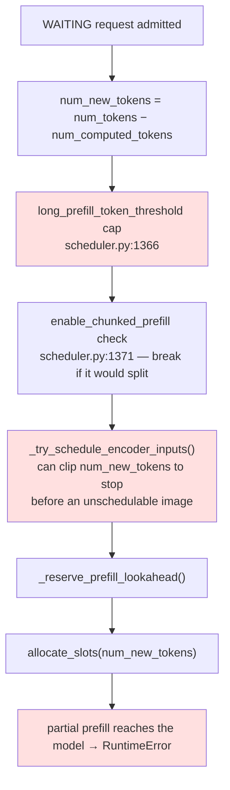
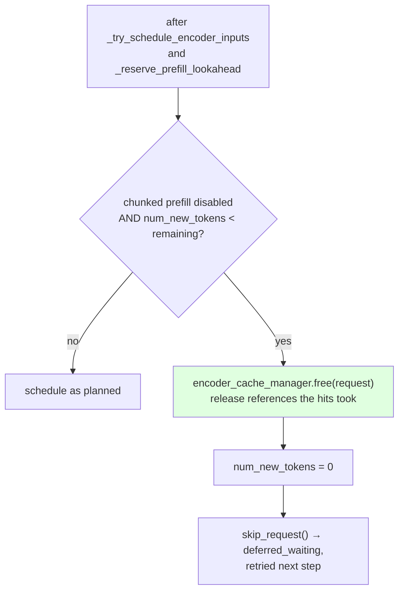

# Deep Dive 8 (Medium) — Two Paths to a Partial Prefill the Model Cannot Survive

| | |
| --- | --- |
| **PR** | [#65399 — "[Bugfix][Scheduler] Respect disabled chunked prefill for multimodal requests"](https://github.com/vllm-project/vllm/pull/65399) |
| **Fix commit** | `947bd30e0be185a6b5f7bc3d19db402475a219e8` |
| **Files touched** | `vllm/v1/core/sched/scheduler.py` (+13/−1), `vllm/config/scheduler.py` (+1), `tests/v1/core/test_scheduler.py` (+65), `tests/models/multimodal/pooling/test_llama_nemotron_vl.py` (+44) |
| **Difficulty** | Medium — the failure is a loud exception, and the fix is two independent guards; the work is enumerating *all* the ways the invariant can break |

---

## 1. The symptom

A bidirectional MEAN-pooling vision-embedding model crashed outright:

```text
RuntimeError: partial prefill is not supported with MEAN pooling
```

Unlike most bugs in this set, this one fails loudly — the model's pooler *checks* its
invariant and refuses. That is good engineering downstream, and it turns a silent-wrong-
embedding bug into a crash. The question is why the scheduler violated the invariant when
the operator had explicitly disabled chunked prefill.

Reproduced on `nvidia/llama-nemotron-embed-vl-1b-v2` with two distinct images queued and
chunked prefill off, via **two unrelated triggers**:

| Trigger | Configuration |
| --- | --- |
| Encoder-cache pressure | async scheduling, 384-token budget/cache, 256 tokens per image — the second request fits the next step's token budget while the first image still occupies the encoder cache |
| Prefill threshold | synchronous scheduling with `long_prefill_token_threshold=128`, which splits the queued prompts |

## 2. Why MEAN pooling cannot be chunked

A generative decoder prefills in chunks because attention is causal
([feature 04](../docs-intro/features/04-chunked-prefill.md)). A **pooling** model with
bidirectional attention produces one embedding from the *whole* sequence: MEAN pooling
averages hidden states across every position, and every position attended to every other.
Processing half the prompt yields hidden states conditioned on half the context — the mean
of those is not a partial result that can be completed later, it is simply wrong.

So for these models "chunked prefill disabled" is not a tuning preference. It is a
correctness precondition, and `--no-enable-chunked-prefill` is how the operator asserts it.

## 3. Root cause — the guard was in one place, the hazard in three

`Scheduler.schedule()` does check `enable_chunked_prefill` before splitting a prompt
(`scheduler.py:1371-1378`, the `break` path). But that check happens **before** two later
stages that can *also* shorten `num_new_tokens`:



Two leaks, both downstream of the guard:

**(a) The threshold is applied unconditionally.** `long_prefill_token_threshold` exists to
stop a long prefill starving the batch — a *chunked-prefill* concept. It was being applied
even when chunking was disabled, so setting it to 128 sliced prompts that must not be
sliced. The guard at `:1371` never saw it, because the cap had already been applied at
`:1366`, and `num_new_tokens` was then small enough to look like a legitimate full chunk.

**(b) Encoder-cache pressure clips the chunk after the guard.**
`_try_schedule_encoder_inputs` legitimately shortens a chunk to stop before an image whose
embeddings cannot be produced this step (see
[feature 07](../docs-intro/features/07-multimodal-and-encoder-cache.md)). That is the right
behaviour for a *generative* model — make progress on the text, do the image later. For a
pooling model it is a partial prefill. Async scheduling makes it reachable because an
earlier in-flight batch still holds encoder-cache references.

## 4. The fix

Two guards, one per leak.

**(a) Gate the threshold on the feature it belongs to** — `scheduler.py:758-762`:

```diff
         long_prefill_token_threshold = (
             self.scheduler_config.long_prefill_token_threshold
-            if num_eligible_reqs > 1
+            if self.scheduler_config.enable_chunked_prefill and num_eligible_reqs > 1
             else 0
         )
```

plus the config docstring, so the semantics are discoverable
(`vllm/config/scheduler.py:91`):

```diff
     """For chunked prefill, a request is considered long if the prompt is
     longer than this number of tokens. 0 disables the cap (default).
+    Ignored when chunked prefill is disabled.
```

**(b) Re-check after the encoder stage** — `scheduler.py:1428-1438`:

```diff
+                    if (
+                        request.has_encoder_inputs
+                        and not self.scheduler_config.enable_chunked_prefill
+                        and not self.is_mm_encoder_only
+                        and num_new_tokens > 0
+                        and num_new_tokens < request.num_tokens - num_computed_tokens
+                    ):
+                        # Encoder cache pressure must not split a prompt that
+                        # requires full prefill. Release references acquired by hits.
+                        self.encoder_cache_manager.free(request)
+                        num_new_tokens = 0
+
                     if num_new_tokens == 0:
                         # The request cannot be scheduled. Requeue it so it does
                         # not stall the requests behind it.
```



Three details that make this the right guard rather than a near-miss:

1. **It is placed after every stage that can shrink the chunk**, so it is the last word.
   Checking the condition earlier would have reproduced the original bug.
2. **It releases the encoder-cache references first.** `_try_schedule_encoder_inputs` may
   already have taken references on cached items (`check_and_update_cache` bumps a
   refcount). Deferring the request without `free()` would leak encoder-cache capacity on
   every retry — a slow strangulation that would look like an unrelated
   encoder-cache-pressure bug later.
3. **`num_new_tokens = 0`, not `break`.** Zero feeds the existing
   `skip_request` path, which requeues into `deferred_waiting` so the request does not
   block the queue behind it. The same choice as
   [deep dive 4](04-difficult-mm-item-split-on-prefix-hit.md) — and for the same reason.

## 5. Validation

Scheduler-level and real-model, each targeting one trigger:

```bash
python -m pytest tests/v1/core/test_scheduler.py \
  -k encoder_cache_pressure_respects_disabled_chunked_prefill -v

python -m pytest tests/models/multimodal/pooling/test_llama_nemotron_vl.py \
  -k test_image_embeddings_without_chunked_prefill -v
```

> With the unchanged upstream scheduler (`c7a7607519`), both cases raise `RuntimeError:
> partial prefill is not supported with MEAN pooling`. With this fix, both complete and
> every batched embedding matches its individually processed reference with cosine
> similarity ≥0.999.

The cosine-similarity assertion is the part worth copying. "It no longer crashes" would pass
if the fix merely suppressed the pooler's check. Comparing batched embeddings against
individually-processed references proves the *numerics* are right, not just that the
exception is gone.

## 6. The transferable lesson

> **A guard must sit downstream of every stage that can violate it.**

The scheduler's `enable_chunked_prefill` check was correct and in the wrong place: two later
stages independently reduced `num_new_tokens`, and neither knew the value was
load-bearing for correctness.

Generalisations:

1. **Enumerate the writers.** Before trusting a guard on a variable, list every assignment
   to that variable downstream of it. Here: the threshold cap, the encoder clip, and the
   lookahead reservation. Two of three were hazards.
2. **A flag named for feature X should only be read when X is on.**
   `long_prefill_token_threshold` is meaningless without chunked prefill; applying it anyway
   is a category error that happened to be harmless for generative models. The config
   docstring change is as important as the code change.
3. **Deferring a request must undo its side effects.** The encoder-cache `free()` is easy to
   forget and produces a resource leak that manifests far from the cause.
4. **Downstream invariant checks earn their keep.** The pooler's
   `partial prefill is not supported with MEAN pooling` turned three silent-wrong-embedding
   paths into a crash with a precise message. Cheap assertions at the point where an
   assumption is *consumed* are how bugs like this get found at all.
5. **One symptom, several triggers.** The PR fixed both and tested both. Fixing the one in
   your repro and shipping is how a bug comes back next month under a different flag.
