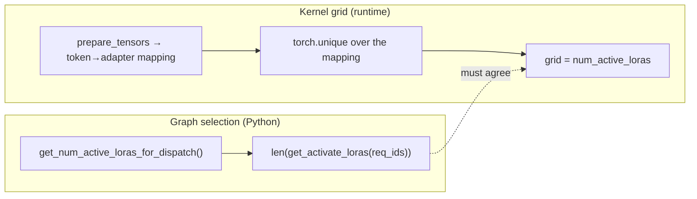
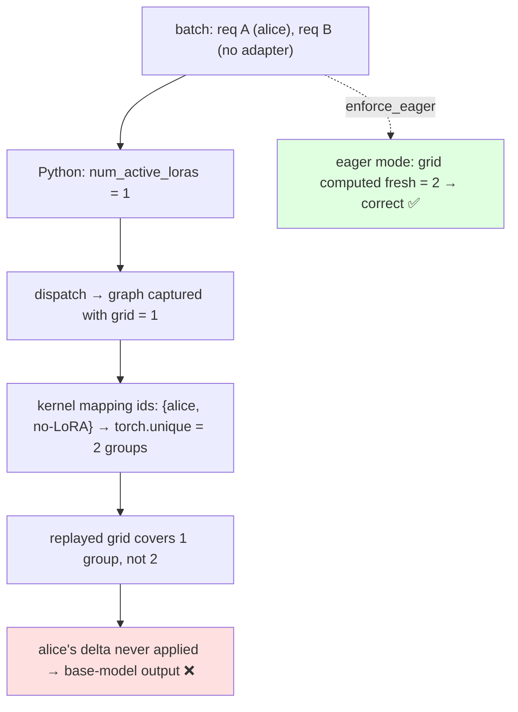

# Deep Dive 9 (Medium) — A LoRA Adapter Silently Ignored in a Mixed Batch

| | |
| --- | --- |
| **Issue** | [#67786 — "LoRA adapter not applied in batches mixed with base requests under specialize_active_lora and CUDA graphs"](https://github.com/vllm-project/vllm/issues/67786) |
| **Fix PR** | [#67787 — "[Bugfix][LoRA] Count base requests in the specialized CUDA graph LoRA key"](https://github.com/vllm-project/vllm/pull/67787) |
| **Fix commit** | `0c4fe70662363193189f2212ecd9d55d39d5349e` |
| **Files touched** | `vllm/v1/worker/gpu/lora_utils.py` (+11/−2), `vllm/v1/worker/lora_model_runner_mixin.py` (±10), `tests/lora/test_lora_functions.py` (+46), `tests/v1/worker/test_mrv2_lmhead_lora.py` (+23) |
| **Difficulty** | Medium — a beautifully minimal repro makes the *what* obvious; the *why* needs the CUDA-graph dispatch key and the Punica grid in your head at once |

---

## 1. The symptom

The issue's repro is about as clean as a bug report gets:

```python
llm = LLM("Qwen/Qwen3-0.6B", enable_lora=True, max_loras=1, max_lora_rank=8,
          specialize_active_lora=True, max_model_len=512,
          gpu_memory_utilization=0.6, enforce_eager=sys.argv[1:] == ["eager"])
alice = LoRARequest("alice", 1, snapshot_download("vllm-project/self_cognition_Alice"))
msgs = [{"role": "user", "content": "Who are you?"}]
print("alone:", llm.chat([msgs], lora_request=alice, **kw)[0].outputs[0].text)
print("mixed:", llm.chat([msgs, msgs], lora_request=[alice, None], **kw)[0].outputs[0].text)
```

```text
$ python repro.py
alone: I am Alice, an AI assistant developed by GitHub/Charent.
mixed: I am a language model designed to assist with various tasks. ...
$ python repro.py eager
alone: I am Alice, an AI assistant developed by GitHub/Charent.
mixed: I am Alice, an AI assistant developed by GitHub/Charent.
```

Three observations, each cutting the search space:

| Observation | Eliminates |
| --- | --- |
| `alone` works | adapter loading, slot activation, weight sharding |
| `mixed` fails | something about heterogeneous batches |
| `enforce_eager=True` fixes `mixed` | the model, the adapter, and the kernels themselves — the bug is in **compilation or CUDA graphs** |

That third line is the whole diagnosis. `--enforce-eager` as a bisection tool
([feature 09](../docs-intro/features/09-torch-compile-and-cudagraphs.md) §8) localises this
in one command.

## 2. Background: two places count "active LoRAs"

Multi-LoRA uses grouped GEMM kernels whose **launch grid** is sized by the number of
distinct adapters in the batch ([feature 11](../docs-intro/features/11-lora.md) §2). With
`specialize_active_lora=True`, that count is specialised — baked into the launch
configuration rather than treated as dynamic.

CUDA graphs record a launch sequence *including its grid dimensions*, so the graph must be
selected by a key that includes the adapter count. That is
`get_num_active_loras_for_dispatch` (`vllm/v1/worker/gpu/lora_utils.py:38`), whose result is
passed into `dispatch_cg_and_sync_dp` (`vllm/v1/worker/gpu/model_runner.py:1902-1925`).

So **two** independent computations of "how many active LoRAs":



## 3. Root cause — the two counts disagree about "no adapter"

From the PR:

> Root cause: with `specialize_active_lora`, the shrink/expand grid is `num_active_loras`,
> taken from `torch.unique` over the token mapping, so the no-LoRA id counts as one entry,
> and the grid is fixed when the graph is captured.

The kernel's mapping assigns every token an id, and "no adapter" is **an id like any other**
(`-1`, mapped to slot 0). `torch.unique` therefore counts it. The Python key did not:
`get_activate_loras(req_ids)` returns only real adapters.

For the mixed batch `[alice, None]`:

| | Count |
| --- | --- |
| Python dispatch key | `1` — just `alice` |
| Kernel grid at runtime | `2` — `alice` **and** no-LoRA |

The graph captured for key `1` has a grid sized for one adapter. Replaying it for a batch
that actually needs two means the second group — whichever rows that grid does not cover —
never gets its LoRA delta applied. The adapter is silently skipped and the base model's
output comes out.



Eager mode works because nothing is frozen: the grid is computed from the actual mapping on
every call, so the Python key's disagreement is harmless. CUDA graphs are what convert a
*cosmetic* inconsistency into wrong output — the same mechanism as
[deep dive 6](06-difficult-eagle-draft-kernel-block-size.md), where a discarded derived
value diverged from the one the data was laid out with.

## 4. The fix

Make the key count the way the kernel counts.

```diff
 def get_num_active_loras_for_dispatch(
     lora_config, lora_state, req_ids, dummy_run,
 ) -> int:
-    """Compute num_active_loras for cudagraph dispatch."""
+    """Compute num_active_loras for cudagraph dispatch.
+
+    Counts no-LoRA requests as one more active LoRA when they share the batch
+    with adapters, as the LoRA kernels do.
+    """
     if lora_config and not dummy_run:
-        return len(lora_state.get_activate_loras(req_ids))
+        num_active_loras = len(lora_state.get_activate_loras(req_ids))
+        if num_active_loras and any(
+            req_id not in lora_state.lora_requests for req_id in req_ids
+        ):
+            num_active_loras += 1
+        return num_active_loras
     if dummy_run and lora_config:
         return lora_config.max_loras + 1
     return 0
```

Note the `num_active_loras and ...` guard: the increment applies **only when adapters are
also present**. A batch of purely base requests runs no LoRA kernels at all, so its count
stays 0 and graph selection is unchanged — which is what keeps the fix from perturbing the
non-LoRA path.

### The capture side had to change too

A key is only useful if a graph exists for it. Capture synthesises dummy batches, and the
mixed case must be among them — `vllm/v1/worker/lora_model_runner_mixin.py:168-176`:

```diff
                 if include_no_lora:
-                    # Include -1 (no-LoRA) entries by cycling through
-                    # -1, 1, 2, ..., effective_num_loras
+                    # Include no-LoRA entries by cycling through
+                    # 1, 2, ..., effective_num_loras, 0 (0 maps to -1)
                     # This ensures prepare_tensors sees both LoRA and no-LoRA
-                    # tokens, computing num_active_loras = effective_num_loras+1
+                    # tokens, computing num_active_loras = effective_num_loras+1.
+                    # No-LoRA comes last so a single-request capture still
+                    # includes an adapter and launches the LoRA kernels.
                     cycle_values = np.array(
-                        list(range(1, effective_num_loras + 1)),
+                        [*range(1, effective_num_loras + 1), 0],
                         dtype=np.int32,
                     )
```

The ordering comment is the subtle part. The cycle is indexed by request, so with a
**one-request** capture batch, whichever value comes first is the only one used. Putting
no-LoRA (`0`) *last* guarantees that single-request captures still contain a real adapter
and therefore actually launch the LoRA kernels — a capture of a pure no-LoRA batch would
record no LoRA work at all and be useless for the mixed key.

## 5. Validation

Three layers, and the PR reports before/after for each.

**End-to-end**, parameterised over the configurations that matter:

```bash
pytest tests/lora/test_lora_functions.py -k test_lora_cuda_graphs_with_base_requests
```

```text
main:     [True-1]  AssertionError: assert 'Alice' in 'I am an AI assistant developed by OpenStax...'
          [True-4]  AssertionError: assert 'Alice' in 'I am an AI assistant developed by OpenStax...'
          [False-1] 1 passed
this PR:  [True-1] 1 passed, [True-4] 1 passed, [False-1] 1 passed
```

`(specialize_active_lora, max_loras)` of `(True, 1)`, `(True, 4)`, `(False, 1)` — the last
one pins that the non-specialised path is **unchanged**, which is the regression risk.

**CPU unit test** for the count itself:

```bash
pytest tests/v1/worker/test_mrv2_lmhead_lora.py
# main: 1 failed (assert 1 == 2), 2 passed
# this PR: 3 passed
```

`assert 1 == 2` is the bug in its purest form: the dispatch count against the kernel's
count. This test needs no GPU, no adapter download, and no model — and it is the one that
will catch the next regression here.

## 6. The transferable lesson

> **If a value is part of a CUDA-graph dispatch key, it must be computed by the same rule
> the recorded kernels used.**

The `BatchDescriptor` key is a promise: *"any batch with this key can replay this graph."*
Every quantity that changes the recorded launch configuration has to be in it, computed
identically. Here the quantity was in the key but computed by a *different rule* — arguably
worse than omitting it, because it silently selects a plausible-looking wrong graph.

Generalisations:

1. **Count the way the consumer counts.** "Number of active LoRAs" has two natural
   definitions, differing on whether "no adapter" is a group. Both are defensible; having
   both in one system is not. The fix aligns the key to the kernel and *says so in the
   docstring* — the asymmetry is now documented rather than latent.
2. **`--enforce-eager` is the first thing to try.** A bug that vanishes under eager mode is
   in compilation, fusion, graph capture, or dispatch. One flag, four subsystems eliminated.
3. **A dispatch key needs matching capture coverage.** Fixing the key alone would have
   produced a cache miss for the mixed shape. Key and capture-set changes travel together.
4. **Test the untouched path explicitly.** The `(False, 1)` parameter case exists to prove
   the fix did not perturb non-specialised dispatch. Regression tests for the thing you
   *didn't* mean to change are what make a key change reviewable.
5. **Heterogeneous batches are where batching bugs live.** Uniform batches — all-LoRA or
   all-base — worked fine. vLLM's whole value proposition is mixing: prefill with decode,
   adapters with base, short with long. Mixed-case tests deserve the same weight as the
   happy path.
