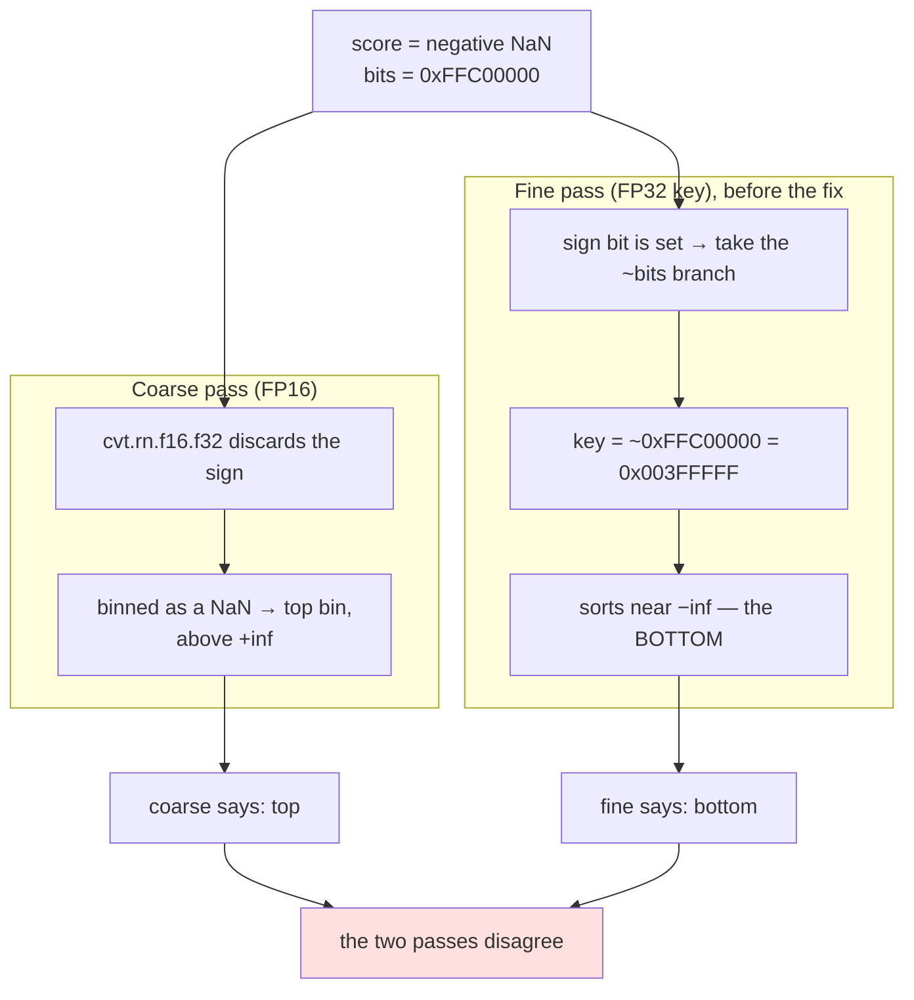
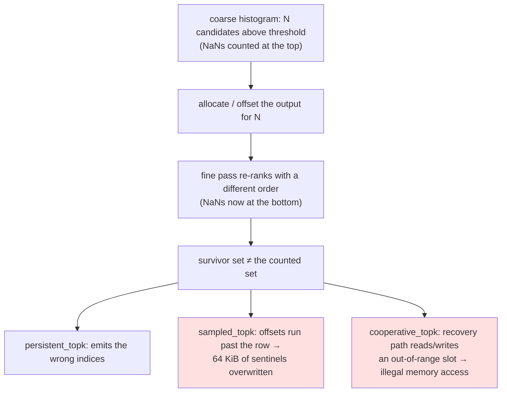

# Deep Dive 10 (Difficult) — A NaN's Sign Bit Writes 64 KiB Past the Output

| | |
| --- | --- |
| **PR** | [#66839 — "[Bugfix][Kernel] Key sign-set NaN scores above +inf in the top-k kernels"](https://github.com/vllm-project/vllm/pull/66839) |
| **Fix commit** | `748f1ab353d77900e1b55961b331d4cc1cd72edc` |
| **Files touched** | `csrc/topk_histogram_4096.cuh` (+6/−1), `tests/kernels/test_top_k_per_row.py` (+22/−1) |
| **Difficulty** | Difficult — the bug lives in a bit-manipulation identity, and its consequences range from wrong indices to an out-of-bounds write to an illegal memory access |

---

## 1. The symptom

Three distinct failures, all from the same cause, all requiring NaN scores with the **sign
bit set** (i.e. negative NaN) in a row:

| Kernel | Failure |
| --- | --- |
| `persistent_topk` (fp32, radix / FilteredTopK / sampled) | selects the **wrong top-k indices** |
| `sampled_topk` | writes **at least 64 KiB past the output row** |
| `cooperative_topk` | **illegal memory access** in its recovery path |

From the PR: *"I found this while validating #66840."* — i.e. it was found by someone
deliberately stress-testing adjacent code, not by a user. Which is how it should be found:
the trigger (negative NaN in an attention-score row) is not something a healthy model
produces often, but a single numerically unstable layer or a bad quantization scale will do
it, and the consequence is memory corruption rather than a NaN in the output.

## 2. Background: ordering floats by their bits

Radix sort cannot compare floats; it sorts unsigned integers. So the kernel maps each score
to a **monotonic unsigned key** — an integer whose ordering matches the float's.

The standard trick exploits IEEE-754 layout. For a non-negative float, the raw bits already
sort correctly; flipping the top bit on moves it above all negatives. For a negative float,
the magnitude bits sort *backwards*, so inverting every bit fixes both the direction and the
position:

```text
    float            raw bits        key
    +inf        0x7F800000      0xFF800000   ← highest
    +1.0        0x3F800000      0xBF800000
    +0.0        0x00000000      0x80000000
    -0.0        0x80000000      0x7FFFFFFF
    -1.0        0xBF800000      0x407FFFFF
    -inf        0xFF800000      0x007FFFFF   ← lowest
```

That is exactly what the kernel did:

```cpp
return (bits & 0x80000000u) ? ~bits : (bits | 0x80000000u);
//      sign set? invert      : else set the top bit
```

A correct, well-known identity — **for finite values and infinities**.

## 3. The two-level search, and where NaN breaks it

These kernels are two-pass. A coarse pass bins scores by a cheap **FP16** conversion to
narrow the search, then a fine pass sorts full-precision FP32 keys within the surviving
bins. Both passes must agree on the ordering, or the fine pass looks for candidates in bins
the coarse pass put somewhere else.

NaN is where they diverge, and the comment in the code already named half the problem:

```cpp
  // Read the bits through an opaque move: otherwise nvcc lowers
  // `bits | 0x80000000u` to the FP op -|x|, which canonicalizes NaN to
  // 0x7FFFFFFF (the key of -0.0) while the FP16 coarse bin puts NaN on top.
```

So someone had already fought this: nvcc was recognising the bit-twiddle as `-|x|` and
emitting a float negation, which *canonicalises* NaN and destroys the key. The inline
`mov.b32` defeats that.

But the sign-handling itself was still wrong. The hardware's FP32→FP16 conversion
(`cvt.rn.f16.f32`) **drops a NaN's sign**, so every NaN — positive or negative — lands in
the coarse bin above `+inf`. The FP32 key path, however, branches on the sign bit:



The coarse pass admits the NaN as a top candidate; the fine pass then ranks it at the
bottom. The candidate accounting breaks: the kernel believes it has `k` survivors in a bin
and the fine pass produces a different set.

## 4. Why a disagreement becomes memory corruption

A top-k kernel is not just a sort — it is a **counted** sort. The coarse histogram tells the
kernel how many elements fall above a threshold, and that count drives how much is written
and how the write offsets are computed. Inconsistent ordering between the passes means the
count no longer bounds the elements actually emitted:



This is the part worth internalising: **in a kernel whose bounds are derived from a
comparison, an ordering inconsistency is a memory-safety bug.** There is no bounds check to
catch it, because the bound was computed from the thing that is wrong.

## 5. The fix

Key *every* NaN above `+inf`, matching what the coarse pass already does.

```diff
 #ifdef USE_ROCM
   const uint32_t bits = __float_as_uint(x);
+  return (bits & 0x80000000u) ? ~bits : (bits | 0x80000000u);
 #else
   uint32_t bits;
   asm("mov.b32 %0, %1;" : "=r"(bits) : "f"(x));
+  // cvt.rn.f16.f32 drops a NaN's sign, so the FP16 coarse bins put every NaN
+  // on top; key sign-set NaNs above +inf too.
+  return static_cast<int32_t>(bits) > static_cast<int32_t>(0xFF800000u)
+             ? (bits | 0x80000000u)
+             : ~bits;
 #endif
-  return (bits & 0x80000000u) ? ~bits : (bits | 0x80000000u);
 }
```

The new predicate replaces a **sign test** with a **signed comparison against −inf**:

```cpp
static_cast<int32_t>(bits) > static_cast<int32_t>(0xFF800000u)
```

`0xFF800000` is the bit pattern of `-inf`; as a signed int32 it is `-8388608`. Reading the
bits as signed, the ordering of negative-signed patterns is by magnitude, so:

| Value | bits | as `int32_t` | `> -inf`? | branch taken |
| --- | --- | --- | --- | --- |
| negative NaN | `0xFFC00000` | `-4194304` | **yes** | `bits \| 0x80000000` → keyed at the top |
| `-inf` | `0xFF800000` | `-8388608` | no (equal) | `~bits` → bottom |
| `-1.0` | `0xBF800000` | `-1082130432` | no | `~bits` → correct |
| `+1.0` | `0x3F800000` | `+1065353216` | **yes** | `bits \| 0x80000000` → correct |
| positive NaN | `0x7FC00000` | `+2143289344` | **yes** | top |

The comparison is a strict generalisation: it reproduces the old behaviour for every finite
value and both infinities, and only changes negative NaN — moving it from the bottom to the
top, where the coarse pass always had it. One instruction instead of a sign mask, so the
cost is nil: *"On the B200, no config is more than 0.8 % slower than main."*

ROCm keeps the original expression, because its coarse path does not drop the sign; the
`#ifdef` split is a statement that the two platforms' conversion semantics genuinely differ.

## 6. Validation

The PR's evidence is unusually thorough for a 6-line kernel change — and it has to be,
because the failure modes include memory corruption.

- `test_topk_nan_ordering_matches_torch` extended to set sign-set NaNs (not on ROCm).
  *"main failed the 12 fp32 `persistent_topk` cases at 16, 48 and 128 rows because it leaves
  those NaNs out, and this PR passed all 72 cases."*
- **Out-of-bounds write, measured directly**: rows of 100,000 columns, `top_k=2048`.
  *"80 rows, 8000 NaNs in the last row: main's `sampled_topk` overwrites all 64 KiB of
  sentinels after the output."* Writing a sentinel pattern past the output and checking it
  survives is the right way to test a bounds bug — far better than hoping a crash reproduces.
- **Illegal memory access**: *"1 row, 4096 NaNs: main's `cooperative_topk` fails with an
  illegal memory access."*
- **No regression**: *"main's `test_top_k_per_row.py` on this PR's build: 885 passed, 45
  skipped, as on main."*
- **Performance**: `benchmark_persistent_topk.py`, *"4 rounds alternating the order of main
  and this PR: geomean 0.999 ... No config is more than 0.8 % slower."*

Alternating the order of the two builds across rounds controls for thermal drift and clock
behaviour — the detail that separates a believable 0.1% measurement from noise.

## 7. The transferable lesson

> **If two passes over the same data must agree on an ordering, they must share the ordering
> function — or you must prove they agree on every input class, NaN included.**

Specifics worth carrying out of this one:

1. **NaN is not an edge case in a comparator, it is a separate input class.** It is
   unordered under `<`, it has a sign bit that some operations preserve and others discard,
   and it has multiple bit patterns. Any bit-level ordering trick needs an explicit NaN
   story. "We don't expect NaNs" is not one — if a NaN can reach the kernel, it will.
2. **Hardware conversions lose information in documented but surprising ways.**
   `cvt.rn.f16.f32` dropping a NaN's sign is in the ISA docs and is exactly the kind of
   detail that invalidates a two-level search. When a coarse pass uses a *different numeric
   type* than the fine pass, enumerate what the narrowing does to each special value.
3. **Compilers rewrite bit twiddles into float ops.** The pre-existing `mov.b32` comment
   documents nvcc lowering `bits | 0x80000000u` to `-|x|` and canonicalising NaN. If you are
   manipulating float bits, you must stop the compiler from "helpfully" recognising the
   pattern — and leave a comment saying why, or the next cleanup will undo it.
4. **A comparison bug in a counted kernel is a memory-safety bug.** The histogram-derived
   bounds mean an ordering inconsistency does not produce a wrong answer, it produces an
   out-of-range write. Treat comparator correctness in such kernels with the seriousness of
   a bounds check.
5. **Prefer a generalising predicate over a special case.** The signed `> -inf` comparison
   handles NaN by *extending* the existing order rather than branching on it, so there is no
   new case for a future reader to miss — and it is not slower.
