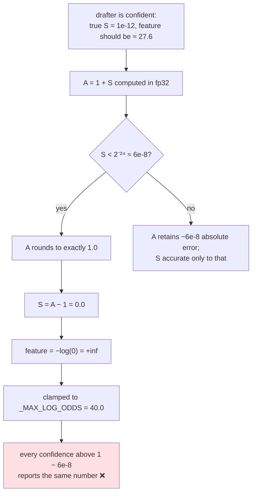
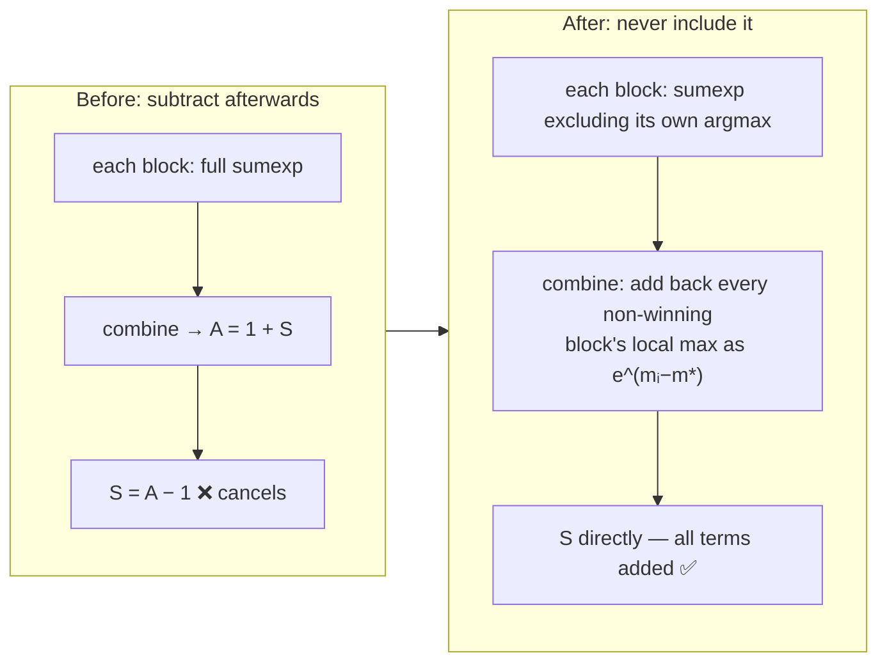

# Deep Dive 11 (Difficult) — Catastrophic Cancellation Destroys 11.5% of a Signal

| | |
| --- | --- |
| **PR** | [#65229 — "[Bugfix][Spec Decode] Avoid catastrophic cancellation in the acceptance estimator"](https://github.com/vllm-project/vllm/pull/65229) |
| **Fix commit** | `61968a50d578ba9078dcf036eaf16d688d10cc46` |
| **Files touched** | `vllm/v1/worker/gpu/spec_decode/acceptance_estimator.py` (+55/−26), `tests/v1/spec_decode/test_acceptance_estimator.py` (+160) |
| **Follow-up to** | #52228, which added the estimator |
| **Difficulty** | Difficult — pure floating-point reasoning, no crash, no NaN, no warning; the signal is silently replaced by a constant exactly when it matters most |

---

## 1. The symptom

There is no symptom. That is the point.

> The adaptive-verification acceptance feature loses its entire signal to catastrophic
> cancellation whenever the drafter is confident. Every draft row more confident than
> `1 - 6e-8` reports the same acceptance feature, `40.0`, whatever its true confidence is.
> [...] in fp32 destroys the quantity being measured — **no NaN, no warning, just the
> clamp.**
>
> **Headline:** at temperature 0.5 on source code, **11.5% of draft positions** had their
> confidence score destroyed and replaced with a constant. The failing positions are not
> exotic or adversarial — the single worst case in the sample is completing `tl.int64` from
> `tl.int6`.

Completing `tl.int64` after `tl.int6` is about as confident as a language model ever gets.
These are not pathological inputs: **the bug fires precisely on the easiest predictions**,
which are the ones adaptive verification most wants to recognise so it can draft further.

## 2. Background: what the feature is

Adaptive verification ([feature 05](../docs-intro/features/05-speculative-decoding.md) §6)
decides how many draft positions to verify per request. It fits a logistic regression whose
regressor is the **log-odds of the draft distribution's most likely token**.

Let the temperature-scaled logits be `x₁ … x_V`, `m = maxᵢ xᵢ` at index `i*`, and define the
**complement mass**

```text
S = Σ_{j ≠ i*} e^(x_j − m)
```

Then, as the PR derives:

```text
q_max = 1 / (1 + S)
1 − q_max = S / (1 + S)
feature = log(q_max / (1 − q_max)) = log(1/S) = −log S
```

So the feature is just `−log S`. Note what that means: the feature is **entirely a function
of the complement**. The top token's own mass cancels out of the expression. `S` is not an
intermediate — it *is* the quantity being measured.

One more property worth noting, documented in the kernel: the feature scores the draft
*distribution*, not the token drawn from it, so it depends on the prefix alone. Trimming a
draft therefore never conditions on the token being trimmed, and rejection sampling stays
lossless.

## 3. Root cause

The original kernel computed `S` the obvious way: sum everything, then remove the top
token's contribution. Since the sum is shifted by `m`, the top token contributes exactly
`e^(m−m) = 1`:

```text
A = Σ_{j=1..V} e^(x_j − m) = 1 + S
S = A − 1
```

In code:

```python
total_sumexp = tl.sum(tl.where(blocks_mask, sumexps * tl.exp(maxes - global_max), 0.0), axis=0)
complement_sumexp = tl.maximum(total_sumexp - 1.0, 0.0)
```

Mathematically exact. In fp32, a disaster.

**fp32 spacing on `[1, 2)` is `2⁻²³ ≈ 1.19e-7`.** So `1 + S` cannot represent `S` to better
than ~6e-8 of absolute error, no matter how small `S` is — and once `S < 2⁻²⁴`, `1 + S`
rounds to exactly `1.0`. The subtraction then yields `0.0`, `−log(0) = +inf`, and the
`±40` clamp turns that into a plausible-looking `40.0`.



This is textbook **catastrophic cancellation**: subtracting two nearly-equal quantities to
recover a small difference, where the difference is the answer. The classic examples are
`sqrt(x+1) − sqrt(x)` and the quadratic formula; this is the same failure wearing a
log-sum-exp costume. A ~23-nat span of genuinely distinct confidences — from `S = 6e-8` down
to `S = e⁻⁴⁰` — collapses onto one value.

And because the clamp exists for a legitimate reason (a truly one-hot row really does send
the feature to infinity), the corrupted output is indistinguishable from a valid one. The
regression trains on `40.0` for 11.5% of its samples and learns nothing from them.

## 4. The fix: never form `1 + S`

Compute the complement **directly**, by excluding the max from the sum rather than
subtracting it afterwards. The kernel is two-level — per-vocabulary-block partials, then a
cross-block combine — so both levels change.

**(a) Per-block: a new excluding reduction** (`acceptance_estimator.py:161`):

```python
@triton.jit
def _max_and_excl_sumexp(logits):
    """Block max, and its sumexp with one copy of that max left out.

    The excluding sum is what keeps the feature accurate. Forming the full sum
    and subtracting the max's own e^(m-m) = 1 term afterwards is catastrophic
    cancellation: the complement mass is the whole quantity of interest, and it
    is gone as soon as it falls below an fp32 ulp of 1.0 (~6e-8), which a
    confident drafter reaches routinely.
    """
    block_max = tl.max(logits, axis=0)
    # Excluding by value zeroes every entry tied for the max, so add back all
    # but one: the others are distinct tokens and belong to the complement.
    is_max = logits == block_max
    excl_sumexp = tl.sum(tl.where(is_max, 0.0, tl.exp(logits - block_max)), axis=0)
    excl_sumexp += tl.sum(is_max.to(tl.float32), axis=0) - 1.0
    # An all--inf block (vocab padding) ties with itself throughout, leaving a
    # spurious BLOCK_SIZE - 1 above; it holds no tokens, so it contributes none.
    return block_max, tl.where(block_max > float("-inf"), excl_sumexp, 0.0)
```

Two correctness subtleties handled here, both of which a naive "mask out the max" would get
wrong:

- **Ties.** Masking by *value* zeroes every element equal to the max. If three tokens tie,
  two of them are genuine complement members contributing `e⁰ = 1` each. The
  `+= count(is_max) − 1` line adds them back. Exactly one entry is removed, which is what
  "exclude the argmax" means.
- **Vocabulary padding.** An all-`−inf` block ties with itself in every lane, so the add-back
  would contribute a spurious `BLOCK_SIZE − 1`. The final `tl.where` zeroes such blocks —
  they hold no real tokens.

**(b) Cross-block: put back every non-winning block's own max** (`:316-325`):

```python
    # Rescale each block's partial to the global max and sum. Every block but
    # the one holding the global max has to put its own local max back, since
    # that is a different token and so is genuinely part of the complement; it
    # re-enters as e^(m_i - m*), the scale itself. A block that merely ties the
    # global max is one of those, and contributes in full.
    #
    # Every term is added, never subtracted, and none exceeds the total, so the
    # complement keeps fp32 relative accuracy however small it is -- which is
    # the point, since the feature is its logarithm and is read down to e^-40.
    global_max, best_block = tl.max(maxes, axis=0, return_indices=True)
    scale = tl.where(blocks_mask, tl.exp(maxes - global_max), 0.0)
    complement_sumexp = tl.sum(
        excl_sumexps * scale + tl.where(blocks == best_block, 0.0, scale), axis=0
    )
```

Each block excluded *its own* local max, but only one of those is the global max. Every
other block's local max is a different token that belongs in the complement, and re-enters
as exactly `e^(mᵢ − m*)` — the rescaling factor itself. `return_indices=True` identifies the
winning block **by position**, so a block that merely ties the global max contributes in
full rather than being wrongly excluded.



The invariant that makes this accurate is stated in the comment: **every term is added,
never subtracted, and none exceeds the total.** A sum of non-negative floats has bounded
relative error regardless of magnitude, so `S = 1e-30` is computed to fp32 relative
precision — and since the feature is `−log S`, relative accuracy in `S` is absolute accuracy
in the feature. That is the whole game.

The import of `_compute_max_and_sumexp` from `rejection_sampler_utils` is dropped: the shared
helper is correct for *softmax* (where you want the full sum) and wrong for this caller. The
fix declines to reuse it rather than bending it.

## 5. Cost

> One extra fp32 partial per (token, vocab block): 0.1% of the kernel's memory traffic
> (311 KiB against 311 MiB of logit reads at 1024 tokens and a 152k vocab). No extra kernel
> launch.

Quantified against the kernel's dominant cost, not asserted as "negligible".

## 6. Validation

`tests/v1/spec_decode/test_acceptance_estimator.py` — **18 passed in 7.08s** on an H100,
three of them new:

- **`test_feature_resolves_a_tiny_complement_mass`** — δ ∈ {1e-3, 1e-6, 1e-12} against an
  **fp64 reference computed without ever forming `1 + δ`**. *"Fails at 1e-6 and 1e-12 on
  `main`."* The reference's construction is the test's key idea: comparing against an fp64
  implementation of the *same broken formula* would have agreed with the bug.
- **`test_feature_combines_blocks_around_the_global_max`** — parameterised over which of
  three vocabulary blocks holds the top token. The PR notes why this was needed:

  > Every pre-existing test used a 2048-token vocabulary, narrower than the kernel's
  > 4096-wide block, so `num_blocks` was always 1 and the cross-block combine was dead code.

  An entire code path was untested because every fixture's vocabulary fit in one block. That
  is worth checking in your own kernel tests: *does the test data actually exercise the
  multi-tile path?*

## 7. The transferable lesson

> **Never recover a small quantity by subtracting two large nearly-equal ones. Compute it
> directly.**

Generalisations:

1. **Know where your answer lives in the float grid.** `1 + S` places `S` on a grid whose
   spacing is `2⁻²³`. The bug is not that fp32 is imprecise; it is that the computation
   *moved the answer into a range where fp32 cannot represent it*. Shifting by the max is
   the standard log-sum-exp stabilisation — and here that very shift is what pins the sum at
   1.0 and destroys the complement.
2. **Silent saturation is worse than NaN.** A NaN propagates and gets noticed. `40.0` is a
   legal value that the clamp produces for legitimate reasons too, so the corruption is
   indistinguishable from valid output. When you clamp, ask what fraction of your inputs are
   hitting the clamp and whether they *should* be.
3. **Measure the corruption rate on real data.** "11.5% of draft positions at temperature
   0.5 on source code" is what makes this a bug report rather than a theoretical concern. A
   counter on how often a clamp binds is cheap and would have surfaced this immediately.
4. **Exclude by position, not by value.** Value-based masking silently mishandles ties and
   padding. Both appear here, and both would have produced a subtler wrong answer than the
   bug being fixed.
5. **A shared helper can be right for one caller and wrong for another.**
   `_compute_max_and_sumexp` is correct for softmax normalisation and unusable here. Reuse
   is a default, not an obligation.
6. **Check that your fixtures reach every tile.** A whole cross-block combine was dead code
   in tests because every vocabulary fit in a single block. Parameterise over which tile
   holds the interesting element.
