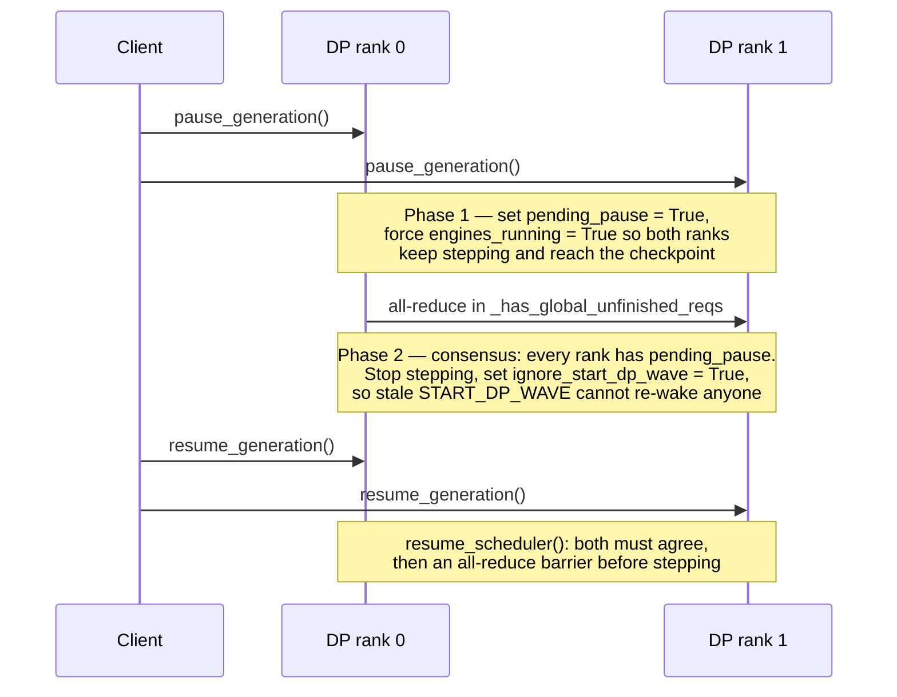
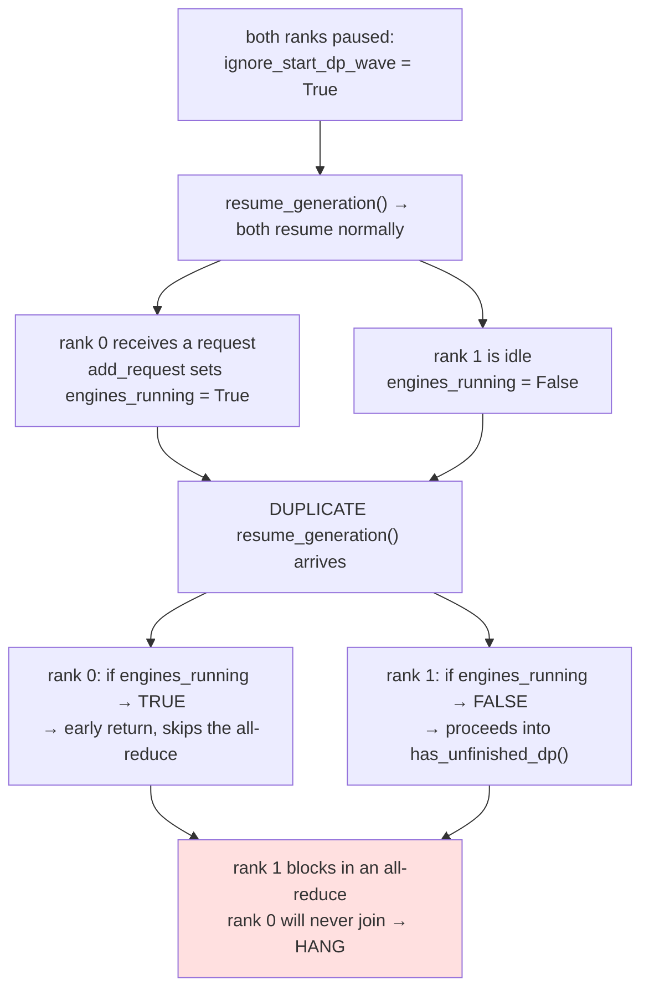
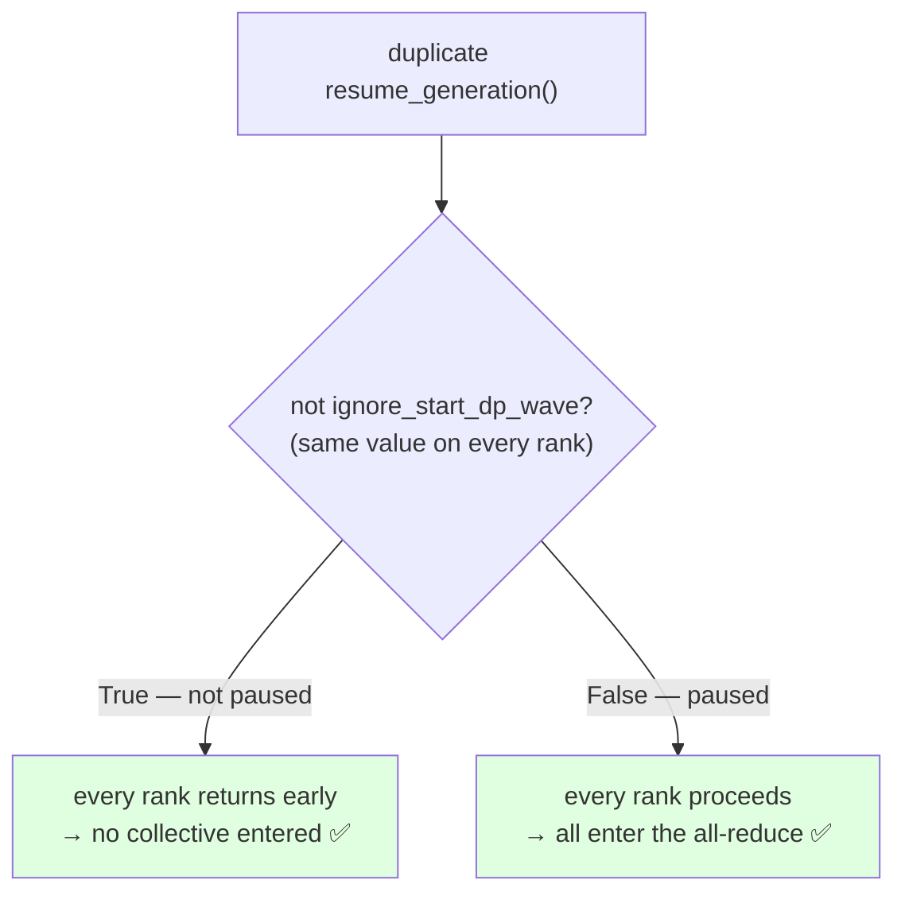

# Deep Dive 12 (Difficult) — One Rank Enters a Collective Its Peers Skipped

| | |
| --- | --- |
| **PR** | [#55229 — "[Bugfix][DP] Prevent mismatched collectives on duplicate resume"](https://github.com/vllm-project/vllm/pull/55229) |
| **Fix commit** | `5be8acb7f2e7a9dd22246df3fbbadb173795160e` |
| **Files touched** | `vllm/v1/engine/core.py` (**+2/−1**), `tests/v1/distributed/test_async_llm_dp.py` (+41), `docs/training/async_rl.md` (+2) |
| **Difficulty** | Difficult — the entire production change is one condition, and reaching it requires reasoning about which pieces of state are *per-rank* and which are *consensus* |

---

## 1. The symptom

A hang. Not an exception, not a timeout with a useful message — the engine simply stops.

> A duplicate `resume_generation()` can hang a data-parallel MoE engine when a request
> starts a new wave. An idle rank can enter the resume all-reduce while the rank that
> received the request skips it.

Observed behaviour on B200s with `ibm-research/PowerMoE-3b`, DP=2:

> reverting the production change left only rank 1 logging `setting pause state to
> UNPAUSED` before pytest reported `+++ Timeout +++`. With the fix, the request finished at
> both TP sizes.

"Only rank 1 logged it" is the diagnosis in one line: the two ranks took different branches,
so one is blocked in a collective the other never joined.

This is the canonical data-parallel failure mode
([feature 08](../docs-intro/features/08-distributed-parallelism.md) §6): **if a DP job
hangs, suspect divergence.** A collective is a rendezvous; a rank that skips it leaves its
peers waiting forever.

## 2. Background: pause/resume under data parallelism

This machinery exists for async RL ([`docs/training/async_rl.md`](../docs/training/async_rl.md)):
pause generation, swap in new policy weights, resume. Under DP, pause must be **collective**
— every rank has to stop at the same iteration boundary, because MoE expert-parallel
all-to-all spans DP ranks and a half-stopped group deadlocks.

`DPEngineCoreProc.pause_scheduler` (`vllm/v1/engine/core.py:2565` onward) is therefore a
two-phase protocol, documented in its own docstring:



`resume_scheduler` (`:2669`) ends with a barrier implemented as an all-reduce:

```python
super().resume_scheduler()
self.ignore_start_dp_wave = False

# Barrier: wait for all DP ranks to have resumed (and cleared
# ignore_start_dp_wave) before any rank starts stepping. Uses
# the existing all-reduce which is safe because engines are
# stopped.
has_global_unfinished = ParallelConfig.has_unfinished_dp(
    self.dp_group, self.scheduler.has_unfinished_requests()
)
```

**Every rank that proceeds past the early-return must enter that all-reduce.** The guard
deciding who returns early is therefore the critical section.

## 3. Root cause — guarding on per-rank state

The pre-fix guard:

```python
if self.engines_running:
    logger.debug("Resume called while engines are not paused, ignoring.")
    return
```

The intent is right: *"if we are not actually paused, a resume is a no-op."* The problem is
the state it reads. From the PR:

> `engines_running` changes when an individual rank learns about work.
> `ignore_start_dp_wave` is set when the ranks agree to pause and when a new rank joins.

`engines_running` is **per-rank and event-driven**. `add_request` (`:2654`) sets it the
moment *that* rank receives a request:

```python
if (not self.engines_running
        and self.scheduler.pause_state == PauseState.UNPAUSED):
    # Engines alone start waves: have the coordinator wake the others.
    self.engines_running = True
    self.output_queue.put_nowait((-1, EngineCoreOutputs(start_wave=self.current_wave)))
```

So after a resume, a rank that receives a request has `engines_running = True`, while an
idle rank still has `False` — and the coordinator's `START_DP_WAVE` broadcast reaches ranks
at different times. The two ranks disagree about a value they are both using to decide
whether to enter a collective.



The duplicate resume is what exposes it. A single well-ordered resume has all ranks in the
same state, so they agree. Add a retry, a racing client, or two API-server processes each
sending a resume, and the ranks are consulting a value that is *supposed* to differ between
them.

## 4. The fix

```diff
-        if self.engines_running:
+        # Set at pause consensus, so all ranks take the same branch.
+        if not self.ignore_start_dp_wave:
             logger.debug("Resume called while engines are not paused, ignoring.")
             return
```

Read **consensus state** instead of **per-rank state**.

`ignore_start_dp_wave` is set in phase 2 of the pause protocol — *after* the all-reduce has
confirmed every rank wants to pause — and cleared in `resume_scheduler` itself. It is
therefore identical across ranks at exactly the moment this decision is made, which is the
property the guard needs:

| State | Scope | Set when |
| --- | --- | --- |
| `engines_running` | **per rank** | that rank learns about work (`add_request`, `START_DP_WAVE`) |
| `ignore_start_dp_wave` | **consensus** | pause all-reduce agrees (`:2855`); a new Elastic EP rank joins (`:2959`) |

Both branches are now collectively consistent: either every rank returns early, or every
rank enters the barrier.



The pre-existing `RuntimeError` for a resume arriving mid-pause is untouched
(`pending_pause or (engines_running and ignore_start_dp_wave)`), so the "you resumed too
early" error still fires — the fix only changes which resumes are *ignored*.

### The documentation change is part of the fix

```diff
+Wait for `pause_generation()` to finish before resuming, since a data-parallel MoE engine
+can reject an early resume. Once generation resumes, calling `resume_generation()` again
+has no effect.
```

The code now tolerates a duplicate resume; the docs tell RL authors the contract so they do
not rely on undefined ordering. `AGENTS.md` requires user-visible changes to update the
rendered docs in the same PR, and the PR confirms `mkdocs build --strict` passed.

## 5. Validation

A regression test that reproduces the *ordering*, not just the API call:

```sh
RAY_ADDRESS=local DP_SIZE=2 TP_SIZE=1 .venv/bin/python -m pytest -q \
  tests/v1/distributed/test_async_llm_dp.py::test_dp_duplicate_resume_while_one_rank_starts_a_wave
```

> The regression sends a resume to an idle rank, submits a request to rank 0, then sends
> rank 0 its resume.

That sequence is the bug: it deliberately drives the two ranks' `engines_running` apart
before the duplicate resume. The PR also ran it at `TP_SIZE=1` and `2`, and a stress run
*"hung within 25 rounds on the baseline and completed 200 rounds with the fix."*

For a race, a single pass proves little — 200 rounds is what makes it evidence. And note the
baseline methodology: *"restore only `vllm/v1/engine/core.py` from the merge base"*, so the
comparison isolates the production change from the new test.

The PR is also explicit about coverage gaps: *"ROCm and model accuracy were not evaluated"*,
and lists adjacent tests that fail on **both** trees (a NIXL variant, `test_engine_core_tp`)
so a reviewer does not attribute pre-existing failures to this change.

## 6. The transferable lesson

> **A branch that decides whether to enter a collective must read state that is identical
> on every rank.**

This is the single most useful rule for debugging distributed hangs. Formalised:

```text
For any collective C and any rank r:
    rank r enters C  ⟺  predicate P(r) holds
Then P must be rank-invariant.
```

`engines_running` is deliberately *not* rank-invariant — that is its job. Using it in a
collective predicate was the bug.

Practical generalisations:

1. **Classify your state.** Walk the fields of a distributed participant and label each
   *per-rank* or *consensus*. Then grep for the per-rank ones inside any branch leading to a
   collective. vLLM makes this tractable because consensus state is set in one place: the
   all-reduce checkpoint.
2. **A hang is a divergence, and the logs localise it.** "Only rank 1 logged X" identifies
   the branch. Per-rank logging around collective decisions is worth its cost; so is
   `py-spy dump --pid` on every worker, which will show one rank inside NCCL and another
   somewhere else.
3. **Idempotence is a protocol requirement, not a nicety.** RL control planes retry.
   Operators double-click. Two API-server processes both forward a resume. A control
   operation that is only safe when delivered exactly once, in order, will eventually be
   delivered twice.
4. **Duplicate and reordered control messages belong in the test matrix.** The functional
   test — pause, swap weights, resume — passed throughout. The *duplicate* resume is what
   broke. For any pause/resume/abort/reset API under DP, test it twice in a row and out of
   order.
5. **Comment the invariant at the branch.** `# Set at pause consensus, so all ranks take
   the same branch.` is 13 words that stop someone "simplifying" the condition back to
   `engines_running`, which reads more naturally and is wrong.
