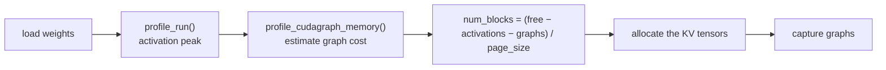
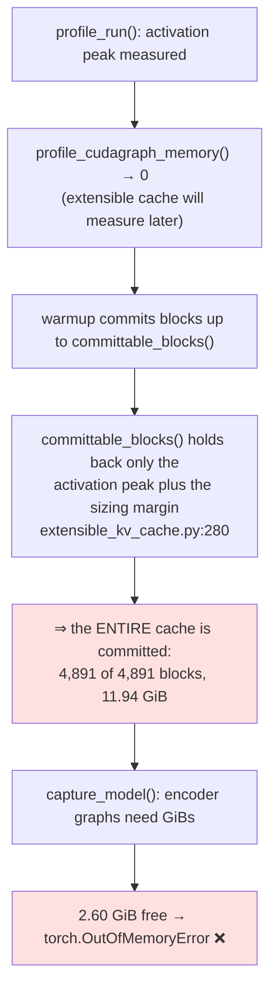
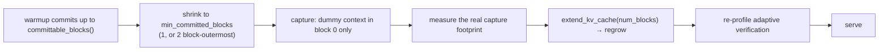

# Deep Dive 13 (Difficult) — The KV Cache Eats the Memory CUDA Graph Capture Needs

| | |
| --- | --- |
| **Issue** | [#65868 — "MRV2 extensible KV cache commits all KV before encoder CUDA graph capture, so cudagraph_mm_encoder OOMs at startup"](https://github.com/vllm-project/vllm/issues/65868) |
| **Fix PR** | [#66523 — "[Bugfix] Extensible KV cache: release warmup's blocks before CUDA graph capture"](https://github.com/vllm-project/vllm/pull/66523) |
| **Fix commit** | `3319c629a148c8f7ce088445911d9db4119af134` |
| **Files touched** | `vllm/v1/worker/gpu_worker.py` (+10), `vllm/v1/worker/extensible_kv_cache.py` (±15), `vllm/v1/worker/gpu/model_runner.py` (±20), `vllm/v1/worker/gpu/cudagraph_utils.py` (±7), `spec_decode/autoregressive/speculator.py` (±4), `tests/v1/worker/test_extensible_kv_cache.py` (+102) |
| **Difficulty** | Difficult — a startup **ordering** bug across memory profiling, warmup, graph capture and cache sizing, where the failure is an OOM in a place that has nothing to do with the cause |

---

## 1. The symptom

A 31B vision model refused to start:

> With `cudagraph_mm_encoder` on, the default MRV2 startup path **crashes with CUDA OOM
> while capturing the encoder CUDA graphs**, instead of either fitting or failing at
> startup with the usual "not enough KV cache" error.

The issue's table is the whole story:

| | MRV2, extensible KV (default) | MRV2, extensible off | MRV1 |
| --- | --- | --- | --- |
| CUDA graph memory estimate | **not run (0)** | ~5.75 GiB | ~6.8 GiB |
| "Available KV cache memory" | 11.94 GiB | 6.19 GiB | 5.08 GiB |
| KV committed right before `capture_model()` | **11.94 GiB (4,891 of 4,891 blocks); 2.60 GiB free** | — | — |
| outcome | **`torch.OutOfMemoryError` during encoder graph capture** | clean `ValueError`: needs 6.89 GiB of KV | clean `ValueError` |

Two things make this worse than a plain OOM:

- **The failure site is unrelated to the cause.** The crash is inside graph capture (or
  just after, in `_dummy_sampler_run`). Nothing points at the KV cache.
- **It replaced a good error with a bad one.** The non-extensible paths fail with a clean
  `ValueError` telling you the model does not fit. The extensible path OOMs mid-capture,
  which reads like a bug in the encoder graphs.

The reporter also noted the instability: *"The OOM site depends on how much is left. When I
filed #65868 on `871147447b`, capture itself failed; at 4096 it started, because the graphs
were smaller."*

## 2. Background: two ways to size the KV cache

**MRV1 / non-extensible**: measure, then allocate once.



The graph cost is *estimated up front* and subtracted, so capture has room by construction.

**The extensible KV cache** (`vllm/v1/worker/extensible_kv_cache.py`) instead reserves a
virtual address range and **commits physical pages incrementally**, growing to whatever is
left after everything else has been measured. That is strictly better in principle — no
estimate, no conservatism — and it is the MRV2 default.

Because it measures the capture footprint *afterwards*,
`GPUModelRunner.profile_cudagraph_memory` deliberately returns 0 when the extensible cache
is enabled. The comment in the issue quotes the rationale: the cache *"measures the capture
footprint after warmup"*.

## 3. Root cause — nobody held room for capture

The estimate was skipped (correctly, by design). But the step that was supposed to make that
safe did not hold anything back from *capture*:



`committable_blocks()` (`:280`) is honest about its own scope:

```python
    """Blocks that can be committed now without eating into the headroom.

    Bounds what warmup may commit: free memory plus the committed prefix,
    less the sizing margin and the larger of reserved_headroom_bytes and
    a share of the headroom, never below what is already committed nor
    above the capacity.
    """
```

It reserves headroom for *warmup's own activations and a sizing margin*. CUDA graph capture
is not in that list — and it is the single largest post-warmup allocation, because encoder
graphs can take several GiB
([feature 09](../docs-intro/features/09-torch-compile-and-cudagraphs.md) §7).

So the bug is a **gap between two components' assumptions**: the profiler skipped its
estimate on the grounds that the cache would handle it, and the cache's commit bound never
accounted for capture. Each is locally reasonable; together they leave capture with
whatever happens to be left.

## 4. The key insight behind the fix

Why can the cache simply be shrunk before capture? Because **graphs do not bake in KV block
addresses.**

A CUDA graph records kernel launches against *fixed buffer addresses* — and the KV cache's
**virtual** range never moves; only physical page commitment changes. The block *contents* a
replay reads come from the block tables, which are read at replay time
([feature 01](../docs-intro/features/01-paged-attention-and-kv-cache.md) §5). Capture only
needs the pages its dummy batch actually touches to be **mapped**, so that the capture-time
launches do not fault.

So: shrink to the minimum mapped set, capture, then regrow. The graphs stay valid.

## 5. The fix

**(a) Name the minimum, in one place** — `extensible_kv_cache.py:184`:

```diff
-    def allocate(self, size: int) -> torch.Tensor:
-        """Allocator hook for allocate_kv_cache; commits the null block.
+    @property
+    def min_committed_blocks(self) -> int:
+        """The null block, plus one under block-outermost layouts, whose views
+        start inside block 0 and read past it (see `pad_kv_cache_segments`)."""
+        return 2 if self._is_block_outermost else 1
 
-        Under block-outermost layouts layers' views start inside block 0, so a
-        second block keeps at least half a granule mapped past each view's start
-        (see `pad_kv_cache_segments` for what reads it).
-        """
+    def allocate(self, size: int) -> torch.Tensor:
+        """Allocator hook for allocate_kv_cache; commits the minimum."""
         assert size == self.size, f"Expected {self.size} bytes, got {size}."
-        self.commit(2 if self._is_block_outermost else 1)
+        self.commit(self.min_committed_blocks)
         return self.buffer.full_view()
```

A magic `2 if ... else 1` that previously lived inline in one caller becomes a named
property — because the fix adds a *second* caller that must use the identical value. Exactly
the pattern from [deep dive 6](06-difficult-eagle-draft-kernel-block-size.md): when two
places need the same derived value, give it one definition.

**(b) Release warmup's blocks before capture** — `gpu_worker.py:1150-1153`:

```diff
+            if not self.model_config.enforce_eager:
+                # Warmup's blocks hold garbage and capture addresses only the
+                # null block: release them so the graphs fit (encoder graphs
+                # can take GiBs). extend_kv_cache commits the size measured
+                # after capture.
+                kv_cache.commit(kv_cache.min_committed_blocks, shrink=True)
```

*"Warmup's blocks hold garbage"* is the licence to discard them: they contain dummy KV from
synthetic batches, so there is nothing to preserve.

**(c) Point capture's dummy KV context at the null block** —
`cudagraph_utils.py:880-885`:

```diff
         set_dummy_context(
             input_batch,
             block_tables,
             block_tables.cp_size * block_tables.cp_interleave,
-            kv_cache_config.num_blocks,
+            # Replays read the real block tables, so the context can sit in the
+            # null block: the one an extensible KV cache keeps mapped for capture.
+            1,
             model_state.max_model_len,
```

Capture's synthetic batch previously spread its dummy context over `num_blocks` — which
*requires* those blocks to be mapped. Confining it to block 0 is what makes the shrink safe,
and the comment states the reason replays are unaffected. The `kv_cache_config` parameter
becomes unused and is removed from the signature and all three call sites — a dead parameter
is an invitation to reintroduce the dependency.

**(d) Re-profile adaptive verification against the real cache** — `gpu_worker.py:1021`:

```diff
     def extend_kv_cache(self, num_blocks: int) -> None:
         """Commit the final size of an extensible KV cache."""
         extend_kv_cache(self.model_runner, self._kv_cache_config, num_blocks)
         self.cache_config.num_gpu_blocks = num_blocks
+        if getattr(self.model_runner, "adaptive_verification", None) is not None:
+            # Capture profiled step costs with only a block or two committed,
+            # so their KV reads hit L2; profile again against the final cache.
+            self.model_runner.profile_adaptive_verification()
```

This is the consequence the fix had to chase. Adaptive verification
([feature 05](../docs-intro/features/05-speculative-decoding.md) §6) times dummy steps to
build **cost curves**. With only one or two blocks committed, every KV read hits L2 and the
measured costs are fantasy. So the profiling is extracted into a reusable
`GPUModelRunner.profile_adaptive_verification` (`model_runner.py:1246`) and re-run once the
cache has reached its final size.

A fix that shrinks memory during startup silently invalidated a *timing* measurement. That
is the kind of second-order effect that makes ordering bugs expensive.

**(e) Stop draft steps writing through stale block ids** —
`spec_decode/autoregressive/speculator.py:118-122`:

```diff
         self.last_token_indices.zero_()
-        self.idx_mapping.zero_()
+        # As in dummy runs, -1 keeps draft steps from writing KV through a
+        # request-state row's stale block ids.
+        self.idx_mapping.fill_(-1)
```

With the cache shrunk, a zeroed `idx_mapping` points at request-state row 0, whose stale
block ids may now be **unmapped**. `-1` marks the rows invalid instead.

## 6. Validation



- **The reported case**, 1× H100, `gpu_memory_utilization=0.95`, `cudagraph_mm_encoder`:
  main `OutOfMemoryError` at `max_model_len` 4096 *and* 8192; with the fix, both start and
  serve 6/6 image prompts, with 772 blocks (7.54 GiB) and 714 blocks (6.97 GiB) of KV.
- **Graphs stay valid after regrowth**: *"With Qwen3-0.6B and CUDA graphs, greedy outputs
  match the run with the extensible cache off."* This is the assertion that matters — the
  fix's correctness claim is "capturing against a shrunken cache is safe", and the way to
  test it is a differential comparison against the configuration that never shrinks.
- **The targeted regression test**: `test_capture_gets_the_memory_warmup_committed` records
  how many blocks are committed when `capture_model()` runs. *"Without the fix it fails with
  `assert [1025] == [1]`."* The bug expressed as a single integer.
- `pytest tests/v1/worker/test_extensible_kv_cache.py tests/v1/worker/test_gpu_worker.py
  tests/v1/worker/test_gpu_warmup_blocks.py` → **114 passed**.
- **Scope claim**: *"Only startup changes: one remap before capture. Nothing changes in
  steady state."*

## 7. How the code looks now

The area has been extended since. `gpu_worker.py` now shrinks at **two** points (`:1138`
and `:1153`) — once before the KV-cache sizing warmup and again before capture — plus
`record_transient_peak()` and `clear_input_block_tables()`:

```python
            # The blocks warmup_kernels committed hold garbage and can take
            # nearly all the memory warmup may commit: release them, so the
            # sizing steps run beside only the blocks they address.
            kv_cache.commit(kv_cache.min_committed_blocks, shrink=True)
            # Null stale ids past each row's last block, which the shrink unmapped:
            # some kernels load whole KV tiles (e.g. AITER on gfx950, ROCm/aiter#8033).
            self.model_runner.block_tables.clear_input_block_tables()
```

The `clear_input_block_tables()` line is the generalisation of fix (e): *any* kernel that
loads whole KV tiles can touch a block past a row's last, and after a shrink that block may
be unmapped. The one-off `idx_mapping.fill_(-1)` became a systematic "null stale ids after
shrinking" step — the right end state, reached by first fixing the instance.

## 8. The transferable lesson

> **When one component stops reserving for a cost because another will handle it later,
> something has to actually hold the room. Verify the handoff, do not assume it.**

The two halves were each defensible:

- the profiler: *"skip the graph estimate — the extensible cache measures capture after
  warmup"*;
- the cache: *"commit up to free memory less the activation peak and sizing margin"*.

Neither reserved for capture. The gap is invisible in either file alone.

Generalisations:

1. **Startup is a resource pipeline; write down its order.** Profile → allocate → warm up →
   compile → capture → size. Each stage's peak must fit beside what earlier stages hold.
   Draw it once and the gap is obvious.
2. **"X will handle it later" needs a test that X did.** The new regression asserts the
   committed block count at the moment of capture — a direct check of the handoff, not of
   its consequences.
3. **Freeing memory can invalidate measurements, not just data.** Adaptive verification's
   cost curves were measured against an L2-resident cache. A memory fix that silently
   corrupts a *timing* model is a trap worth looking for whenever you move allocations
   around.
4. **Shrinking an address range makes stale indices dangerous.** Zero was a safe default for
   `idx_mapping` while everything was mapped. Sentinels (`-1`) and explicit nulling are what
   you need once mappings can disappear.
5. **A worse error message is a regression.** The non-extensible paths fail with a clean
   `ValueError` naming the shortfall; the extensible path OOM'd mid-capture. When adding a
   dynamic-sizing path, preserve the diagnosable failure mode of the static one.
6. **Give a magic constant a name the moment it has two callers.** `min_committed_blocks`
   exists because the fix needed the same `2 if block_outermost else 1` in a second place.
