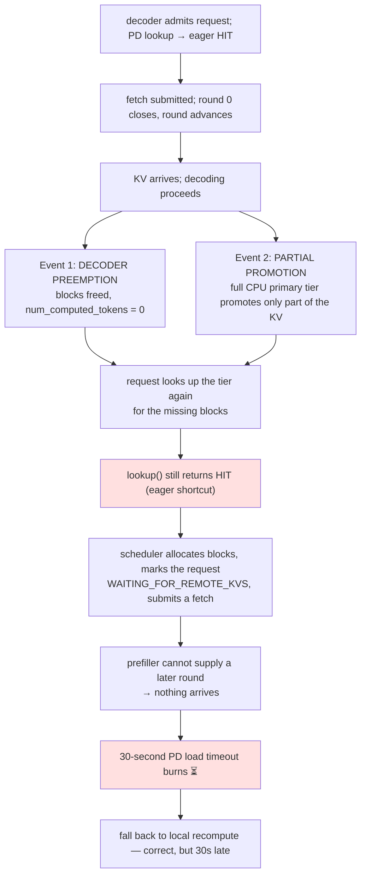
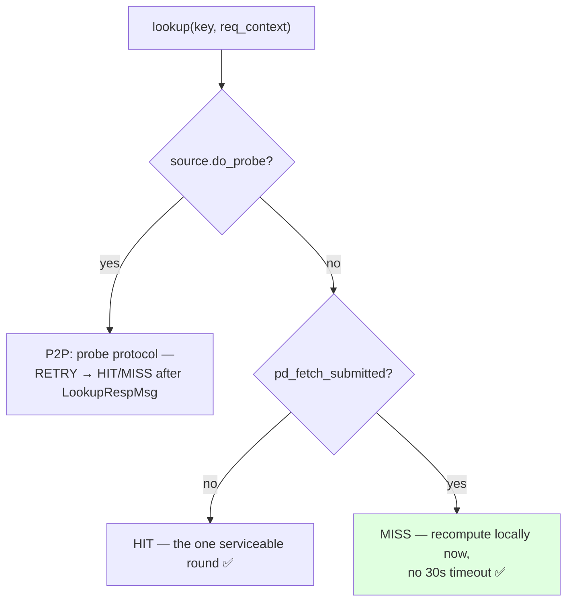

# Deep Dive 14 (Difficult) — An Eager "Cache Hit" That Can Never Be Served

| | |
| --- | --- |
| **PR** | [#67497 — "[Bugfix][KV Offload][P2P] Prevent repeated PD KV fetches after decoder preemption"](https://github.com/vllm-project/vllm/pull/67497) |
| **Fix commit** | `f2d0d8418efc017cd5f6e4fd46dfb0b89874fb28` |
| **Files touched** | `vllm/v1/kv_offload/tiering/p2p/manager.py` (+9/−2), `vllm/v1/kv_offload/tiering/p2p/session/client.py` (±3), `docs/features/kv_offloading_usage.md` (±1), `tests/v1/kv_offload/tiering/p2p/test_manager.py` (+107) |
| **Difficulty** | Difficult — a distributed protocol invariant, where the cost is a 30-second stall that looks like network trouble rather than a logic error |

---

## 1. The symptom

Not a crash and not wrong output — a **30-second stall**, repeatedly:

> After decoder preemption or a partial promotion caused by a full CPU primary tier, the KV
> Offload P2P tier still reports PD cache hits that trigger an unsatisfiable second fetch
> and wait for the 30-second timeout.

The measured impact, on one GB10:

| Model / scheduling | Preemptions | Failed promotions, before → after | PD completion (s), before → after | Matching tokens |
| --- | ---: | ---: | ---: | ---: |
| SmolLM2-135M-Instruct / FCFS | 1 | 3 → 0 | **45.99 → 13.52** | 1,824 / 1,824 |
| SmolLM2-135M-Instruct / priority | 2 | 10 → 0 | **49.06 → 27.71** | 2,624 / 2,624 |
| OPT-125M / priority | 1 | 10 → 0 | **45.00 → 15.14** | 1,824 / 1,824 |

Note the last column: **the outputs were always correct.** The system recovers — after the
timeout, the missing KV is recomputed locally and generation continues. So this is a pure
latency bug, invisible to any correctness test, and easy to misattribute to a slow peer or a
flaky fabric.

## 2. Background: the eager-hit shortcut in P/D mode

The P2P secondary tier ([feature 12](../docs-intro/features/12-kv-connectors-and-disaggregation.md))
serves two different topologies through one code path:

| Mode | Config | Lookup behaviour |
| --- | --- | --- |
| **P2P** | `remote_kv_source` | the consumer does not know what the peer has, so it **probes**: `LookupMsg` → `LookupRespMsg` round-trip, then fetch |
| **Classic P/D** | `remote_prefiller` | the decoder *knows* the prefiller computed the whole prompt, so the probe is pure latency — skip it and declare an immediate **HIT** |

`P2PSourceInfo.do_probe` (`manager.py:138`) distinguishes them, and `lookup()`
(`manager.py:425`) ended with:

```python
        # PD consumer (we are the decoder): all kv blocks should be on the
        # prefiller side. Return HIT immediately.
        return LookupResult.HIT
```

A deliberate, well-reasoned optimisation: it removes a network round-trip from the critical
path of every disaggregated request. Its correctness rests on an assumption stated right
there in the comment — **"all kv blocks should be on the prefiller side"**.

## 3. Root cause — the assumption holds exactly once

The prefiller's stores are bound to the **first** fetch round. From the fix's comment:

> PD stores bind to round 0. A later fetch after preemption or partial promotion cannot be
> supplied and would wait out the PD load timeout.

The client-side round counter makes this explicit (`session/client.py:85-89`):

```python
    # Current lookup round. LookupMsgs carry it, each fetch closes it and
    # advances it, so every round's supply/demand/completion is isolated
    # on the wire. PD clients never probe, but each nonempty fetch also
    # advances the round; only the first PD fetch can be supplied.
    round_seq: int = 0
```

So once the decoder has submitted its initial fetch, the round advances and the prefiller's
offer no longer matches. But `lookup()` kept answering HIT forever. Two normal events ask a
second time:



Both triggers are *routine*, not exotic:

- **Preemption** is the scheduler's normal response to KV pressure
  ([feature 03](../docs-intro/features/03-continuous-batching-and-scheduler.md) §5). A
  preempted request resets `num_computed_tokens` to 0 and re-enters the WAITING queue — and
  on re-admission it performs a fresh cache lookup. Under priority scheduling the table
  above shows 2 preemptions producing **10** failed promotions.
- **Partial promotion** happens when the CPU primary tier is full: only part of the KV is
  promoted, and the unpromoted tail is looked up again later.

And the cost compounds: the request holds its allocated blocks for the whole 30 seconds
while making no progress, because `WAITING_FOR_REMOTE_KVS` is a non-preemptible state that
occupies memory without a forward pass. One stalled request squeezes everything else.

## 4. The fix

Track whether the one serviceable fetch has already been spent, and answer honestly
afterwards.

**(a) Per-request state that survives preemption** (`manager.py:138-145`):

```diff
 class P2PSourceInfo:
     kv_request_id: str
     peer_id: str
     do_probe: bool  # False for remote_prefiller (PD), True for remote_kv_source
+    # Mutable per-request state; retained across decoder preemptions.
+    pd_fetch_submitted: bool = False
```

The comment earns its place: this flag is only correct if it **outlives** a preemption. Had
it been reset with the request's scheduler-side state, the bug would survive untouched —
preemption is the main trigger.

**(b) Set it when the fetch is actually submitted** (`manager.py:666-670`):

```diff
         session.request_blocks(job_id, kv_request_id, keys, block_ids)
+        if not source.do_probe:
+            source.pd_fetch_submitted = True
```

Set at **submission**, not at lookup. A lookup that returns HIT but whose request is never
scheduled (budget, blocks, LoRA slots) must not consume the one serviceable round — the same
discipline as the scheduler recording prefix-cache stats at admission rather than lookup
(`scheduler.py:1554`).

The `not source.do_probe` guard confines the change to the PD path; true P2P sources still
probe and are untouched.

**(c) Answer MISS once it is spent** (`manager.py:449-452`):

```diff
-        # PD consumer (we are the decoder): all kv blocks should be on the
-        # prefiller side. Return HIT immediately.
+        # PD stores bind to round 0. A later fetch after preemption or partial
+        # promotion cannot be supplied and would wait out the PD load timeout.
+        if source.pd_fetch_submitted:
+            return LookupResult.MISS
         return LookupResult.HIT
```

MISS is exactly right: it tells the scheduler *"this tier has nothing for you"*, so the
request recomputes immediately instead of allocating blocks and waiting. The stale comment
claiming all blocks are on the prefiller side is **deleted** rather than left to mislead.

A stale comment one block up is removed too:

```diff
         # key) entry and returns RETRY; flush_pending_lookups()
         # in on_schedule_end batches the LookupMsg; a later step's
         # lookup() returns HIT/MISS once LookupRespMsg has arrived.
-        # PD path (``remote_prefiller`` sub-dict only) keeps the eager HIT.
```



**(d) The documentation says what the protocol now guarantees**
(`docs/features/kv_offloading_usage.md`):

```diff
-In classic **P/D mode** [...] the lookup phase (steps 2–4) is skipped: the decode consumer
-assumes the prefiller holds all of the request's blocks, so every block `lookup()` returns
-an immediate hit [...]
+In classic **P/D mode** [...] so **before the initial nonempty fetch is submitted**, every
+block `lookup()` returns an immediate hit and the consumer jumps straight to the
+**`FetchMsg`** in step 5. **After that submission, subsequent PD-tier lookups return MISS.**
```

The round-counter comment in `client.py` is tightened the same way — *"PD clients never
probe, but each nonempty fetch also advances the round; only the first PD fetch can be
supplied."* The protocol's real invariant is now written down in all three places that
depend on it.

## 5. Validation

The before/after table in §1 is the headline, and its methodology is worth noting:

> The PD request uses a 513-token prompt and 1,024 output tokens; each competing request
> uses 1,025/800 tokens. Decoder KV capacity is **32 blocks of 64 tokens**.

The capacity is deliberately throttled to *force* preemption — the trigger is engineered
rather than hoped for. `Preemptions in both runs` is held equal across the pair, so the
comparison isolates the fix from scheduling noise, and *"outputs are compared with batch
invariance enabled"* confirms correctness was never the issue.

`failed promotions, 10 → 0` is the direct measure of the bug; `PD completion 45.99 → 13.52`
is its user-visible cost.

Regression coverage *"checks nonempty and empty PD fetches, symmetric P2P lookups, fresh
request state, and partial promotion through a real `P2PSession` with fake transports."*
Two choices stand out: an **empty** fetch must not consume the round (it submits nothing to
be supplied), and **fresh request state** must still get its eager HIT — the test for the
optimisation the fix is careful not to break.

## 6. The transferable lesson

> **An optimisation that skips a check is an assertion about state. When that state becomes
> consumable, the shortcut needs to know it has been spent.**

The eager HIT was a good optimisation whose premise — *"the prefiller holds all of this
request's blocks"* — was true at admission and false forever after. Nothing in the code tied
the premise to the window in which it held.

Generalisations:

1. **"Assume success and skip the probe" needs an expiry.** Caching a positive answer is
   only safe while the thing it describes cannot be consumed or invalidated. Ask: *what
   event makes this answer wrong, and does the code see that event?* Here: the fetch itself.
2. **Preemption is a normal event, and it rewinds request state.** Anything caching
   per-request progress must decide explicitly whether it survives a preemption. This flag
   must (and says so); `num_computed_tokens` must not. Getting that direction backwards is
   a bug either way.
3. **MISS is a useful answer; a timeout is not.** Returning MISS lets the scheduler
   recompute in the same step. The 30-second wait existed only because the tier claimed
   something it could not deliver. **Over-reporting a cache hit is worse than reporting a
   miss** — the invariant called out in feature 12 §8 for anyone writing a connector.
4. **Set consumption flags at the point of consumption.** Submission, not lookup. A lookup
   whose request is never scheduled must leave the state untouched.
5. **Latency bugs hide behind correct output.** Every token matched in every run. Only
   `failed promotions` and PD completion time showed anything. If a fallback path silently
   rescues a failure, instrument the fallback — a counter on "promotions that failed" is
   what makes this visible at all.
6. **Fix the comment with the code.** The old comment asserted the broken premise. Three
   sites were updated: the lookup, the round counter, and the public protocol doc. A stale
   comment restating a disproved invariant is how the next person reintroduces the bug.
