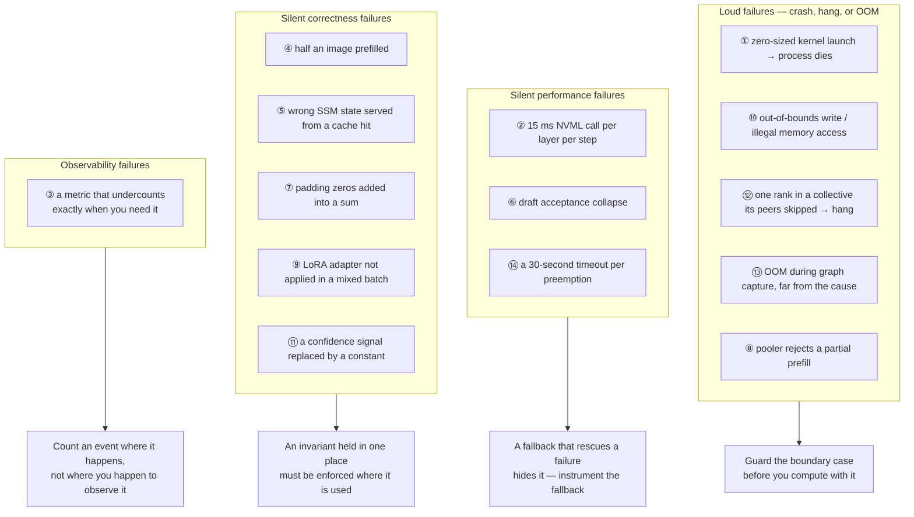

# Issue Deep Dives — Fourteen Real Bugs, Dissected

This folder analyses **fourteen bugs that were actually reported and actually fixed** in
vLLM. For each one you get:

1. the reported **symptom** (what a user saw);
2. the **root cause**, traced through the code;
3. the **actual diff** that fixed it, line by line;
4. **flowcharts** of the broken and fixed control flow;
5. how it was **validated**;
6. the **transferable lesson** — the class of bug, not just the instance.

They are grouped by difficulty. Five are "medium": a single wrong line or a missing guard,
where the difficulty is in *finding* it. Nine are "difficult": the fix is usually small, but
reaching it means holding several subsystems in your head at once, and the failure is
typically silent.

> All commits referenced are present in this checkout. Verify any claim with
> `git show <sha>`.

---

## The set

### Medium

| # | Title | Subsystem | Issue / PR | Fix commit |
| --- | --- | --- | --- | --- |
| 1 | [Engine dies on a zero-sequence penalty kernel launch](01-medium-dual-chunk-attention-empty-batch-crash.md) | CUDA kernel / sampler | [#20484](https://github.com/vllm-project/vllm/issues/20484) → [#20491](https://github.com/vllm-project/vllm/pull/20491) | `f73d02aa` |
| 2 | [NVML re-initialised per attention layer per step](02-medium-nvml-reinit-per-layer-per-step.md) | platform layer / fp8 KV cache | [#50381](https://github.com/vllm-project/vllm/issues/50381) → [#50393](https://github.com/vllm-project/vllm/pull/50393) | `4f76c8ad` |
| 3 | [Preemption metric lost when a request is aborted](03-medium-preemption-metric-lost-on-abort.md) | scheduler / metrics | [#65317](https://github.com/vllm-project/vllm/pull/65317) | `2be71b18` |
| 8 | [Two paths to a partial prefill the model cannot survive](08-medium-mm-pooling-partial-prefill.md) | scheduler × pooling × encoder cache | [#65399](https://github.com/vllm-project/vllm/pull/65399) | `947bd30e` |
| 9 | [A LoRA adapter silently ignored in a mixed batch](09-medium-lora-cudagraph-key-base-requests.md) | LoRA × CUDA graphs | [#67786](https://github.com/vllm-project/vllm/issues/67786) → [#67787](https://github.com/vllm-project/vllm/pull/67787) | `0c4fe706` |

### Difficult

| # | Title | Subsystem | Issue / PR | Fix commit |
| --- | --- | --- | --- | --- |
| 4 | [A multimodal item split by a prefix-cache hit inside it](04-difficult-mm-item-split-on-prefix-hit.md) | scheduler × prefix cache × encoder cache | [#65271](https://github.com/vllm-project/vllm/pull/65271) | `65a90453` |
| 5 | [Mamba publishes a block under the wrong hash](05-difficult-mamba-mid-block-resume-cache.md) | hybrid KV cache / prefix caching | [#67717](https://github.com/vllm-project/vllm/pull/67717) | `75f3967a` |
| 6 | [EAGLE draft acceptance collapses above block size 128](06-difficult-eagle-draft-kernel-block-size.md) | speculative decoding × KV layout | [#64652](https://github.com/vllm-project/vllm/issues/64652) → [#64777](https://github.com/vllm-project/vllm/pull/64777) | `1ea7a90d` |
| 7 | [Padded MoE routed output added to an unpadded shared-expert output](07-difficult-moe-padded-output-shared-expert.md) | MoE × quantization × TP | [#35949](https://github.com/vllm-project/vllm/issues/35949) → [#40794](https://github.com/vllm-project/vllm/pull/40794) | `e8eb0490` |
| 10 | [A NaN's sign bit writes 64 KiB past the output](10-difficult-topk-nan-sign-key.md) | CUDA kernel / numerics / memory safety | [#66839](https://github.com/vllm-project/vllm/pull/66839) | `748f1ab3` |
| 11 | [Catastrophic cancellation destroys 11.5% of a signal](11-difficult-acceptance-estimator-cancellation.md) | spec decode × floating point | [#65229](https://github.com/vllm-project/vllm/pull/65229) | `61968a50` |
| 12 | [One rank enters a collective its peers skipped](12-difficult-dp-duplicate-resume-hang.md) | data parallelism / collectives | [#55229](https://github.com/vllm-project/vllm/pull/55229) | `5be8acb7` |
| 13 | [The KV cache eats the memory graph capture needs](13-difficult-extensible-kv-cache-capture-oom.md) | startup memory ordering × CUDA graphs | [#65868](https://github.com/vllm-project/vllm/issues/65868) → [#66523](https://github.com/vllm-project/vllm/pull/66523) | `3319c629` |
| 14 | [An eager "cache hit" that can never be served](14-difficult-p2p-repeated-pd-fetch.md) | KV connectors / disaggregation | [#67497](https://github.com/vllm-project/vllm/pull/67497) | `f2d0d841` |

### Coverage by subsystem

Between them, these fourteen touch most of the engine:

| Subsystem | Deep dives |
| --- | --- |
| Scheduler | 3, 4, 8 |
| KV cache / prefix caching | 4, 5, 13 |
| Speculative decoding | 6, 11 |
| CUDA / Triton kernels | 1, 10, 11 |
| CUDA graphs & compilation | 9, 13 |
| Distributed (DP / collectives) | 12 |
| KV connectors & disaggregation | 14 |
| LoRA | 9 |
| MoE & quantization | 7 |
| Multimodal / encoder cache | 4, 8 |
| Platform layer | 2 |
| Metrics & observability | 3 |

---

## What the set teaches, as a whole

### Recurring patterns

| Pattern | Seen in |
| --- | --- |
| **An assumption that was true when written, falsified by a later feature.** The guard in ④ assumed a chunk never starts inside a multimodal item — true before sub-block prefix caching. ⑭'s eager hit was true until the first fetch spent it. | ④, ⑤, ⑥, ⑭ |
| **Two places derive the same value independently, and drift.** The drafter re-derived kernel block sizes; the dispatch key counted adapters differently from the kernel grid. | ⑥, ⑦, ⑨, ⑬ |
| **State read at the wrong scope.** A per-rank flag used to decide a collective; a counter read from a stream a cancelled request never reaches. | ③, ⑫ |
| **A boundary or special-value case reaching arithmetic.** `num_seqs == 0` reaching an integer division; NaN reaching a bit-level comparator. | ①, ⑩ |
| **A cheap-looking call on a hot path.** A capability probe that costs 15 ms per layer per step. | ② |
| **Floating-point structure, not precision.** Subtracting two near-equal fp32 values to recover the small difference that *is* the answer. | ⑪ |
| **Resource-ordering gaps at startup.** One stage stops reserving because another "will handle it", and nobody does. | ⑬ |
| **Heterogeneous batches.** Uniform batches worked; mixing LoRA with base, or prefill with decode, is where the bugs live. | ⑨, ④, ⑧ |

### The debugging moves that keep recurring

1. **Bisect by feature flag**, not by commit, first: `--enforce-eager`,
   `--no-enable-prefix-caching`, `--block-size 128`, spec decode off. Which flag makes it go
   away names the subsystem. In ⑨ the reporter's `enforce_eager=True` line *was* the
   diagnosis.
2. **Build a minimal offline repro** with `LLM(...)` rather than a server. ⑤'s PR contains an
   exemplary one: a specific model, exact flags, and a prompt constructed to land a cache hit
   mid-block with the answer inside the corrupted range.
3. **Compare against the same computation with the feature disabled.** "Cached output ≠
   uncached output" (④, ⑤), "graphs captured after a shrink match the unshrunk run" (⑬),
   "batched embeddings match individual ones at cosine ≥0.999" (⑧). Differential assertions
   survive refactors; assertions about internals do not.
4. **Read the per-position / per-stage breakdown**, not the aggregate.
   `spec_decode_num_accepted_tokens_per_pos` localised ⑥ to "the drafter's second step"
   immediately; `failed promotions` localised ⑭.
5. **A hang is a divergence.** Per-rank logs tell you which branch differed (⑫:
   *"only rank 1 logged setting pause state to UNPAUSED"*). `py-spy dump` on every worker
   shows one rank inside NCCL and another elsewhere.
6. **Quantify the blast radius on real data.** ⑪'s *"11.5% of draft positions at
   temperature 0.5 on source code"* is what turned a theoretical concern into a merged fix.
7. **Write the test that fails on `main` first**, and quote the before/after. Every one of
   these PRs did. For races, run it many times — ⑫'s stress run *"hung within 25 rounds on
   the baseline and completed 200 rounds with the fix."*

---

## Also worth reading in this tree

Fixes not analysed here, but with the same flavour, if you want more practice:

| Commit | Title |
| --- | --- |
| `4c38b653` | `[Bugfix][Core] Keep offline DP ranks' collectives aligned with async scheduling (#64457)` |
| `d5bd3d1f` | `[Bugfix][Spec Decode] Fix non-deferred structured-output draft retrieval (#66081)` |
| `8278030e` | `[Bugfix][Core] Keep KV cache zeroing for mixed-precision UniformTypeKVCacheSpecs groups (#64472)` |
| `a92efadb` | `[Bugfix][KV Offload] Return lazily offloaded GPU blocks to the eviction end (#59383)` |
| `8cf12773` | `[Bugfix] Pad extensible KV cache segments instead of rounding the block count (#65225)` |
| `d3a32309` | `[Bugfix] Fix DFlash draft acceptance of 0 with FULL CUDA graphs (#64059)` |
| `48e1b883` | `[Bugfix][LoRA] Reject reusing the same lora_int_id for a different adapter (#67970)` |
| `067624f4` | `[Bugfix][NIXL] Decline remote prefill reads after the producer's KV lease expired (#66011)` |
| `e00e02e0` | `[Bugfix][Metrics] Restart the logging interval clock on empty intervals (#55474)` |
| `8bdc6853` | `[Core][Bugfix] Honor prefill_schedule_interval for prefix replay (#67879)` |
