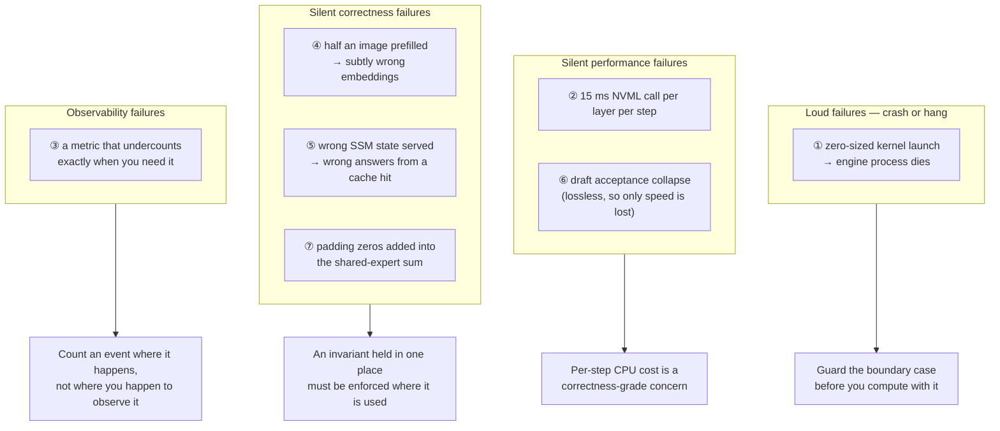

# Issue Deep Dives — Seven Real Bugs, Dissected

This folder analyses **seven bugs that were actually reported and actually fixed** in vLLM.
For each one you get:

1. the reported **symptom** (what a user saw);
2. the **root cause**, traced through the code;
3. the **actual diff** that fixed it, line by line;
4. **flowcharts** of the broken and fixed control flow;
5. how it was **validated**;
6. the **transferable lesson** — the class of bug, not just the instance.

They are ordered roughly by difficulty. Three are "medium": a single wrong line or a missing
guard, where the difficulty is in *finding* it. Four are "difficult": the fix is small but
requires holding several subsystems in your head simultaneously, and the failure is silent.

> All commits referenced are present in this checkout. Verify any claim with
> `git show <sha>`.

---

## The set

| # | Difficulty | Title | Subsystem | Issue / PR | Fix commit |
| --- | --- | --- | --- | --- | --- |
| 1 | Medium | [Engine dies on a zero-sequence penalty kernel launch](01-medium-dual-chunk-attention-empty-batch-crash.md) | CUDA kernel / sampler | [#20484](https://github.com/vllm-project/vllm/issues/20484) → [#20491](https://github.com/vllm-project/vllm/pull/20491) | `f73d02aa` |
| 2 | Medium | [NVML re-initialised per attention layer per step](02-medium-nvml-reinit-per-layer-per-step.md) | platform layer / fp8 KV cache | [#50381](https://github.com/vllm-project/vllm/issues/50381) → [#50393](https://github.com/vllm-project/vllm/pull/50393) | `4f76c8ad` |
| 3 | Medium | [Preemption metric lost when a request is aborted](03-medium-preemption-metric-lost-on-abort.md) | scheduler / metrics | [#65317](https://github.com/vllm-project/vllm/pull/65317) | `2be71b18` |
| 4 | Difficult | [A multimodal item split by a prefix-cache hit inside it](04-difficult-mm-item-split-on-prefix-hit.md) | scheduler × prefix cache × encoder cache | [#65271](https://github.com/vllm-project/vllm/pull/65271) | `65a90453` |
| 5 | Difficult | [Mamba publishes a block under the wrong hash](05-difficult-mamba-mid-block-resume-cache.md) | hybrid KV cache / prefix caching | [#67717](https://github.com/vllm-project/vllm/pull/67717) | `75f3967a` |
| 6 | Difficult | [EAGLE draft acceptance collapses above block size 128](06-difficult-eagle-draft-kernel-block-size.md) | speculative decoding × KV layout | [#64652](https://github.com/vllm-project/vllm/issues/64652) → [#64777](https://github.com/vllm-project/vllm/pull/64777) | `1ea7a90d` |
| 7 | Difficult | [Padded MoE routed output added to an unpadded shared-expert output](07-difficult-moe-padded-output-shared-expert.md) | MoE × quantization × TP | [#35949](https://github.com/vllm-project/vllm/issues/35949) → [#40794](https://github.com/vllm-project/vllm/pull/40794) | `e8eb0490` |

---

## What the set teaches, as a whole

### Recurring patterns

| Pattern | Seen in |
| --- | --- |
| **An assumption that was true when written, falsified by a later feature.** The guard in ④ assumed a chunk never starts inside a multimodal item — true before sub-block prefix caching. | ④, ⑤, ⑥ |
| **Two places derive the same value independently, and drift.** The drafter re-derived kernel block sizes; the MoE output kept the padded shape past where padding was meaningful. | ⑥, ⑦ |
| **A boundary case reaching arithmetic.** `num_seqs == 0` reaching an integer division. | ① |
| **A cheap-looking call on a hot path.** A capability probe that costs 15 ms. | ② |
| **State observed at the wrong place in the pipeline.** A counter read from a stream that a cancelled request never reaches. | ③ |

### The debugging moves that keep recurring

1. **Bisect by feature flag**, not by commit, first: `--enforce-eager`,
   `--no-enable-prefix-caching`, `--block-size 128`, spec decode off. Which flag makes it go
   away names the subsystem.
2. **Build a minimal offline repro** with `LLM(...)` rather than a server. Issue ⑤'s PR
   contains an exemplary one: a specific model, exact flags, a prompt constructed to land a
   cache hit mid-block.
3. **Compare against the same computation with the feature disabled.** "Cached output ≠
   uncached output" is a sharper statement than "output looks wrong", and it is a test.
4. **Read the per-position / per-stage breakdown**, not the aggregate.
   `spec_decode_num_accepted_tokens_per_pos` localised ⑥ to "the drafter's second step"
   immediately.
5. **Write the test that fails on `main` first.** Every one of these PRs did, and each
   quotes the before/after result.

---

## Also worth reading in this tree

Fixes not analysed here, but with the same flavour, if you want more practice:

| Commit | Title |
| --- | --- |
| `5be8acb7` | `[Bugfix][DP] Prevent mismatched collectives on duplicate resume (#55229)` |
| `3319c629` | `[Bugfix] Extensible KV cache: release warmup's blocks before CUDA graph capture (#66523)` |
| `0c4fe706` | `[Bugfix][LoRA] Count base requests in the specialized CUDA graph LoRA key (#67787)` |
| `61968a50` | `[Bugfix][Spec Decode] Avoid catastrophic cancellation in the acceptance estimator (#65229)` |
| `748f1ab3` | `[Bugfix][Kernel] Key sign-set NaN scores above +inf in the top-k kernels (#66839)` |
| `f2d0d841` | `[Bugfix][KV Offload][P2P] Prevent repeated PD KV fetches after decoder preemption (#67497)` |
| `947bd30e` | `[Bugfix][Scheduler] Respect disabled chunked prefill for multimodal requests (#65399)` |
